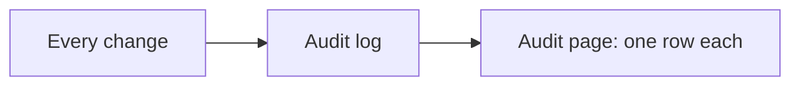
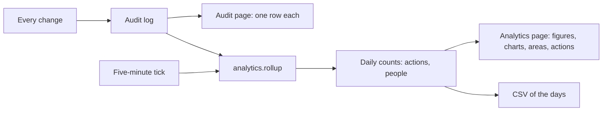

# The Analytics module

> **In plain words.** The portal now has an Analytics page. It shows, for the last 7, 30 or 90
> days, how many things were done, by how many people, how many the portal did on its own, and how
> many were refused or failed, each compared with the period before ("+12% on the 30 days
> before"). Two bar charts show every day; the busiest parts of the portal and the most frequent
> actions are listed; the days can be downloaded as a spreadsheet file. Every number comes from
> the audit log, which already records every change, so nothing is estimated and nothing extra is
> stored about what was changed. The owner asked for "an analytics system" on 2026-10-27.

## What changed, and why

| What | Why |
|---|---|
| `@oltrem/analytics`: a page of figures, two bar charts, the busiest areas and actions, a CSV | Reports and dashboards are among the first things a buyer of an admin portal looks for (the roadmap's research) |
| Counted from the audit log | Every module already audits its changes, so each one is counted with no code of its own, and the numbers are real |
| Counted by a job into two tables of daily counts, in SQL | A chart of ninety days reads a few hundred rows instead of every change, and the Worker spends no CPU time on the counting (the free plan allows 10 ms a request) |
| Read at the company only | The counts are the whole company's; someone trusted at one place sees no more than that place |

## Before and after

Before, the activity could be read only row by row, on the audit page:

After, a job counts the new rows every five minutes, and the page reads the counts:

Explanation: on each tick the job adds the rows written since it last stopped to the daily counts,
in the database itself, and moves its place in the same transaction, so a row is counted once.
Its first run starts from the first row, so the history is there from the start. The page asks
for one period and the one before it and draws what comes back; a day without activity is zero.

## Impact on each part

| Part | Impact |
|---|---|
| `@oltrem/analytics` | new: bit plane `16`, migration `0024`, two jobs, one route, two pages; no error codes of its own |
| The client template | the module mounted after Automations with its page; `0024` synced; the worker and screens tests extended |
| Clients | an Analytics section under Work from their next deploy; two tables added; no new binding, secret or variable |

## How it was verified

`pnpm verify` passes. The module's six tests run inside the Workers runtime through the pipeline
beside the IAM module (the list is in its README); the counting is tried in chunks of two rows to
show that each row is counted once across runs. The client template opens the page before any
count, then after a tick reads its figures, charts and areas, and downloads the CSV. Not yet tried
on a deployed portal or a phone.
