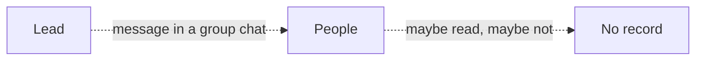
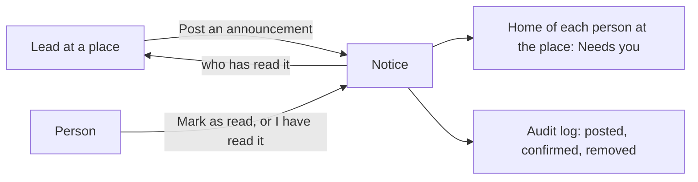

# Announcements module

> **In plain words.** A portal can now tell people things and know they read them. Someone who
> runs a place posts a notice, such as "the north office is closed on Monday" or "new safety
> rule: gloves on in the store room". Everyone who may see that place's notices finds it at the
> top of Home until they read it. When it matters, the notice asks each person to confirm "I have
> read it", and the person who posted sees who has and when. The owner asked on 2026-10-27 for
> features that sell; a notice board with read confirmations is something every team with more
> than one place needs, whatever the business, and the confirmations are the record a policy
> change needs.

## What changed, and why

| What | Why |
|---|---|
| `@oltrem/announcements`: a notice at a place, with its text and the last day it is shown | Notices were sent in group chats, where they scroll away and nobody knows who saw them |
| `announcements.read` and `announcements.post`, read at the notice's place | The same place-based rules as tasks and files: a lead at one branch posts to that branch |
| "I have read it" for a notice that must be confirmed, audited as `announcements.confirm` | A rule or policy needs proof that each person read it |
| Who has read it, shown to whoever may post at the place | The person who posted follows up with those who have not |
| Needs you: "N announcements to read", with how many to confirm | Home answers "what do I need to know" |
| Shown until a day, then under Past | A notice about Monday disappears from Home after Monday by itself |

## Before and after

Before, a notice went to a chat, and nobody could tell who had read it:

After, the notice is in the portal until each person reads it:

Explanation: a notice is a row of `announcements_posts` at a place, and each read is a row of
`announcements_reads`. Posting, reading and removing go through the module's API as the
signed-in person, are checked against their roles at that place, and are audited. Home asks the
module what the person has not read, as it asks every module for Needs you.

## Impact on each part

| Part | Impact |
|---|---|
| `@oltrem/announcements` (new) | bit plane `20`, migration `0028_announcements.sql`, no error block of its own, five routes plus Needs you and the search, two pages |
| The client template | mounts the module under Work, after Approvals; two more tables, no binding, secret or variable |
| `@oltrem/cli` | `announcements` is a kit module's name, so `new module` refuses it |
| Clients | the Announcements page from their next deploy; the Owner holds both capabilities, other roles get them from the Access page |

## How it was verified

`pnpm verify` passes. The announcements tests run inside the Workers runtime through the pipeline:
who may post where, the checks on the title, the text and the last day, each person's list and
unread count, Needs you with what must be confirmed, reading and confirming once, who has read it
shown only to whoever posts, a notice moving to Past after its day, removal with its readers and
the title kept in the log, and the search. The client template's screens journey posts a notice
that must be confirmed as the Owner, sees it confirmed by them and removes it. Not checked: a phone,
a deployed portal, and a second person reading through the pages (covered by the module tests).
Those are listed in the [verification log](../verification-log.md).
