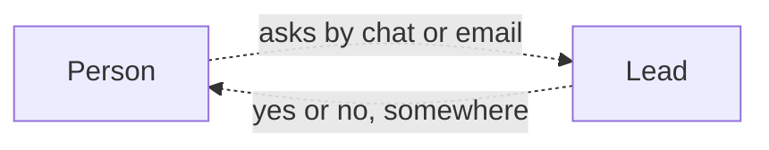
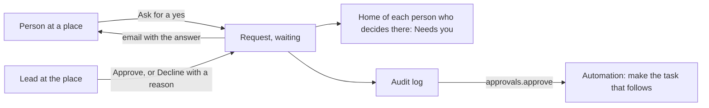

# Approvals module

> **In plain words.** A portal can now say yes or no on the record. Someone asks for a yes, such
> as "a new laptop for the front desk" or "two days off next week", at their place (a branch, a
> department). The people who decide there see it at the top of Home, open it, and approve it or
> decline it with a reason. Nobody can approve their own request, and an answer is never changed.
> The person who asked gets the answer by email, and everything is in the audit log, so an
> automation can take the next step: when a purchase is approved, a task to order it goes to the
> right person. The owner asked on 2026-10-27 for features that sell; approval workflows are one
> of the reasons teams buy client and internal portals, whatever the business.

## What changed, and why

| What | Why |
|---|---|
| `@oltrem/approvals`: a request at a place, with details and the day it is needed by | Approvals happened in chats and emails, with no record of who said yes |
| `approvals.ask` and `approvals.decide`, read at the request's place | The same place-based rules as tasks and files: a lead at one branch answers that branch's requests and nobody else's |
| Nobody answers their own request (`KIT-E-3001`) | Four eyes: the reason an approval is asked at all |
| An answer is final, and two people answering at once give one answer (`KIT-E-3002`) | The record says one thing, and the person who asked is told once |
| A no always says why | A bare no is the most common complaint about approval tools |
| The person who asked sees their own requests whatever they hold (`approvals.self`) | Losing a role does not hide what one asked |
| Needs you: "N requests wait for your answer", with how many are needed by today | Home answers "what do I do now" for the people who decide |
| An email with the answer | People learn of it where they already look |
| The requests in the portal's search | A request is found by its title like everything else |

## Before and after

Before, a yes was given in a chat or an email, and nothing showed who gave it:

After, the request and its answer are in the portal and in the audit log:

Explanation: a request is a row of `approvals_requests` at a place. Asking and answering go through
the module's API as the signed-in person, are checked against their roles at that place, and are
audited. The answer only changes a request that still waits, so it is given once. Home asks the
module what waits for the person, as it asks every module for Needs you.

## Impact on each part

| Part | Impact |
|---|---|
| `@oltrem/approvals` (new) | bit plane `19`, migration `0027_approvals.sql`, the `3000` error block, five routes plus Needs you and the search, two pages |
| The client template | mounts the module under Work, after Tasks; an `approvals.message` email template; one more table, no binding, secret or variable |
| `@oltrem/cli` | `approvals` is a kit module's name, so `new module` refuses it |
| Clients | the Approvals page from their next deploy; the Owner holds both capabilities, other roles get them from the Access page |

## How it was verified

`pnpm verify` passes. The approvals tests run inside the Workers runtime through the pipeline: who
may ask where, the checks on the title and the day, what waits for whom and in which order, Needs
you, who may open a request, the answer given once and never to one's own request, a no only with
its reason, the emails with the answer and the note, the withdrawal, every refusal in the audit
log, and the search. The client template's screens journey asks as the Owner, finds no Approve on
the Owner's own request and withdraws it. Not checked: a phone, a deployed portal, an answer
given through the pages by a second person (covered by the module tests), and the email opened in
a real mail app. Those are listed in the [verification log](../verification-log.md).
