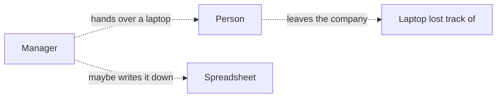
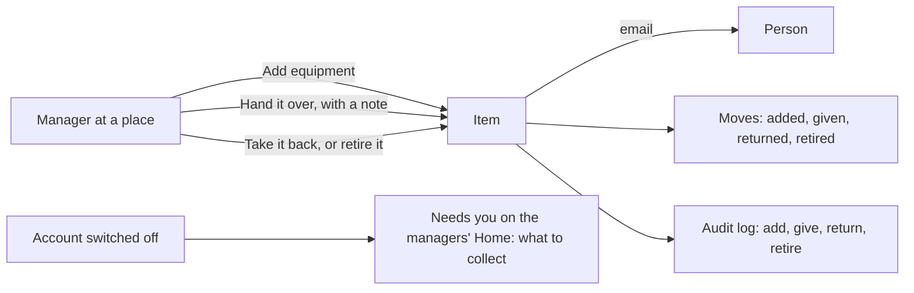

# Equipment module

> **In plain words.** A portal now knows who has the company's things. Laptops, phones, keys,
> tools and badges are listed at the place they belong, each with its tag. Whoever manages the
> equipment there hands an item to a person, who is told by email, takes it back, or retires it
> when it is sold or broken; every hand-over is kept with the item. When someone leaves and their
> account is switched off, Home tells the managers what that person still holds, so nothing walks
> out of the door. The owner asked on 2026-10-27 for features that sell; every company that lends
> its people a laptop or a key needs this, whatever the business.

## What changed, and why

| What | Why |
|---|---|
| `@oltrem/assets`: items at a place, each held by one person or available | A spreadsheet of "who has which laptop" goes stale the day it is written |
| `assets.view` and `assets.manage`, read at the item's place | The same place-based rules as the other Work modules: a lead at one branch manages that branch's equipment |
| The holder always sees what they hold | A person with no role at the place still knows what they signed for |
| A tag names one item in the company, refused in the statement that writes it | Two items with one serial number make the record useless |
| Handed only to a person of the company whose account is on; handed straight on records both moves | An item never goes to an address nobody can sign in as, and the history has no gap |
| Every change names the holder it changes from | Two managers moving the same item at once move it once |
| Retired only when nobody holds it, with a reason | Nothing in someone's hands disappears from the list |
| A table of moves beside the items | The item's page shows its history at once; the audit log is written after the answer and is not read by item |
| Needs you: what people whose account is off still hold | The step most often missed when someone leaves |
| The module's `personal` answer | A privacy request finds every hand-over to and from the person |

## Before and after

Before, who held what lived in someone's memory or a spreadsheet:

After, the portal holds the item, its holder and every move:

Explanation: each item is a row of `assets_items` at a place, with its holder and since when; each
move is a row of `assets_moves`. A hand-over is one statement that names the holder the page showed
and an item still in service, so a second hand-over at the same moment, or one after it was
retired, changes nothing and is told so. The person it is handed to must be a person of the same
company whose account is on. Every change goes through the module's API as the signed-in person, is
checked against their roles at the item's place, and is audited. Needs you reads the items held by
accounts that are off at the places the reader manages.

## Impact on each part

| Part | Impact |
|---|---|
| `@oltrem/assets` (new) | bit plane `24`, migration `0034_assets.sql` (two tables), error block `3400`, six routes plus search and Needs you, two pages, no setting, the privacy answer |
| The client template | mounts the module under Work, after Expenses, with the plain email template `assets.message`; two more tables, no binding, secret or variable |
| `@oltrem/cli` | `assets` is a kit module's name, so `new module` refuses it |
| Clients | the Equipment page from their next deploy; the Owner holds both capabilities, other roles get them from the Access page |

## How it was verified

`pnpm verify` passes. The equipment tests run inside the Workers runtime through the pipeline: items
added only where the person manages, a tag naming one item, a blank name and an unknown place
refused, every refusal audited; what each person sees, the holder always and someone with no role
nothing else; handed only to a person of the company, who is emailed with the note and the link,
never to an unknown address or to an account that is off; handed straight on with both moves kept,
taken back, retired only when nobody holds it and never moved after; the search by name or tag;
Needs you only where the reader manages; the privacy answer. The client template's screens journey
adds an item as the Owner through the page's form, is refused an unknown address, hands it to
themselves, finds it under Yours, is refused retiring it while held, takes it back and retires it.
Not checked: a phone, a deployed portal, and the email opened in a real mail app. Those are listed
in the [verification log](../verification-log.md).
