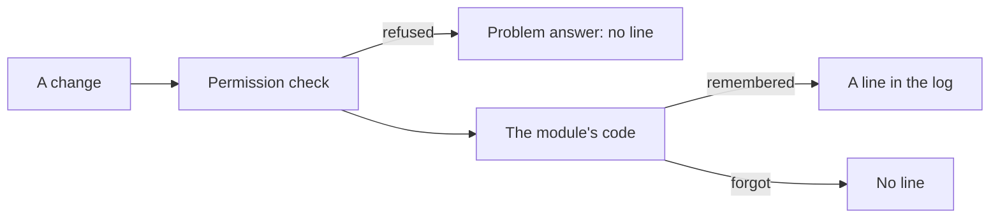
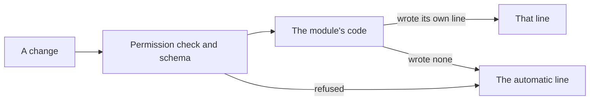

# The automatic audit

> **In plain words.** Until now each feature had to remember to write its own line in the audit
> log, and a change a feature forgot, or a change the permission check turned away before the
> feature ran, left no line at all. Now the portal itself writes a line for every change made
> through it: who, what, to what, whether it worked or was refused and why, how long it took, and
> where it came from. A feature that writes its own, more detailed line keeps it, and the portal
> does not add a second. The Audit log page can now show one section or one person at a time.
> The owner asked for this on 2026-10-27 ("auto audit logging, improve audit log architecture").

## What changed, and why

| What | Why |
|---|---|
| `@oltrem/core-http`: an `onChange` option, told of every POST, PUT, PATCH and DELETE that reached a route, after it answered or threw | One place sees every change, so no module can forget one |
| `@oltrem/core-module`: the `RouteChange` shape, an optional `action` on a route, and `routeAction` | The row's verb is the route's own name when it gives one, and a readable one made from the method and path when not |
| `@oltrem/core-audit`: `createChangeAudit`, the writer marks each request a row was asked for | A module's richer row is never doubled by the automatic one |
| The row's details: method, route, status, time taken, error code, the caller's address and country | The fields the audit-log products settle on (an actor, an action, targets, a context of where from) |
| `list` and `GET /entries` take `module` and `actor` | The page narrows to one section or one person |
| The client template passes the writer as `onChange` | Every client portal audits every change from its next deploy |
| The Audit log page: a row of sections, a tap on an address shows one person, each change shows how it arrived | Finding one thing in a busy log on a phone |

A status from 500 up is recorded as `failed`, from 400 to 499 as `refused`. The door's and the
same-origin check's refusals are not recorded: they stop the request before a route is known, and
the door has no account to name.

## Before and after

Before, a line was written only where a module's code asked for one:

After, the pipeline writes a line for every change the module did not record itself:

## Impact on each part

| Part | Impact |
|---|---|
| `@oltrem/core-module` | `RouteChange`, `routeAction`, the `action` field and its check |
| `@oltrem/core-http` | `onChange`, the `ChangeHook` type |
| `@oltrem/core-audit` | `createChangeAudit`, `changeEntry`, `takeRecorded`, the `module` filter |
| `@oltrem/screens` | the Audit log page's section row, the person filter, the how and the from columns |
| The client template | `onChange` wired; a journey test |
| Clients | one more row per change a module did not record; no migration |

## How it was verified

`pnpm verify` passes. The pipeline's tests: a change told with its action, route, status and
caller; a deletion's target; a read never told; the refusals of the capability check (403), the
schema (422) and the handler (409) told with their codes; a thrown error told as failed with the
answer still the generic problem; a hook that throws reported without changing the answer; a
named action and a bad one refused by the contract. The audit tests, inside the Workers runtime:
a row with every detail, a refusal without a session as a person, a module's own row not
doubled, the module and actor filters. The client template's journey: a backup by hand refused
for the Vendor (503, `failed`) and for a stranger with no account (403, `KIT-E-2005`), both rows
written with their route and code.
