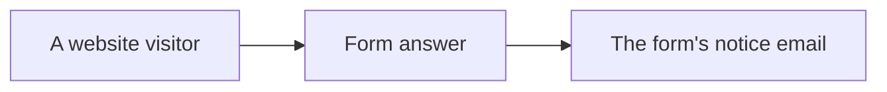
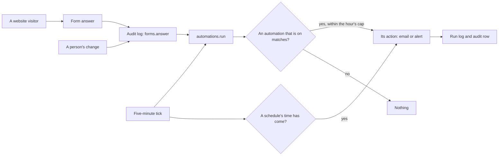

# The Automations module

> **In plain words.** The portal can now do things on its own. Someone sets up a rule in two
> parts: **when** (a website form is answered, a file is shared, anything the portal records; or
> every hour, every day at a time, or every Monday at a time) and **then** (send an email, or raise
> an alert). The rule starts switched off; once its email or alert is filled in, it can be switched
> on. From then on it acts by itself, and every time it acts is written in its log, with whether
> it worked. It never reacts to its own actions, and it acts at most sixty times an hour, so a rule
> cannot run away. Website form answers are now written in the audit log too, so a rule (and a
> webhook) can react to them. The owner asked for "an auto check, auto run system" on 2026-10-27.

## What changed, and why

| What | Why |
|---|---|
| `@oltrem/automations`: an event or schedule trigger, one action, made off and switched on when ready, Run now, a log of runs | Work that happens by itself is what buyers name with an API as the fifth thing they pay for (the roadmap's research) |
| Triggers read from the audit log | Every change is already a row of it, so any module's action can set one off with no code of its own |
| Two actions the client hands in, email and alert, and `defineAction` for its own | The module depends on neither the email nor the alerts module; a client's own action is one object |
| Its own runs never set anything off, sixty runs an hour at most, twenty runs a tick | No loop, no burst against the email provider or the free plan's limits |
| `@oltrem/forms`: the system's `forms.answer` audit row for each website answer, naming the form, never what was written | The answer that most automations and webhooks want was not in the log |

## Before and after

Before, a website answer sent its own notice and nothing else could follow it:

After, the answer is audited, and an automation can act on it or on a schedule:

Explanation: every change and every website answer becomes an audit row. On each tick the job
reads the new rows, runs each automation whose events and condition match, then runs the
schedules that are due. Each run is logged on the automation and in the audit log; the job skips
its own rows, so a run cannot set off another.

## Impact on each part

| Part | Impact |
|---|---|
| `@oltrem/automations` | new: bit plane `15`, migration `0023`, errors `2701` to `2703`, two jobs, one check, seven routes, two pages |
| `@oltrem/forms` | each website answer writes the system's `forms.answer` row; it depends on `@oltrem/core-audit` |
| The client template | the module mounted after Files with its pages and the two actions; `0023` synced; the worker and screens tests extended |
| Clients | an Automations section from their next deploy; two tables added; no new binding, secret or variable |

## How it was verified

`pnpm verify` passes. The module's eleven tests run inside the Workers runtime through the
pipeline beside the IAM module, with the email and alerts modules stood in for (the list is in
its README). The forms tests check the new audit row holds the form's name and none of the answer.
The client template opens the Automations page and runs a journey through the pages: an
automation made for `forms.answer`, its email filled in, switched on, and run by hand on the
website answer of the forms journey, its message found in the outbox. Not yet tried on a deployed
portal or a phone.
