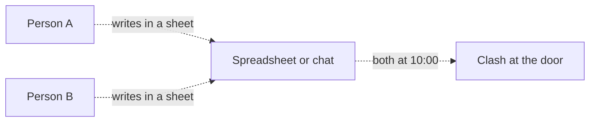
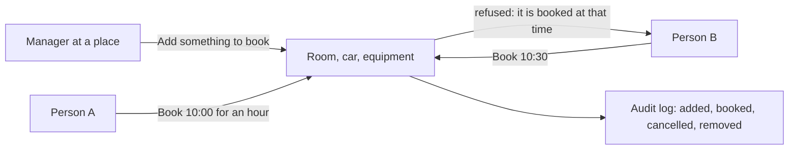

# Bookings module

> **In plain words.** A portal can now book shared things: a meeting room, a company car, a
> projector, a desk. Someone who runs a place adds what can be booked there. Anyone who may book
> at that place picks a day, a start time and how long, and the portal refuses a time that
> overlaps another booking, even when two people press Book at the same moment. Times are shown
> on the company's clock, which the owner sets once. The owner asked on 2026-10-27 for features
> that sell; shared rooms and vehicles exist in almost every company with more than a handful of
> people, whatever the business.

## What changed, and why

| What | Why |
|---|---|
| `@oltrem/bookings`: things that can be booked at a place, and their bookings | Rooms and cars were booked in a spreadsheet or a chat, and two people turned up for the same one |
| `bookings.book` and `bookings.manage`, read at the thing's place | The same place-based rules as tasks and files: a lead at one branch manages that branch's rooms |
| A booking is refused when it overlaps another, in one database statement | Two people booking the same hour at the same moment cannot both win |
| The company's time zone as the setting `bookings.time_zone` | People think in the company's clock, not in UTC; a booking keeps its moment if the setting changes |
| Lengths from 15 minutes to a day, up to 365 days ahead, never in the past | Keeps the list short and the rules plain |
| Removing a thing only once nothing is booked from now on | Nobody loses a booking they made; past bookings stay as the record |
| Cancel your own booking, or anyone's at a place you manage | The person who booked can free the time; the person who runs the place can sort out a clash |

## Before and after

Before, a shared room was booked outside the portal, and a clash was found at the door:

After, the portal holds the bookings and refuses the second one:

Explanation: what can be booked is a row of `bookings_resources` at a place, and each booking is
a row of `bookings_items` with its start and end as moments. A booking is inserted only if no
booking of the same thing overlaps it, in the same statement, so the database itself refuses the
second of two bookings made at once. Days and times are turned into moments on the company's
clock, including the days the clock moves for daylight saving. Every change goes through the
module's API as the signed-in person, is checked against their roles at that place, and is
audited.

## Impact on each part

| Part | Impact |
|---|---|
| `@oltrem/bookings` (new) | bit plane `21`, migration `0029_bookings.sql`, error block `3100`, six routes plus the search, two pages, one setting |
| The client template | mounts the module under Work, after Announcements; two more tables, no binding, secret or variable |
| `@oltrem/cli` | `bookings` is a kit module's name, so `new module` refuses it |
| Clients | the Bookings page from their next deploy, on the UTC clock until the owner sets the company's time zone; the Owner holds both capabilities, other roles get them from the Access page |

## How it was verified

`pnpm verify` passes. The bookings tests run inside the Workers runtime through the pipeline, on
the America/Mexico_City clock: who may add and book where, the checks on the day, time, length
and title, an overlap refused and a booking that touches another's end accepted, each person's
list and day view, cancelling one's own and a manager cancelling another's, removal refused while
something is booked from now on, refusals audited, and the search. The clock tests cover a day
the clock moves forward and one it moves back. The client template's screens journey adds a
room, books it tomorrow at 10:00, is refused at 10:30, is refused removal, cancels and removes it.
Not checked: a phone, a deployed portal, and a time zone other than UTC through the pages
(covered by the module tests). Those are listed in the [verification log](../verification-log.md).
