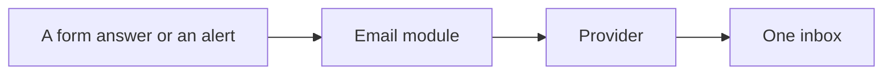
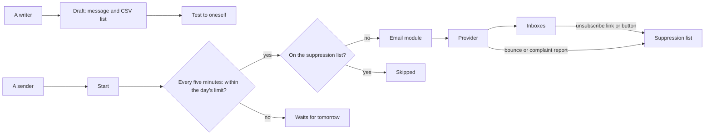

# The Campaigns module

> **In plain words.** The portal can now send an email to a whole list of people. Someone writes
> the message in the portal, uploads the list as a spreadsheet saved as CSV, sends a test to
> themselves, and presses send. The portal then sends a few messages every five minutes and
> never more in a day than the email provider's plan allows, so nothing is refused or marked as
> spam for arriving in a burst. Each message can greet the person by name or any other column of
> the sheet. Every message has a link to stop receiving them, which also works as the one-click
> button Gmail and Yahoo show; whoever uses it, reports a message as spam or has an address that
> bounces is never sent a campaign again. Who may write and who may send is decided by the roles
> people already hold. The owner asked for "an email system with more features like auto bulk
> send in chunks from files" on 2026-10-27.

## What changed, and why

| What | Why |
|---|---|
| `@oltrem/campaigns`: drafts at a place, a CSV list with merge fields, a test to oneself, start now or later, pause, resume, cancel | Bulk email that a team runs itself, written where the rest of the work is |
| A job every five minutes that hands out a chunk within the day's limit | Brevo's free plan sends 300 a day; a steady pace keeps the provider and the inboxes trusting the sender |
| Each message through the email module under its own key | Nobody is sent twice; the email module's failover and delivery reports apply |
| `List-Unsubscribe` and `List-Unsubscribe-Post` headers, and a link signed with the campaign's secret | Gmail and Yahoo ask bulk senders for one-click unsubscribe (RFC 8058); a link cannot be made up |
| A page that asks before it unsubscribes, and a POST that does it at once | Mail scanners open links; a mail app's one-click button posts |
| The suppression list, fed by unsubscribes, bounces and complaints | Anti-spam law and the providers' rules: whoever left is never mailed again |
| A check of the week's bounce and complaint rates | Gmail blocks senders above 0.3% complaints |
| `@oltrem/email`: a template may add headers | The one-click headers, without the campaigns module reaching into the email module |

## Before and after

Before, a message went to one person at a time, for the portal's own reasons:

After, a campaign goes to a list, a chunk at a time, and the list keeps itself clean:

Explanation: a writer prepares the draft; only someone allowed to send starts it. The job then
works through the list in the order of the file, skipping anyone on the suppression list, and
stops for the day at the limit. Whatever comes back (an unsubscribe, a bounce, a complaint) adds
the address to the list, so the next run and every later campaign leave it out.

## Impact on each part

| Part | Impact |
|---|---|
| `@oltrem/campaigns` | new: bit plane `13`, migration `0020`, errors `2501` to `2505`, four settings, two jobs, one check, the unsubscribe hook, two pages |
| `@oltrem/email` | `TemplateInput.headers`: a template may add headers to its message |
| The client template | the module mounted after email with its pages; `CAMPAIGN_TEMPLATE` among the email templates; `0020_campaigns.sql` synced; the worker and screens tests extended |
| Clients | a Campaigns section from their next deploy; the migration adds three tables; no new binding, secret or variable. A campaign needs the footer setting and a ready email provider. |

## How it was verified

`pnpm verify` passes. The module's fifteen tests run inside the Workers runtime through the
pipeline, beside the IAM module, with the email module stood in for and its table real (the list
is in its README). The email module's template test covers the new headers. The client template
runs the pages end to end: a campaign made, its list uploaded with a bad row reported, the footer
set on the Settings page, a test, the start, two messages handed out by the cron tick, the
unsubscribe page and its one-click POST, and the address on the Never mailed list. Not yet tried
with a real provider, a real mail app's unsubscribe button or a phone.
