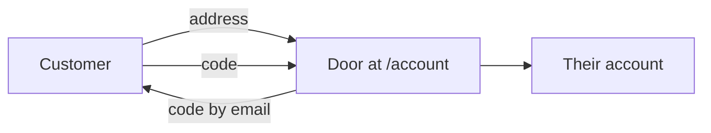
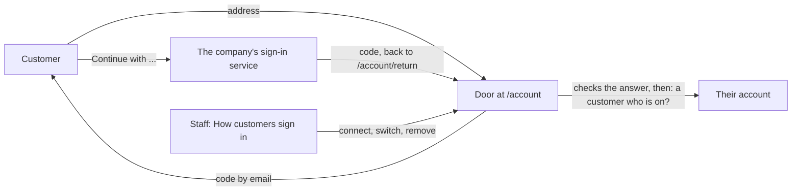

# Customer sign-in services

> **In plain words.** Earlier today customers got their own door at `/account`, where they sign
> in with a code emailed to them. The owner then asked that each client can choose how its
> customers sign in. Now a company can also offer "Continue with" a sign-in service it already
> uses, such as its own app's Auth0 or Supabase accounts, Google, Okta or Keycloak. Staff connect
> one on the new "How customers sign in" page by pasting three things the service gives them. The
> emailed code always stays, and the service only proves who the person is: they must still be a
> customer the company added.

## What changed, and why

| What | Why |
|---|---|
| "Continue with" any OpenID Connect service, beside the code | One standard covers Auth0, Supabase, Google, Okta, Keycloak and most others, so the kit needs no code per vendor |
| Connected by issuer address, client id and client secret on `/customers/sign-in`, under a new capability `customers.services` (admin, fresh sign-in) | Choosing how customers sign in is a security decision, kept to the people trusted with it |
| The service's published details read and checked before it is kept | A typo or a look-alike service is refused at once, not when a customer tries |
| The secret sealed under the KEK the providers already use | No new secret or binding (R-05, R-09), and a copy of the database shows no secret |
| State, nonce and PKCE on every trip, the ID token checked, a verified address required, the address a customer who is on | Nobody finishes another person's sign-in, and a service never adds customers by itself |
| Clerk not offered | Clerk does not act as a sign-in service for other applications in this way; a company on Clerk keeps the code |
| Microsoft Entra ID refused | Its ID tokens do not say whether the address was verified |

## Before and after

Before, a customer had one way in:

After, the company may add services beside it:

Explanation: the door sends the customer to the service with a random state, nonce and PKCE
challenge, kept in a short cookie. When the service sends them back with a code, the Worker
exchanges it at the service's token endpoint, server to server, and checks the ID token the
answer carries: the issuer, this portal as its audience, the nonce, its times, and a verified
address. The address must be one of the company's customers who is on; then the customer gets the
same sign-in as with a code, marked with the service's name.

## Impact on each part

| Part | Impact |
|---|---|
| `@oltrem/customers` | version `0.2.0`, because a portal registers a module's capabilities once per version and the new one must join every Owner role; migration `0037_customers_services.sql` (one table), capability `customers.services` on plane `26`, errors `3603` and `3604`, five routes, the `/customers/sign-in` page, "Continue with" on the door, two door paths (`/account/with/<id>`, `/account/return`) |
| The client template | passes the KEK to the customers module; one more table; no new binding, secret, variable or setting |
| Clients | nothing changes until someone connects a service; the `account` Bypass path already covers the new door paths |

## How it was verified

`pnpm verify` passes. The customers tests run a stand-in OpenID Connect service inside the Workers
runtime: connecting refused without the KEK, without the capability, with an `http://` issuer and
with a service naming another issuer; the secret kept only sealed and never listed; a trip with
PKCE whose return signs the customer in, marked with the service; the return refused for another
state, after ten minutes, when cancelled, with another nonce, with an unverified address and with
an address that is no customer; a service switched off gone from the door; a removed service and
its secret gone; each step audited. The client template's screens test opens the new page. Supabase's
OAuth 2.1 server guide was read for its discovery address, its client authentication and its
`email_verified` claim. Not checked: a real Auth0, Supabase, Google, Okta or Keycloak application,
or a phone. Those are listed in the [verification log](../verification-log.md).
