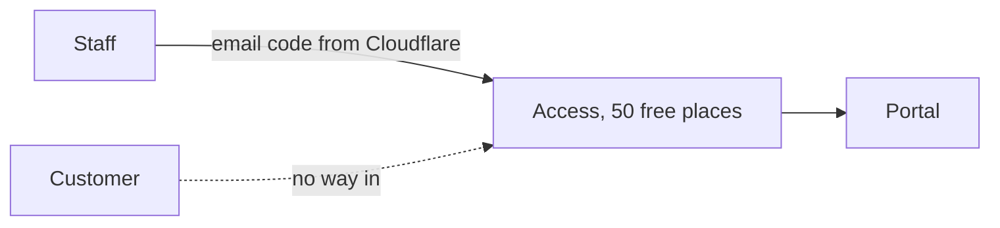
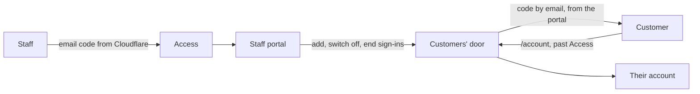

# Customer sign-in

> **In plain words.** Until now only a company's staff could sign in to its portal, through
> Cloudflare's sign-in door. That door is free for 50 people, so it cannot also hold a company's
> customers. Now a company's customers sign in at the portal's `/account` page in a different way:
> they type their email address, get a six-digit code by email, and type it. There is no password.
> Staff decide who is a customer: they add each one on the new Customers page, can email them the
> link, see when they last signed in, switch them off, and sign them out of a lost phone. On
> 2026-10-27 the owner chose this, the free email code, over paying Cloudflare for every customer,
> and asked that a client can later choose another sign-in service instead.

## What changed, and why

| What | Why |
|---|---|
| `@oltrem/customers`: one row a customer, added by staff with an address and a name | The company decides who its customers are; nobody signs themselves up |
| The door at `/account`, mounted before the staff door, which the client lets past Access | Customers do not take Access's 50 free places, and the staff door stays as strong as it was |
| A six-digit code by email, ten minutes, once, five tries; kept only as a hash | No password to forget or leak; a guess is one in a million per try |
| The same answer for any address; five codes an hour an address, thirty requests a network | Nobody learns who is a customer by trying addresses, and nobody floods a mailbox |
| A sign-in is a random token in a `__Host-` cookie, kept only as a hash, for thirty days | Scripts cannot read it, it stays on this host over HTTPS, and a copy of the database opens nothing |
| Customers sign out on their other devices; staff end a customer's sign-ins or switch them off | A lost phone is closed from either side |
| `customers.view` and `customers.manage`, audited | The same permissions and audit as every other page |
| `customerPage` in the screens | The door looks like the portal, without the staff sidebar |
| The deploy's door step lets `/account` through | One more path on the same Bypass application as `/hooks` and `/healthz` |

## Before and after

Before, only staff could sign in:

After, customers have their own door:

Explanation: the client adds `/account` to the self-hosted Access application that already lets
`/hooks` and `/healthz` through, with a Bypass policy. The Worker hands every request under
`/account` to the door before it reads Access's headers, so the door never trusts a staff sign-in
and its cookie opens no staff page. The door looks up the address among the customers staff added,
stores the hash of a new code, emails the code, and on the right code stores the hash of a new
sign-in token and sets it in the customer's cookie.

## Impact on each part

| Part | Impact |
|---|---|
| `@oltrem/customers` (new) | bit plane `26`, migration `0036_customers.sql` (three tables), error block `3600`, eight routes and the search, two staff pages, the door's three pages, the privacy answer |
| `@oltrem/screens` | `customerPage`: a page outside the staff frame, the mark leading to `/account` |
| `@oltrem/cli` | the deploy's door step names the `account` path; `customers` is a kit module's name, so `new module` refuses it |
| The client template | mounts the module under People and the door before the staff door; one email template for the code and the link; three tables, no binding, secret, variable or setting |
| Clients | the Customers page from their next deploy; customers can sign in once the client adds the `account` path to the Bypass application (until then Access asks them to sign in, and lets in only the addresses it allows) |

## How it was verified

`pnpm verify` passes. The customers tests run inside the Workers runtime through the pipeline,
with the door mounted as the template mounts it: adding, listing, searching and changing customers
under the two capabilities; a customer asking for a code and signing in with it; the code stored
only as a hash and working once; the cookie refused by the staff routes and Access's headers
refused by the door; the same answer and no email for an address that is not a customer; a form
from another site refused; five wrong tries, a newer code and ten minutes each ending a code; the
limits for an address and a network; signing out on other devices and on this one; staff ending
sign-ins and switching a customer off and on; the privacy answer. The client template's screens
journey adds a customer on the Customers page, signs them in at `/account` with the code read from
the outbox, and shows their account; the deploy test names the new path. The pages were opened at
360 px in light and dark. Not checked: a phone, a deployed portal behind a real Access Bypass, and
a code arriving in a real mailbox. Those are listed in the
[verification log](../verification-log.md).
