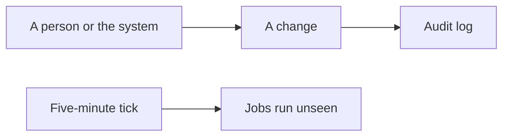
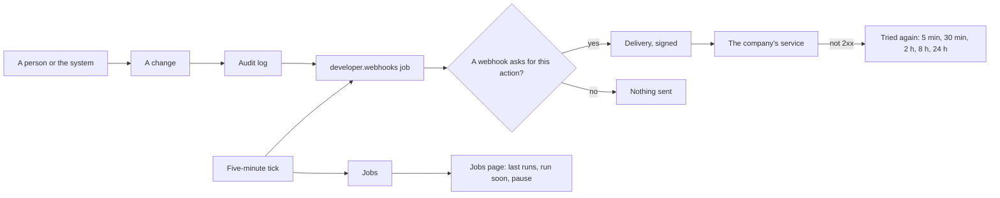

# The Developer module

> **In plain words.** The portal has a new **Developer** section. Its first page lists all the
> work the portal does on its own (sending the next chunk of a campaign, emptying the trash,
> sealing the audit log and so on), when each last ran, whether it worked and what went wrong;
> someone allowed can make one run now or pause it. Its second page sends the portal's changes to
> the company's other systems as they happen: say "tell this address whenever a form is
> answered", and the portal posts each new answer there, signed so the other system knows it came
> from the portal, and keeps trying for a day and a half if that system is down. Its third page
> describes every address of the portal's API, read from the code that runs, so it is never out
> of date. The owner asked for "Developer tools" on 2026-10-27.

## What changed, and why

| What | Why |
|---|---|
| The jobs page: every job and flow, its schedule, last run, time taken, error; **Run soon**, **Pause**, **Resume** | The automatic work was invisible; a failing job was found only through a health check |
| `@oltrem/core-jobs`: `runSoon`, `setPaused`, two columns (migration `0021`), a tick that skips a paused job | A pause has to hold across isolates and survive a deploy, so it lives in the jobs' own table |
| Webhooks fed by the audit log | Every change is already an audit row (the automatic audit of this round), so every module's changes can be sent with no code per module |
| Standard Webhooks signing, the same id on each attempt, a ladder of five retries, ten failures switch a webhook off | Receivers check it with ready-made libraries, drop repeats, and a dead address stops costing requests |
| Each signing secret sealed under the KEK secret | The database never holds a usable secret; no new secret name |
| The API reference read from the manifests | The routes the pipeline enforces are the routes described |
| Both capabilities read at the company | A webhook carries every place's changes; a job works for the whole company |

## Before and after

Before, a change stayed inside the portal, and the jobs ran unseen:

After, the tick also reads the audit log and sends what each webhook asked for, and the jobs are
on a page:

Explanation: every change is written to the audit log as before. On each tick the webhooks job
reads the rows written since its last run and, for each webhook whose events match the action,
makes a delivery and sends it, signed with that webhook's secret. A delivery that is not answered
with a 2xx is tried again on the ladder; ten that fail for good in a row switch the webhook off.
The jobs page reads the same table the tick writes, and its commands change that table.

## Impact on each part

| Part | Impact |
|---|---|
| `@oltrem/developer` | new: bit plane `14`, migration `0022`, errors `2601` to `2603`, two jobs, two checks, thirteen routes, two pages |
| `@oltrem/core-jobs` | migration `0021` (`paused_at`, `paused_by`); `runSoon`, `setPaused`; the tick's `stopped` list |
| The client template | the module mounted after GitHub with its pages; `0021` and `0022` synced; the worker and screens tests extended |
| Clients | a Developer section from their next deploy; two columns and two tables added; no new binding, secret or variable. Webhooks need the KEK secret, which every client already has. |

## How it was verified

`pnpm verify` passes. The module's twelve tests run inside the Workers runtime through the
pipeline beside the IAM module, with the real scheduler and a stand-in receiver that checks each
signature (the list is in its README); the signature matches the example the Standard Webhooks
project publishes. The jobs tests cover a pause by hand, a resume, a run soon and a pause before
the first tick. The client template opens the three Developer views and runs a journey through the
pages: a job paused, resumed and made due, a refused address, a webhook made with its secret shown
once and never again, switched off and removed. Not yet tried against a real receiving service or
on a phone.
