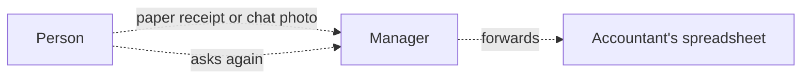
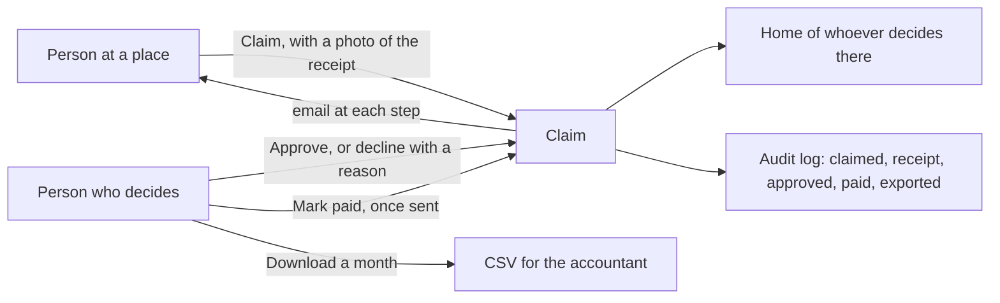

# Expenses module

> **In plain words.** A portal can now pay people back. Someone who bought printer ink or took a
> taxi for work claims it from their phone: the amount, what it was for, and a photo of the receipt
> taken with the camera. The people who decide at that place approve it, or decline it with a
> reason, and mark it paid once the money is sent; the person is told each time by email and sees
> what the company still owes them. Nobody approves or pays their own claim. At the end of the
> month, one button downloads the approved and paid claims as a spreadsheet for the accountant. The
> owner asked on 2026-10-27 for features that sell; every company that lets staff spend money needs
> this, whatever the business.

## What changed, and why

| What | Why |
|---|---|
| `@oltrem/expenses`: claims at a place, with the receipt, answered and then paid | Receipts were handed over on paper or sent in a chat, and lost; nobody knew what was still owed |
| `expenses.claim` and `expenses.decide`, read at the claim's place | The same place-based rules as approvals and time off: a lead at one branch answers that branch's claims |
| Nobody approves or pays their own claim; a no has a reason; each step happens once | Money needs two people, and two clicks at once must not pay twice |
| The amount typed as 12.50 or 12,50 and kept in cents, in the company's currency (`expenses.currency`) | People in different countries write decimals differently; refusing a thousands separator removes the guess, and whole cents never round |
| The receipt kept in the client's one bucket, under its own prefix, served only to the person and the people who decide | No new resource (R-09); a receipt is personal and financial, and never runs as a page |
| Mark paid after approval | The portal records a payment made at the bank; it does not move money |
| A month as a CSV file, audited | The accountant works in a spreadsheet; who downloaded which month is on record |
| Needs you shows what waits and the sum to pay | The person who pays sees the amount at a glance on Home |
| The module's `personal` answer | A privacy request finds every claim the person made |

## Before and after

Before, receipts and repayments lived outside the portal:

After, the portal holds the claim, the receipt, the answer and the payment:

Explanation: each claim is a row of `expenses_claims` at a place with its amount in the currency's
smallest unit, and its receipt is an object in the client's bucket under `expenses/`. Changing the
state happens in one statement that names the state it changes from, so the second of two answers,
or of two payments, changes nothing and is told so. A receipt sent by a page has no length, so it is
read up to 10 MB before it is kept; one sent with its length streams straight to the bucket. Every
change goes through the module's API as the signed-in person, is checked against their roles at
that place, and is audited.

## Impact on each part

| Part | Impact |
|---|---|
| `@oltrem/expenses` (new) | bit plane `23`, migration `0033_expenses.sql`, error block `3300`, nine routes plus Needs you, two pages, one setting, the privacy answer |
| The client template | mounts the module under Work, after Time off, with the plain email template `expenses.message` and the files' bucket for receipts; one more table, no binding, secret or variable |
| `@oltrem/cli` | `expenses` is a kit module's name, so `new module` refuses it |
| `@oltrem/files` | none; receipts share its bucket under another prefix, and its storage check does not count them yet (in the module's README) |
| Clients | the Expenses page from their next deploy, in USD until the owner sets the currency; the Owner holds both capabilities, other roles get them from the Access page |

## How it was verified

`pnpm verify` passes. The expenses tests run inside the Workers runtime through the pipeline with a
bucket: who may claim where, the checks on the amount (a thousands separator and zero refused), day,
category and text, the receipt kept only by the person who claimed and served only to the people who
decide, a type that is not a photo or PDF refused and one without its length read, what waits for
each person who decides, Needs you with the sum to pay, approved or declined once and paid once,
never one's own, the four emails, withdrawn while it waits, the month's CSV with a formula defused
and the download audited, and the privacy answer. The amount tests cover a point and a comma, and a
currency without decimals. The client template's screens journey claims an expense with a photo of
its receipt as the Owner through the page's form, is refused an amount with three decimals, finds no
Approve, and withdraws it. Not checked: a phone's camera, a deployed portal, and a second person
answering and paying through the pages (covered by the module tests). Those are listed in the
[verification log](../verification-log.md).
