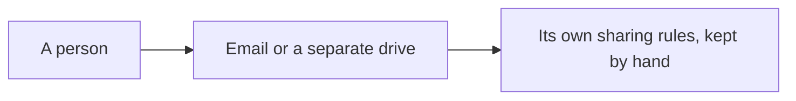
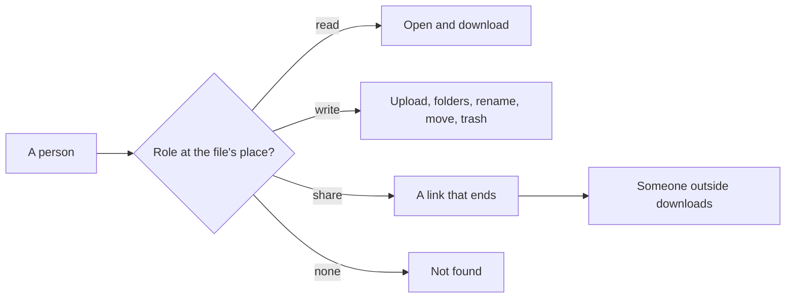

# The Files module

> **In plain words.** The portal can now keep the company's documents. Each place of the company
> (the company itself, a site, a team) has its own drive with folders. Who may open, upload,
> share or delete a file is decided by the roles people already hold at that place, so there is
> nothing extra to set up: give someone a role at a place and they see its files at once, take it
> away and they do not. A file can be handed to someone outside by a link that ends after a few
> days or a few downloads, and can be ended by hand. Deleted items wait in a trash for 30 days
> (a setting) before they go for good. Everything is recorded in the audit log, without the files'
> contents. The owner asked for "a files system built in with auto permissions, synced with the
> system, but better than our existing one" on 2026-10-27.

## What changed, and why

| What | Why |
|---|---|
| `@oltrem/files`: a drive per place, folders eight deep, unique names, uploads to the one bucket under `files/` | Documents with the rest of the work, on the free plan's 10 GB bucket, with no new resource (R-09) |
| Permissions read from the roles at the item's place, never a list on the file | One permission system: nothing to keep in step, and a role change takes effect at once |
| Links that end by day, by downloads, by hand or by the trash; only a hash kept | Sharing outside without accounts, and no working link in the database |
| A trash, restored to where it was, emptied by a daily job | Nothing goes by accident |
| The `/files` pages, the first module to bring its own through `withPages` | The section appears when the module is mounted |
| `@oltrem/core-module`: `GET` hooks, `bytes` routes, the page types in a subpath that names no Workers type | A link a person opens; an upload; pages type-checked against the DOM and the manifest against the Workers runtime |
| `@oltrem/core-http`: a response's own content security policy kept | A file served for download keeps its sandbox |
| The screens' `api.send` sends a `File` as it is; the stylesheet reads kit modules' pages | The upload form; the module pages' classes |

## Before and after

Before, a file had nowhere to live in the portal:

After, a file sits at a place, and the roles there decide:

## Impact on each part

| Part | Impact |
|---|---|
| `@oltrem/files` | new: bit plane `12`, migration `0019`, errors `2401` to `2405`, two settings, one job, one check, one hook |
| `@oltrem/core-module` | `HookDefinition.method`, `RouteDefinition.body`, the `./pages` subpath |
| `@oltrem/core-http` | GET hooks, bytes routes, the policy kept |
| `@oltrem/screens` | `api.send` with a `File`; the stylesheet's sources |
| The client template | the module mounted with its pages; `0019_files.sql` synced; the screens test runs the pages |
| Clients | a Files section from their next deploy; the migration adds two tables; no new binding or secret |

## How it was verified

`pnpm verify` passes. The module's sixteen tests run inside the Workers runtime through the
pipeline, with the IAM module, on a company with places, roles and people (listed in its README):
places seen by role, another place's files not found, a role given at a place opening its files
at once, the download headers, the size limit, rename and move, links ended four ways, the trash
and a delete for good of a folder with its content, the job, the audit without content. The
pipeline's new tests: a GET hook, a bytes route and the contract's refusals. The client template
runs the pages end to end: an upload from the form, a folder, a move, a link opened, and the link
ended by the trash. The client bundle was built with wrangler's dry run and the pages compiled.
Not yet tried on a real account or a phone.
