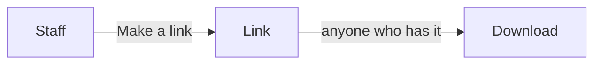

# Files shared with customers

> **In plain words.** Staff could already hand a file to anyone with a link that ends. A link can
> be forwarded, though, and anyone who has it can download the file. Now staff can share a file
> with one customer by their email address instead. The customer finds it on their account page,
> under "Files shared with you", and downloads it there after signing in. No link exists to
> forward, and the sharing can last up to a year.

## What changed, and why

| What | Why |
|---|---|
| "Share with the customer" on a file's page: an address and 30 days, 90 days or a year | Quotes, contracts and reports are what a company most often hands its customers |
| No link is made; the file opens only from the customer's account, signed in | A forwarded email or a leaked link no longer exposes the file |
| A customer part may `open` an item, at `/account/open/<module>/<id>` | The same contract serves any later module that hands a customer something |
| The share is a row of the existing `files_shares` with the address; migration `0040` adds the column and an index | Reuse before create: the counting, ending and clean-up of links apply as they are |
| Ended by hand, at its day, or while the file or a folder above it is in the trash | The rules people already know from links |
| The download audited by `customers.door`, without the address | The audit log keeps ids, not personal data |

## Before and after

Before, a file left the portal only by a link:



After, it can also wait on the customer's account page:

```mermaid
flowchart LR
  S[Staff] -->|Share with the customer| R[Share for their address]
  C[Customer] -->|signs in| A[/account: Files shared with you]
  R --> A
  A -->|/account/open/files/...| F[Files checks it is still theirs] --> D[Download]
```

Explanation: the share is kept with the customer's address and a token nobody is given. When the
customer opens their account, the files module lists the shares for the address they proved at
sign-in that are still good and whose file is not in the trash. The link on the page goes through
the customers door, which asks the files module to open that share for that address; the module
checks again, counts the download, records it, and answers the file.

## Impact on each part

| Part | Impact |
|---|---|
| `@oltrem/core-module` | `CustomerItem.id` and `CustomerPart.open` |
| `@oltrem/customers` | the `/account/open/<module>/<id>` path and its notice; no new capability, route or table |
| `@oltrem/files` | `email` on the share route, the "Customers" section of a file's page, the customer part; migration `0040_files_customers.sql` (one column, one index) |
| The client template | one more migration; no new binding, secret, variable or setting |

## How it was verified

`pnpm verify` passes. The files tests share a file with a customer for a year without a link,
refuse a link over 30 days and a bad address, list and open it for that address and company only,
hide it while its folder is in the trash and bring it back when restored, end it by hand and at
its day, list the newest twenty with more, and audit the download without the address. The
customers tests open an item for its customer only, uncached, and send anything else back to the
account. The client template's journey shares a file from its page and the customer downloads it
from their account page. Not checked: a phone, a deployed portal, a large file.
