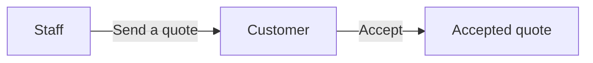
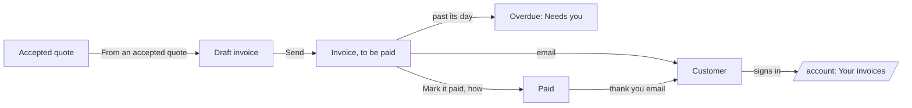

# Invoices module

> **In plain words.** After a customer accepts a quote, the company can now bill them from the
> portal. Staff pick the accepted quote (or start blank), check the lines, set the day it is due
> and how to pay, and send it. The customer gets an email and sees the invoice on their account
> page. When the money arrives, staff tap "Mark it paid" and the customer is thanked. Invoices past
> their day show as overdue, on the list and on Home. The portal does not take the payment itself:
> the invoice says how to pay.

## What changed, and why

| What | Why |
|---|---|
| An `invoices` module: drafts at a place, sent to a customer's address, marked paid, voided while unpaid | Billing is the step after a quote, and what client-portal buyers expect next to it |
| "From an accepted quote" on the page that makes an invoice | No retyping; the two modules stay separate, the invoice page reads the quotes through their own API and starts blank without them |
| The customer sees what they owe and what they paid on their account page | One place for everything the company sends them, behind the same sign-in |
| Overdue invoices in their own view and in Needs you | The money owed is what a business most needs to chase |
| No online payment yet | A payment provider needs a secret, which waits for the owner's yes (R-09) |
| The currency is a setting, `invoices.currency` | A setting is data in the database, not a new variable |

## Before and after

Before, a quote ended when the customer accepted it:

After, the accepted quote becomes an invoice the customer can see until it is paid:

Explanation: the page that makes an invoice asks the quotes API for the accepted quotes the person
sees and fills the form from the one picked, so nothing is copied between the modules' tables. The
draft is numbered in its own series within the company. Sending it emails the customer and puts it
on their account page, read by the customers door for the address they proved at sign-in. Each
day the list and Needs you compare the day it is due with today. Marking it paid is one write that
holds only while the invoice is sent, so it happens once, and the customer is thanked.

## Impact on each part

| Part | Impact |
|---|---|
| `@oltrem/invoices` | new: two capabilities on plane 29, seven routes, four pages, one setting, the `39xx` errors, migration `0042_invoices.sql` (one table) |
| `@oltrem/quotes` | none: its API is read, unchanged |
| `@oltrem/customers` | none: the account page shows the new part through the existing contract |
| The client template | the module mounted with an email template for its messages; one more migration; no new binding, secret or variable |

## How it was verified

`pnpm verify` passes. The invoices tests make, change and send invoices only where the person makes
them; refuse bad addresses, lines and days; show each person only the places they see, with the
counts; show a sent invoice on its customer's account page and nobody else's; mark it paid once and
thank the customer; never void a paid one; show one past its day as overdue in its view and in Needs
you, and settle it when paid late; show a voided sent invoice as cancelled and never a voided draft;
find them in the search and a privacy request; and audit every step. The client template's journey
makes an invoice from the quote the customer accepted, sends it, finds it on their account page and
marks it paid. Not checked: a phone, a deployed portal, a real mailbox.
