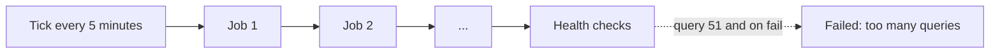
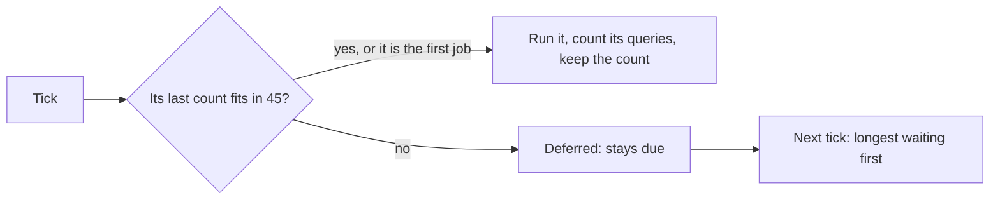

# The jobs within the queries of one tick

> **In plain words.** Every five minutes the portal does its background work: sending queued
> email, checking its own health, sealing the audit log, emptying the trash. All of it runs in one
> go, and on Cloudflare's free plan one go may ask the database at most 50 questions. While a
> morning email was being designed on 2026-10-27, the background work of a fresh portal was
> measured: its first go asked 99. Past 50 every question fails, so the work at the end of the
> list (the health checks among it) failed whenever many jobs fell due together, once a day at
> least. Now the portal counts the questions each job asks, remembers it, and starts a job only
> when it still fits; what does not fit waits five minutes and goes first then. Nothing is
> skipped, and the jobs page shows each job's count.

## What changed, and why

| What | Why |
|---|---|
| The tick hands the jobs an env whose databases count every query (`src/queries.ts` in `@oltrem/core-jobs`) | The jobs do not need to know: the count is taken where the queries are made |
| Each run's count is kept, `last_queries` (migration `0031_jobs_queries.sql`) | The tick plans by what a job made last time; ten is assumed before its first run |
| A job starts only when the count so far, its two writes and its last count stay within 45 | The Free plan allows 50 D1 queries an invocation; past it every query fails |
| The due jobs go longest waiting first, and one that did not fit (`deferred`) keeps its time | It goes first on the next tick, where the first job runs whatever it costs, so none waits for ever |
| The jobs page shows each job's queries beside its last run | An operator sees which job is heavy |

## Before and after

Before, the tick ran every due job in one go, in manifest order, whatever they asked:

After, the tick counts and leaves to the next tick what does not fit:

Explanation: the count is a thin wrapper around each D1 database in the env the jobs receive,
which adds one for every `first`, `run`, `all`, `raw`, `batch` or `exec` and changes nothing
else. The tick reads it before and after a job, stores the difference with the outcome, and
compares the next run's expected count with what is left.

## Impact on each part

| Part | Impact |
|---|---|
| `@oltrem/core-jobs` | `queryBudget` (default 45), `deferred` in the tick's result, `lastQueries` on each row, migration `0031` |
| `@oltrem/developer` | the jobs page shows the queries of each job's last run |
| The client template | no change to its wiring; a fresh portal's jobs now run over the first few ticks instead of failing at the end of the first |
| Clients | from their next deploy; a 5-minute job may run a tick later when heavy jobs fall due together |

## How it was verified

`pnpm verify` passes. The scheduler tests run inside the Workers runtime: a job's four queries
counted with a batch as one, the first job of a tick run, two whose cost is not known yet left for
the next tick where they go first, and all three fitting once their counts are known. The client
template's worker test ticks a fresh portal until every job has run, which takes more than one
tick, and finds each run's count recorded. The figure of 99 was measured by hand in that test on
2026-10-27, with the budget lifted. Not checked: a deployed portal on the Free plan (the limit of
50 is Cloudflare's published figure, read from its D1 limits page), and the cron's other work
(starting Workflow instances), which is not counted. Those are listed in the
[verification log](../verification-log.md).
