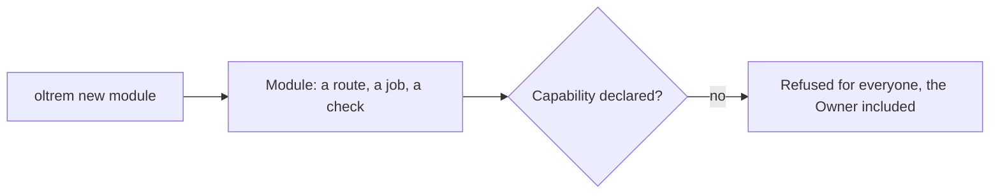
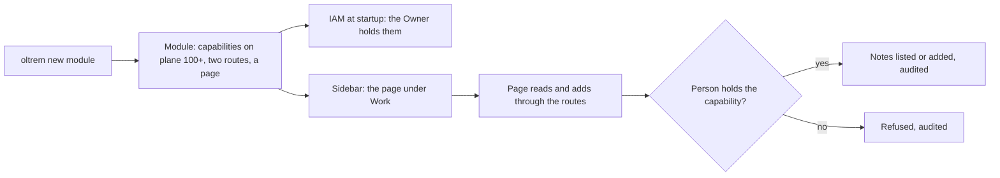

# A new client module gets permissions and a page

> **In plain words.** When a client wants a feature of their own, one command writes the start of
> it: `oltrem new module <name>`. Until today, what it wrote had no permissions of its own and no
> page. Since the portal checks permissions everywhere, nobody, the Owner included, could use the
> new module's routes once it was deployed, and there was nothing to see in the sidebar. Now the
> command writes a module that works on day one: it has its own permissions, which the Owner holds
> at once and can give to other roles on the Access page, and a page in the sidebar that lists its
> items and adds one. A developer or an AI agent starts from something that already runs and
> changes it, instead of wiring it up by hand.

## What changed, and why

| What | Why |
|---|---|
| The module template declares `sample-notes.read` and `sample-notes.write` on its own bit plane | A route behind a capability nobody declared is refused for everyone; tried on a generated module before the change, the list answered no one |
| The generator gives each client module the next free plane from `100` | The kit's own modules take the planes below; a client module never collides with a kit module added later |
| A `GET /` route beside `POST /` | A page needs something to read |
| A page `/sample-notes` in the sidebar, under Work: the notes in a table, "Add a note" in a dialog, an empty state | The owner asked for a portal where every feature has its screen; the page shows the pattern every kit module follows |
| `src/modules.ts` joins each client module to its pages; `test/pages-types.ts` holds each module's page types to its page | The page is checked against the browser's types and the Worker against the Workers types, in two programs, as the kit's modules are |
| The client's `package.json` maps `#modules/*/pages` | The generated file imports a module's pages without a path that reaches across folders |
| `oltrem check modules` also checks `test/pages-types.ts` and that each plane is its own, from 100 | Both files are generated; a hand edit or a reused plane fails verify |
| The generator refuses every kit module's name, and a test fails when a kit module is missing from that list | The newer kit modules (files, tasks, privacy and the rest) could have been taken as a client module's name |

## Before and after

Before, a generated module answered no one and had no screen:

After, it is usable from its first deploy:

Explanation: the module declares its capabilities on a plane of its own, so the permission model
registers them when the Worker starts and adds them to the Owner role. The page calls the module's
routes as the person signed in, so a person sees and does only what their roles allow, as on every
other page.

## Impact on each part

| Part | Impact |
|---|---|
| `templates/module` | capabilities, a list route, a page, its types and its type check |
| `@oltrem/cli` | `new module` writes the plane, the pages and `test/pages-types.ts`; `check modules` checks them; the reserved names cover every kit module |
| The client template | the `#modules/*/pages` import, a second type-check program, the generated `test/pages-types.ts`; no binding, secret or variable |
| Clients | a module generated from now on works on its first deploy; one generated before has no capabilities and should declare them as the template now does |

## How it was verified

`pnpm verify` passes. The CLI tests hold the generator to the template byte for byte and check
the plane, the pages and the reserved names; the template module's own tests check its manifest,
the list for the Owner and its refusal for a stranger. By hand, a module `pet-food` was generated
into the client template: both type-check programs, `oltrem check modules`, `oltrem docs --check`
and its tests passed, and a portal test showed the Owner the empty page with "Add a note", added a
note, saw it listed and found the page in the sidebar. The trial was then removed. Not checked on
a phone or a deployed portal; listed in the [verification log](../verification-log.md).
