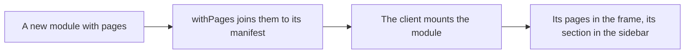

# Modules bring their own pages

> **In plain words.** Until now every page of the portal was written inside one package, so a new
> feature could not arrive with its own screen: someone had to add it by hand to the kit's page
> list and to the sidebar. Now a feature brings its pages with it. When a portal switches a
> feature on, its pages and its place in the sidebar appear; when it does not, they do not. The
> look stays the same because the page building blocks moved to the shared design package.
> This is the ground the new Files, Campaigns, Developer and Jobs sections stand on. The owner
> asked for "sharded packages" and a "solid foundation" on 2026-10-27.

## What changed, and why

| What | Why |
|---|---|
| `@oltrem/core-module`: a `pages` field, `PageDefinition` and its context, and `withPages` | A module declares its screens the way it declares its routes, checked when it is defined |
| A page reads and writes only through the portal's own API | A screen can never show or change more than the routes behind it allow |
| `@oltrem/screens` mounts each module's pages inside the frame, and `navWith` places its sidebar section in its group | Switching a module on adds its section; one sidebar, phone first (R-12) |
| The page building blocks (`Panel`, `Section`, `Notice`, `Stats`, `ActionRow`, `ProblemNotice`, `Loaded`, `Done`, `when`) moved to `@oltrem/core-ui` | A module's pages look like the kit's without importing the kit's screens |
| Pages live in a module's separate JSX entry, joined with `withPages` | The manifest stays type-checked against the Workers runtime, the pages against the DOM |

## Before and after

Before, a new section meant editing the kit's screens:

After, the module carries its pages and the screens mount what is mounted:

## Impact on each part

| Part | Impact |
|---|---|
| `@oltrem/core-module` | `pages`, `PageDefinition`, `PageContext`, `PageResult`, `PageNav`, `withPages`, and their checks |
| `@oltrem/core-ui` | the page building blocks, exported for every module |
| `@oltrem/screens` | module pages mounted; `navWith`; the moved blocks re-exported from core-ui |
| The client template | none yet; a module with pages is joined with `withPages` before it is listed |
| Clients | no change until a module with pages is mounted; no migration |

## How it was verified

`pnpm verify` passes. The contract's tests: a page's path, its `get`, its sidebar words, a path
inside the pipeline's own, a path taken twice and a missing `get` refused; `withPages` checked the
same way. The screens' test, on Node: a module's page opens inside the frame with its section
after the Work group's last one and marked current, a page without a section sits under its
module's, a posted form comes back by its redirect, and a form from another site is refused.
