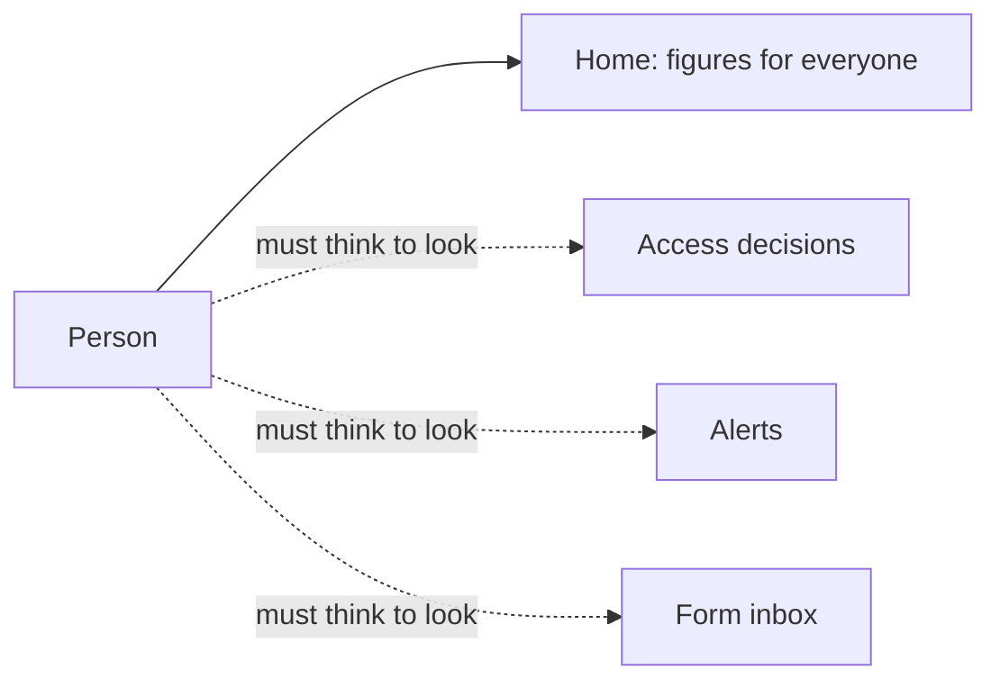
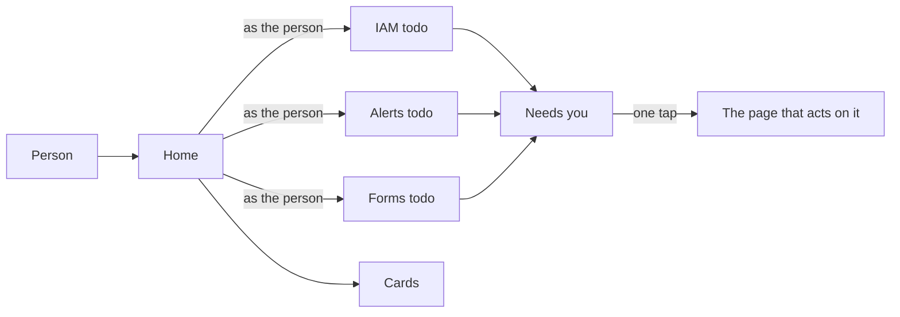

# Needs you on Home

> **In plain words.** Home used to show figures: how many people, how many alerts. It did not
> say what *you* had to do. Now it opens with **Needs you**: a short list of what waits for the
> person signed in, each a row that opens the page where it is done. Someone asked for a role you
> may give; a change waits for a second person's yes; an access review has grants for you to keep
> or remove; your own access ends this week; an alert nobody has taken; new answers to a form you
> handle. When nothing waits, one line says so. Each person sees only what they may act on, by
> the same rules the action itself checks. The owner asked for "an auto check, auto run system"
> and a better permission system on 2026-10-27.

## What changed, and why

| What | Why |
|---|---|
| A `todo` part of the module contract: `GET /api/<module>/todo` under the module's capability, items of a title, a line and a portal page, five at most per module | Any module, the client's own included, can put a task in front of the right person without the screens package knowing it |
| IAM: requests and approvals the person may decide, reviews with grants they may keep or remove, their own grants ending within 7 days | The access rules had pages but nothing led a person to them; a decision waited until someone looked |
| Alerts: the open alerts nobody has acknowledged, for whoever may acknowledge | An alert is meant to be taken by someone; the card counted them for everyone |
| Forms: the forms with new answers, for whoever may take them at the form's place | Answers from the website waited in an inbox nobody opened |
| Home: Needs you first, read in the same moment as the cards | The first screen answers "what do I do now" before "how are things" |
| `standingAt` in `@oltrem/iam`: the standing a grant needs, as a value | The decisions and the list share one rule, so a person is never sent to a decision the API refuses |

## Before and after

Before, a person had to go looking; nothing on Home was about them:

After, Home asks each module what waits for this person and shows it first:

Explanation: Home calls each module's `todo` route with the person's own session, in parallel with
the cards. A module answers only for the person in front of it: IAM counts a request only when
the person could have given that role there and did not ask for it; an approval only when they
hold the capability and did not request it; a review's grant only when it is not their own or
their group's. A module that refuses the person (403) adds nothing.

## Impact on each part

| Part | Impact |
|---|---|
| `@oltrem/core-module` | the `todo` contract (`TodoProvider`, `TodoItem`, `TODO_ITEMS`) and its route |
| `@oltrem/iam` | `GET /todo` under `iam.self` (59 routes in all), `waitingFor`, `standingAt`; no migration |
| `@oltrem/alerts` | `GET /todo` under `alerts.manage` |
| `@oltrem/forms` | `GET /todo` under `forms.read`, narrowed to `forms.handle` at each form's place (17 routes) |
| `@oltrem/screens` | Needs you on Home (`NeedsYou`), and the `todo` field of a mounted module |
| Clients | the section from their next deploy; no new table, binding, secret or variable |

## How it was verified

`pnpm verify` passes. Core-module's test of the route (the person's context passed, pages outside
the portal dropped, five at most); the IAM governance test of who sees what (a manager the
request at her place and the open review, a second Owner the approval another asked for and not
the one who asked, a clerk nothing, a person their grant ending in three days); the alerts test
(the unacknowledged count and the worst first, refused to a reader); the forms test (the company's
form for the Owner, nothing for a keeper of another place or a reader, refused to someone with no
role); the client template's Home with nothing waiting, then with a member's request waiting for
the Owner and linking to the decisions page. Not yet looked at on a phone or a deployed portal.
