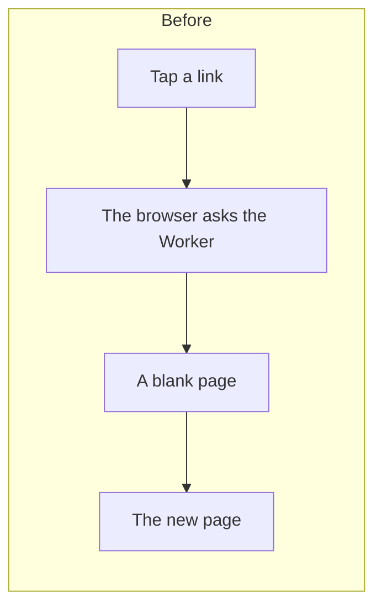
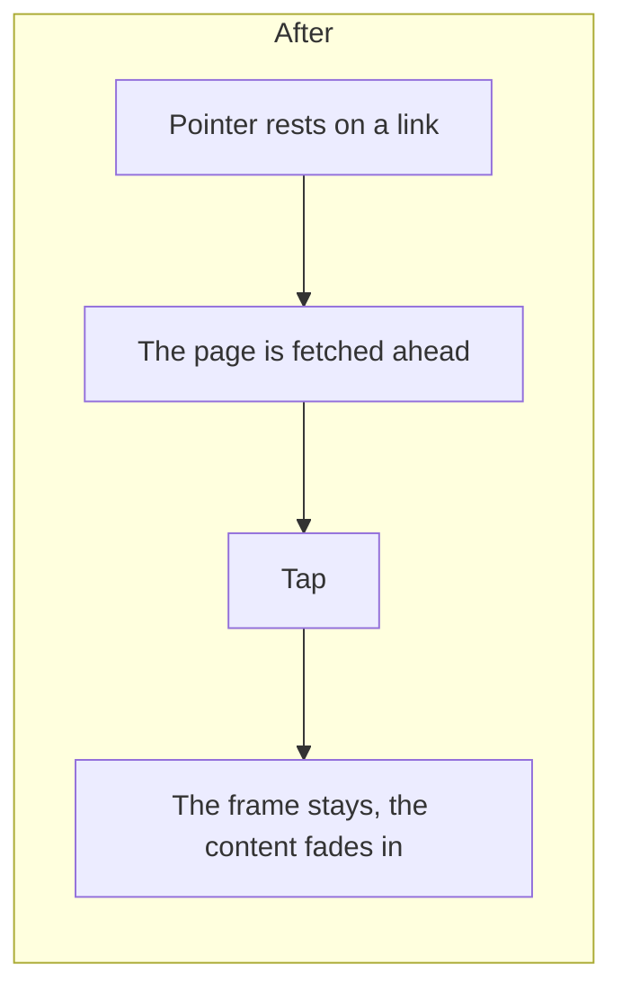

# The portal's new look and motion

> **In plain words.** The portal looks calmer and moves more smoothly. The colours are a little
> deeper and cooler, corners are rounder, shadows are softer, and the background carries two faint
> washes of the client's brand colours with the sidebar and the phone's top bar as frosted glass
> over them. Going from one page to another no longer flashes white: the frame stays still and
> only the page's content fades in. A computer starts loading a page as soon as the pointer rests
> on its link, so the click that follows feels instant. The phone's browser bar takes the
> portal's own background colour. None of it adds a script to the page. The owner asked for "a
> complete makeover visually", "smoothness, fluid transition" and "very lightweight" on 2026-10-27.

## What changed, and why

| What | Why |
|---|---|
| The colour values: cooler neutrals, a deeper primary, softer borders, layered shadows; radii 10 and 16 px | A calmer, more current look; every text-on-colour pair still reads at 4.5:1 (the theme's test) |
| `ui-canvas`, `ui-glass` and `ui-page` in the theme | One place for the background, the frame's glass and the part of a page that moves |
| A cross-document view transition (`@view-transition`) moving only `ui-page` | No white flash between pages, with no script; off under reduced motion; a browser without it just loads |
| Speculation rules in the document's head, moderate eagerness | A page is fetched while the pointer rests on its link; the API, hooks, stylesheet, local door and invitation link are never fetched ahead |
| `theme-color` in the head, light and dark | The phone's browser bar matches the page |
| The sidebar's current section marked with a bar at its edge; buttons press in when tapped; Home's cards lift on hover | Where you are, and that a tap was taken |

## Before and after

## Impact on each part

| Part | Impact |
|---|---|
| `@oltrem/core-ui` | the token values, the three surface classes, the view transition, the button's press |
| `@oltrem/screens` | the frame's glass, the current-section bar, the document's head (speculation rules, bar colours), the stylesheet rebuilt |
| Clients | the new look on their next deploy; a brand's own colours and radius still win; no migration |
| The free plan | a page fetched ahead is one more Worker request when the pointer rests on a link and the link is not then followed |

## How it was verified

`pnpm verify` passes. The theme's contrast test recomputes every pair from the new values, light
and dark. The screens' frame test reads the speculation rules and checks what they leave out, the
two bar colours and the one moving part. The stylesheet was rebuilt and the new rules were found
in it. Not yet seen on a phone: the owner's test steps are in the round's report.
