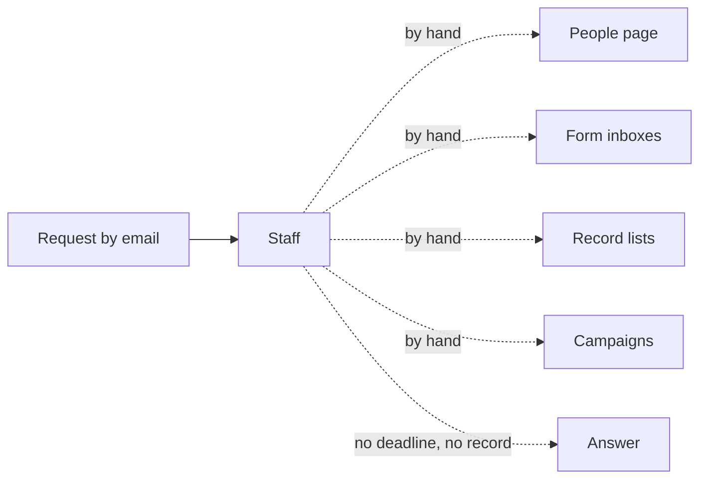
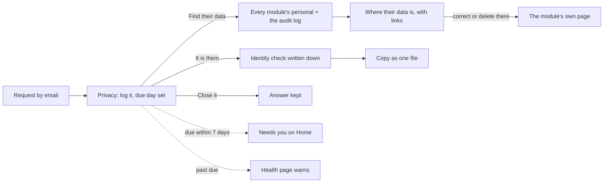

# Privacy module

> **In plain words.** Laws such as the GDPR give people the right to ask a company what data it
> holds on them, to have it corrected or deleted, and to stop a use of it, and the company must
> answer within a set time. Until now a portal could not answer that without someone digging
> through every page by hand. Now staff log the request on the **Privacy** page and the portal
> counts the days. One tap searches every part of the portal for the person's address (their
> account, form answers, records, campaigns, emails, and what they did in the portal) and shows
> where their data is. Once someone writes down how they checked the person's identity, the data
> downloads as one file to send them. Home reminds whoever answers when a request is due within a
> week, and the health page warns when one is late. The owner asked on 2026-10-27 for features
> that sell and a better permission and audit system. A privacy request answered on time is
> something every business with customers needs, whatever it does.

## What changed, and why

| What | Why |
|---|---|
| A `personal` part of the module contract: a title and `find(env, tenantId, email)`, at most 200 rows, with a link to the module's page | Each module knows its own tables. The privacy module asks them, and so does a client's own module, with no list to keep up to date |
| `personal` in users, forms, records, campaigns and email | The kit's modules that keep rows about people answer for them |
| `@oltrem/privacy`: requests with a kind, an address, a due day, the identity check, the answer | The deadline and the record of the answer are what a regulator asks for |
| The due day from the setting `privacy.answer_days` (30 by default, 1 to 90) | Laws differ: one month under the GDPR, 45 days under the CCPA, 20 business days under Mexico's 2010 law. The client sets its own |
| The copy only after the identity is written down | Giving one person's data to someone pretending to be them is a breach of its own |
| No delete button on the request page | A deletion goes through the module that holds the data, where its rules, its checks and its audit apply (R-11) |
| Needs you and the check `privacy.due` | A deadline nobody is reminded of is missed |

## Before and after

Before, answering a request meant searching each page by hand, with nothing counting the days:

After, the request is logged once, and the portal does the searching and the counting:

Explanation: the privacy module holds only the requests. When staff search, it calls each mounted
module's `personal` in the same Worker, in parallel, with the company and the address, and reads
the audit log for the address's own actions. The answer is shown as a count per part. The rows go
only into the downloaded copy, and every search and download is audited with who did it.

## Impact on each part

| Part | Impact |
|---|---|
| `@oltrem/core-module` | `PersonalData`, `PersonalFound`, `PERSONAL_ROWS`; `defineModule` refuses a `personal` without a title |
| `@oltrem/users`, `forms`, `records`, `campaigns`, `email` | each answers `personal`; no new route, table or capability |
| `@oltrem/privacy` (new) | bit plane `17`, migration `0025_privacy.sql`, the `2800` error block, eight routes, the pages, one setting, one check |
| The client template | mounts the module under People in the sidebar; one more table, no binding, secret or variable |
| Clients | the Privacy page from their next deploy, open to the Owner (who holds every capability); other roles get `privacy.read` or `privacy.manage` from the Access page |

## How it was verified

`pnpm verify` passes. The privacy tests run inside the Workers runtime: logging at the company
only, the due day, the search across modules and the audit log, the copy refused and then given,
Needs you and the health check, and a closed request kept. Each kit module's `personal` is tested
in its own package. The client template's screens journey answers a request for an address a
campaign was sent to, end to end. Not checked: a phone, a deployed portal, the search's time on a
large portal, and a lawyer's reading of the periods. Those are listed in the
[verification log](../verification-log.md).
