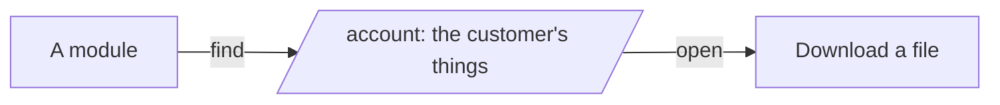

# Quotes module

> **In plain words.** A company can now send a customer a price from the portal. Staff write the
> quote line by line (what, how many, the price of one), with a last day and a note, and send it.
> The customer gets an email, signs in on their account page, reads the quote and taps "Accept the
> quote" or "Decline". The person who made it is told by email, and accepted quotes show on their
> Home under Needs you. Any business that sells a service or goods can use it.

## What changed, and why

| What | Why |
|---|---|
| A `quotes` module: drafts at a place, sent to a customer's address, withdrawn while open | The research of the day found quotes and their approval among what client-portal buyers ask for most |
| The customer answers on their account page, signed in, once, until the last day | The answer is proved by the same sign-in as everything else on that page, with nothing to forward |
| An item on the account page may show `details` and `actions`, and a part may `act` | The same contract serves any later module that asks a customer for an answer (a document to approve, a booking to confirm) |
| The answer is one database write that checks the quote is still sent, theirs and within its day | Two taps, or a tap after a withdrawal, change nothing |
| The currency is a setting, `quotes.currency`; each quote keeps its own | A setting is data in the database, not a new variable (R-09) |
| The answer is audited by `customers.door`, without the address | The audit log keeps ids, not personal data, and an automation can follow `quotes.accept` |

## Before and after

Before, a customer's account page only showed things:



After, it can also take their answer:

```mermaid
flowchart LR
  S[Staff] -->|Make a quote, send it| Q[Quote, sent]
  Q -->|email| C[Customer]
  C -->|signs in| A[/account: Your quotes/]
  A -->|Accept the quote| T[/account/act/quotes/id/accept]
  T -->|act: still sent, theirs, in time?| W[Accepted, audited]
  W -->|email| S
  W --> N[Needs you for whoever makes quotes there]
```

Explanation: the customer's account page asks each module for the customer's things. The quotes
module lists the quotes sent to the address the customer proved at sign-in, each with its lines
and total as details and, while it is open, two actions. A tap posts to the customers door, which
checks the sign-in and its form origin, then asks the quotes module to do that action for that
address. The module accepts or declines the quote in one write that holds only while the quote is
still sent, theirs and within its last day, records it in the audit log, emails the maker, and the
door returns the customer to their page with a thank-you.

## Impact on each part

| Part | Impact |
|---|---|
| `@oltrem/core-module` | `CustomerItem.details`, `CustomerItem.actions` and `CustomerPart.act` |
| `@oltrem/customers` | the `/account/act/<module>/<id>/<action>` path, the details and buttons on the account page, and the thank-you; no new capability, route or table |
| `@oltrem/quotes` | new: two capabilities on plane 28, six routes, four pages, one setting, the `38xx` errors, migration `0041_quotes.sql` (one table) |
| The client template | the module mounted with an email template for its messages; one more migration; no new binding, secret or variable |

## How it was verified

`pnpm verify` passes. The quotes tests make, change, send and withdraw quotes only where the
person makes them; refuse bad addresses, lines and days; show each person only the places they
see; list a sent quote on its customer's account page and nobody else's; accept it once and refuse
another address, another action, a second answer and an expired quote; email the customer and the
maker; show accepted quotes in Needs you; find them in the search and a privacy request; and audit
every step. The customers tests post an action for its customer and thank them, and send a refused
one back with "no longer open". The client template's journey makes a quote as the Owner, sends
it, and the customer accepts it on their account page. Not checked: a phone, a deployed portal, a
real mailbox.
