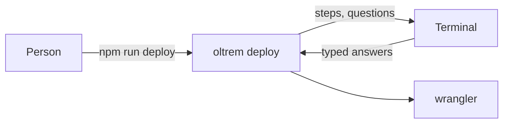
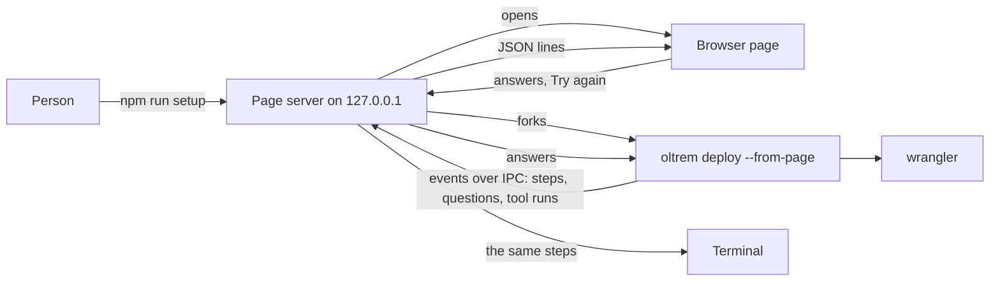

# The setup page

> **In plain words.** Putting a portal on Cloudflare asks a few things: your email, the portal's
> address, a key copied from Cloudflare, and a moment to turn the door on. Until now that was all
> typed into a terminal. `npm run setup` now opens a page in the browser, in the portal's own look:
> each step is a card, each question a box with a button, each Cloudflare address a link, an email
> address has a copy button, and a long step shows a spinner with how long it has taken. When
> something stops, the page says what, shows what the tool printed last, and has a **Try again**
> button. The terminal shows the same steps, and `npm run deploy` still works without the page.

## What changed, and why

| What | Why |
|---|---|
| `oltrem deploy --page`, and `npm run setup` at the kit's root | The owner chose a setup page on top of the terminal's look: a non-technical person can click a link and paste a key into a box |
| The page is drawn with `@oltrem/core-ui`'s theme tokens, light and dark | It should look like the portal it sets up; a test fails if the two drift apart |
| The deploy runs in a second process and sends its steps as events | The deploy's tools hold their process while they run; the page's server has to stay free to answer the page |
| Only this computer reaches the page: `127.0.0.1`, its own `Host` only, a key after the `#` for every call, a strict content policy | A page on `localhost` is reachable by other web pages in the same browser unless it refuses them |
| A pasted key goes to the deploy and is kept nowhere else | The page's record of the answer is empty, so a page opened again does not show it |
| When wrangler's sign-in does not open the browser, the page shows a button to its sign-in page | Before, that address went to a log file, and the person waited for nothing |
| **Try again** on the page after a stop | A wrong key or a step not done no longer means going back to the terminal |

## Before and after

Before, the questions and the answers were in the terminal:

After, a page in the browser asks, and the terminal shows the same steps:

Explanation: the first process serves the page and starts the deploy when the page first opens.
The deploy is the same `runDeploy` the terminal uses; only its tools differ: its lines and
questions go out as events, and each long wrangler step is a "task" event before it starts and a
"task-end" after, with the tool's last lines when it failed. The page draws each event as it comes,
and a page opened again gets every event so far. The command ends when the deploy has ended well,
after ten minutes without the page ever opening, or once the page has been closed for a minute
while the deploy waits on it, never in the middle of a tool's run.

## Impact on each part

| Part | Impact |
|---|---|
| `@oltrem/cli` | new `src/setup-page.ts` (the server, the IPC tools, opening the browser) and `src/setup-page-html.ts` (the page); `oltrem deploy` takes `--page`, and `--from-page` for its second process |
| The kit's root | `npm run setup` (`scripts/run.mjs`); the install's last line names it |
| The client template | none in code; its README names `npm run deploy -- --page` |
| Workflows | none: they run `oltrem release`, which has no page |

No new dependency, variable, secret or resource.

## How it was verified

`pnpm verify` passes. The tests check the deploy's side (a question out and its answer back, a
labelled tool run as a task, a failure's last lines without colour codes), the server (the page
under its nonce and policy, another `Host` refused, a call without the key refused, the run started
when the page opens, an answer taken once and for the question asked only, a secret's answer
recorded empty, a page opened later given every event, **Try again** after a stop and not before,
a deploy that dies without a word ending in a stop, a page never opened giving up), a forked
stand-in for the deploy talking over IPC with its sign-in address turned into a link, the browser
command on each platform, and the page's colours against `@oltrem/core-ui`'s theme.

By hand on a Linux container: a scripted run of all seven steps through the real server in a
headless browser (the email, the address left empty, a pasted key, three tool runs, the door, the
end in light; a run that stops at the database with **Try again** in dark); and the real
`oltrem deploy --page` in the client template, with the real wrangler, up to the sign-in step, at
390 px and 1000 px wide, where the page showed the spinner and then the sign-in button.

Not checked: a Windows computer (the browser opening through `start`), a real deploy to Cloudflare
through the page, and a sign-in that reaches several Cloudflare accounts, which stops on the page
(wrangler cannot ask which account without a keyboard; `npm run deploy` can).
