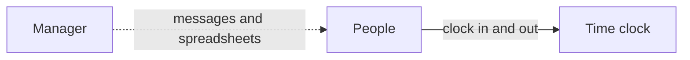
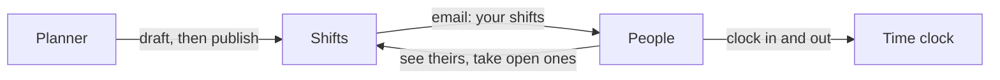

# Shifts module

> **In plain words.** A portal can now plan who works when. Whoever plans at a place (a shop, an
> office, a site) drafts the week's shifts on their phone, each with a person or left open, and
> publishes the week when it is ready. Everyone on it gets an email with their shifts. People see
> their own shifts and can take an open one at a place they belong to. If a published shift moves
> or is cancelled, the people on it are told. It plans the work; the time clock records the hours
> actually worked.

## What changed, and why

| What | Why |
|---|---|
| `@oltrem/shifts`, one row a shift at a place, kept in UTC and typed on the company's clock | Planning staff is one of the first things a company with more than a few people needs |
| Drafts until the week is published, then an email to each person with their shifts | People see a decided schedule, once, instead of a schedule changing under them |
| Open shifts, taken once by someone who sees the place and is free then | Gaps fill themselves without a round of messages |
| One shift at a time a person, checked in the statement that writes it | Nobody is double-booked, even by two planners at once |
| `shifts.view` and `shifts.plan` held at a place | The same place-bound permissions as bookings, time off and the time clock |
| Drafts and open shifts in Needs you; the privacy answer | The same contracts as every other module |

## Before and after

Before, the time clock recorded hours, but nothing said who should work:

After, the week is planned in the portal:

Explanation: a planner's shifts stay drafts until they publish the week at their place. Publishing
marks them in one statement and emails each person on them. Open shifts appear to the people of
the place, and the first who is free takes one.

## Impact on each part

| Part | Impact |
|---|---|
| `@oltrem/shifts` (new) | bit plane `27`, migration `0038_shifts.sql` (one table), error block `3700`, seven routes and Needs you, two pages, the privacy answer |
| `@oltrem/cli` | `shifts` is a kit module's name, so `new module` refuses it |
| The client template | mounts the module in the Work group after the time clock, with one plain email template; one table, no binding, secret, variable or setting |
| Clients | the Shifts page from their next deploy; Owners hold both capabilities at once, others once a role is given them |

## How it was verified

`pnpm verify` passes. The shifts tests run inside the Workers runtime through the pipeline on the
Mexico City clock, as the module's README lists. The client template's screens journey plans a
shift on the page, is refused a second at the same time, publishes the week and finds the shift
and its email in the outbox; that journey caught a message key longer than email accepts, now
shorter. The pages were opened at 360 px in light and dark. Not checked: a phone, a deployed
portal, and an email in a real mailbox. Those are listed in the
[verification log](../verification-log.md).
