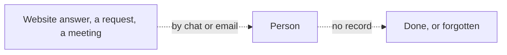
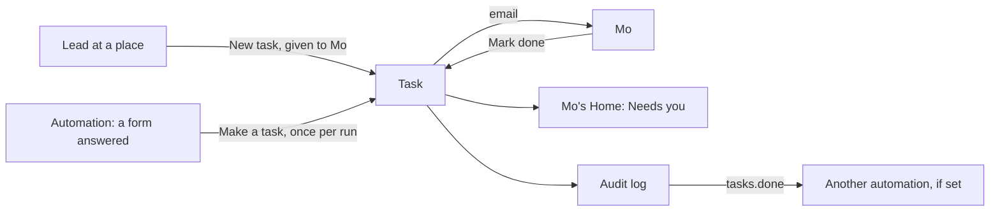

# Tasks module

> **In plain words.** A portal can now hand out work. Someone who runs a place (a branch, a
> department) makes a task such as "count the stock by Friday", gives it to a person, and that
> person gets an email, sees it at the top of Home and on their own list, and marks it done. Who
> can see and give tasks follows the roles people hold at each place, like everything else in the
> portal. An automation can make a task too: when a website form is answered, a task to call back
> lands with the right person. Every step is in the audit log. The owner asked on 2026-10-27 for
> "an auto check, auto run system" and for features that sell; giving out work and seeing it done
> is part of nearly every team's day, whatever the business.

## What changed, and why

| What | Why |
|---|---|
| `@oltrem/tasks`: a task at a place, given to one person, with a due day and notes | The portal held lists, files and answers, but not the work they lead to |
| `tasks.read` and `tasks.manage`, read at the task's place | The same place-based rules as files and forms: a lead at one branch gives out that branch's work and nobody else's |
| The person it is given to may mark it done without `tasks.manage` | A permission on the row, not only on the page: doing your own work needs no manager's rights |
| A task is given only to someone who may see it there, checked against their access at that moment | A task nobody can open is lost work |
| An email when someone else gives it | People learn of new work where they already look |
| Needs you: "N open tasks are yours", with how many are late or due today | Home answers "what do I do now" with the person's own work |
| `taskAction` in the automations module, once per run | "When X happens, make a task for Y" is the most asked-for automation after an email |
| The tasks in the portal's search | A task is found by its title like everything else |

## Before and after

Before, work was agreed outside the portal, in chats and emails, and nothing showed it was done:

After, the work is a task in the portal, made by a person or an automation:

Explanation: a task is a row of `tasks_items` at a place. Each change goes through the module's
API as the signed-in person, is checked against their roles at that place, and is audited. When
it is given to someone, their access is compiled once to make sure they can open it, and the
email goes out after the answer. Home asks the module what is the person's, as it asks every
module for Needs you.

## Impact on each part

| Part | Impact |
|---|---|
| `@oltrem/tasks` (new) | bit plane `18`, migration `0026_tasks.sql`, the `2900` error block, seven routes plus Needs you and the search, two pages |
| `@oltrem/automations` | the `taskAction` and its `TaskMaker` contract; no route or table |
| The client template | mounts the module under Work, after Files; a `tasks.message` email template; the task action beside the email and alert actions; one more table, no binding, secret or variable |
| Clients | the Tasks page from their next deploy; the Owner holds both capabilities, other roles get them from the Access page |

## How it was verified

`pnpm verify` passes. The tasks tests run inside the Workers runtime through the pipeline: who
may make and give a task at which place, the refusals and their audit rows, the email to the
person it is given to, each person's list and Needs you, who may mark it done, changes and
removal, the automations' task made once per key, and the search. The automations tests cover the
task action's fields and its run. The client template's screens journey makes a task for today,
sees it on Home, marks it done, opens it again, changes and removes it. Not checked: a phone, a
deployed portal, and a task email opened in a real mail app. Those are listed in the
[verification log](../verification-log.md).
