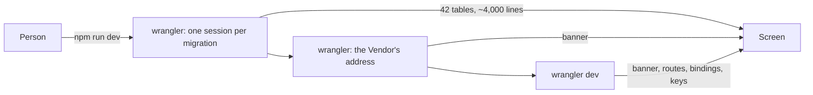
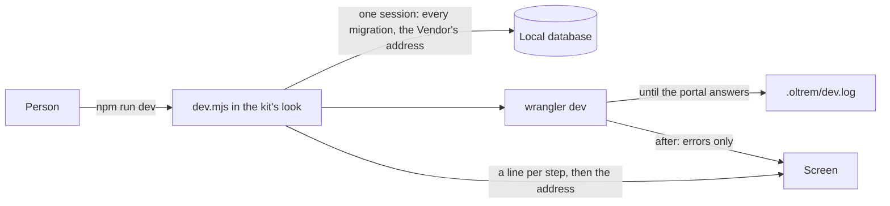

# The kit's look in a terminal

> **In plain words.** Installing the kit, starting the portal on a computer, getting the newest kit
> and putting a portal on Cloudflare used to fill the screen with other tools' output: about four
> thousand lines of database tables on a first `npm run dev`, wrangler's banners and lists, and
> forty "no release notes" lines after an upgrade. Now each command shows one short line per step
> on a rail down the left, a spinner with what it is doing and for how long, and one line saying
> what was done. The other tools' output is kept in a log file, and only its last lines are shown
> when something fails. The first `npm run dev` also starts about four times faster, and a new
> `npm run update` gets the newest kit in one command.

## What changed, and why

| What | Why |
|---|---|
| One look for every command a person runs (`packages/cli/look/`): a rail, a step, a spinner, a line done, a warning, a stop, the end | The owner found the first install and the updates hard to read; a non-technical client would too |
| The other tools' output goes to `.oltrem/<command>.log`; a failure shows its last twelve lines and the log's path | A person needs what happened, not how wrangler and pnpm report it; the detail is still there when something breaks |
| A tool that asks something, or names a link to open, is shown as it is from then on | wrangler may ask for a `workers.dev` name on a first deploy, or a link when it cannot open the browser |
| `npm run dev` applies the migrations in one database session | wrangler opens a session per migration: about 30 seconds for the forty-two the kit has; one session takes about 3 |
| `npm run update` in the kit: git pull, what is new, an install only when a package changed, the tool built | One command instead of three, and it says what changed |
| `npm install` builds the `oltrem` tool, and checks the Node version first | `npm run dev` and `npm run deploy` then start straight away, and an old Node gets a plain sentence |
| `oltrem upgrade` shows only the checks that did not pass and the packages that have notes | Forty lines saying "no release notes" hid the ones that mattered |
| Plainer symbols in the console PowerShell 5 opens by itself | Its fonts cannot draw every symbol; Windows Terminal and the others get the full set |
| A root `.npmrc`: no audit summary, funding note or update banner from npm | npm's own lines after the kit's |

## Before and after

Before, every tool printed straight to the screen:

After, the command speaks for itself and the tools write to the log:

Explanation: `dev.mjs` asks wrangler for the local database through `getPlatformProxy`, the same
files `wrangler dev` reads, and applies each migration file with its row in the migrations table
in one batch, as wrangler does, so `wrangler d1 migrations list --local` agrees afterwards. The
statements are split as wrangler splits them, a trigger's `BEGIN … END` kept whole. Should that way
fail, wrangler's own commands run instead. `wrangler dev` then starts with its log level at
`error` and without its key menu, and the command waits until the portal answers before it prints
the address. `oltrem deploy` runs its tools one after the other and cannot draw while it waits, so
a small Node process of its own (`look/run.js`) runs each long wrangler step and draws the spinner.

## Impact on each part

| Part | Impact |
|---|---|
| `@oltrem/cli` | new `look/` (exported as `@oltrem/cli/look`); `oltrem deploy` and `oltrem upgrade` print in the look; `wranglerRunner` takes a log file and shows labelled steps behind a spinner; the deploy's last line names the `workers.dev` address |
| The client template | `scripts/dev.mjs` rewritten in the look, with the one-session migrations; `.oltrem/` ignored by git |
| The kit's root | `npm run dev`, `npm run deploy` and the new `npm run update` go through `scripts/run.mjs`; `scripts/install.mjs` in the look, building the tool; `.npmrc`; `.oltrem/` ignored |
| Workflows | none: in a workflow nobody watches, so wrangler's output is printed as before |

No new dependency, variable, secret or resource.

## How it was verified

`pnpm verify` passes. Timed on a Linux container with the package store warm, so a first install on
a new Windows computer takes longer:

| Command | Before | After |
|---|---|---|
| `npm install` | pnpm's progress, npm's audit | 8 lines, 8 s |
| First `npm run dev` until the portal answers | about 4,000 lines, about 40 s | 8 lines, 9 s |
| A later `npm run dev` | about 120 lines | 7 lines, 8 s |
| `npm run update` with six new changes | three commands | 15 lines, 7 s |

The look's tests check every line it draws with and without colour, the plainer symbols, the
spinner's lines when the output is not a terminal, how far pnpm and wrangler are read from their
output, a failed tool's last lines and the log, and the process that runs a tool for a caller that
cannot wait. The template's tests split every kit migration and run it in SQLite, check the order
wrangler uses, and the one-batch-per-file apply. The deploy's tests check the labels of its long
steps and the `workers.dev` address in its last line. Not checked: a Windows computer, the console
PowerShell 5 opens by itself, and a real deploy to Cloudflare in the look.
