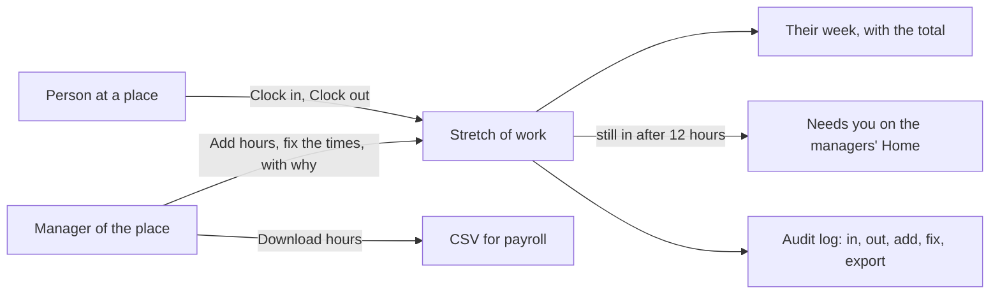

# Time clock module

> **In plain words.** A portal now keeps the hours people work. Someone starting work opens the
> portal on their phone and taps Clock in; when they stop, Clock out. Their week, with its total,
> is on the same page. The people who manage a place see everyone's hours there, add the time
> someone forgot to clock, and fix a missed clock-out, always saying why and never for themselves.
> When someone is still clocked in after twelve hours, Home tells the managers. At the end of a
> pay period, one button downloads the hours as a spreadsheet for payroll. The owner asked on
> 2026-10-27 for features that sell; paying people for the hours they worked is needed by any
> company with hourly staff, whatever the business.

## What changed, and why

| What | Why |
|---|---|
| `@oltrem/timeclock`: one stretch from clocking in to clocking out, at a place | Paper timesheets and chat messages are where hours get lost and disputed |
| `timeclock.clock` and `timeclock.manage`, read at the stretch's place | The same place-based rules as the other Work modules: a lead at one branch sees and fixes that branch's hours |
| One open stretch a person, held by the statement and a unique index | A double tap, or two phones, never starts two clocks |
| Times kept in UTC, typed and shown on the company's clock; an end before the start is the next day | Night work crosses midnight, and daylight saving must not change anyone's pay |
| Added and fixed only by another manager, with a reason, never overlapping and never ahead of now | Hours are paid: the record says who changed them and why, and nobody pays themselves |
| Needs you after 12 hours clocked in | A forgotten clock-out is the most common mistake, and it is caught the same day |
| The hours as a CSV file between two days, audited | Payroll runs in a spreadsheet or a payroll service; who downloaded which period is on record |
| The company's clock moved from `@oltrem/bookings` to `@oltrem/core-config` | Two modules need it, and a module never imports another; the template feeds both from the one time zone setting |
| The module's `personal` answer | A privacy request finds every stretch the person worked |

## Before and after

Before, hours lived outside the portal:

After, the portal holds each stretch, its fixes and the download:

Explanation: each stretch is a row of `timeclock_entries` at a place, with its start and end in
UTC. Clocking in inserts a row only when the person has no open one, and a partial unique index on
the open rows refuses the second of two taps at once. Clocking out closes the open row. A manager
types a day and two times on the company's clock, which `instant` from `@oltrem/core-config` turns
into UTC; the statement that adds or fixes a stretch refuses it when it would overlap another of the
same person. Every change goes through the module's API as the signed-in person, is checked against
their roles at that place, and is audited.

## Impact on each part

| Part | Impact |
|---|---|
| `@oltrem/timeclock` (new) | bit plane `25`, migration `0035_timeclock.sql`, error block `3500`, seven routes plus Needs you, two pages, no setting, the privacy answer |
| `@oltrem/core-config` | gains the company's clock (`wallClock`, `instant`, `nextDay`, `isTimeZone`) and its tests, moved unchanged from bookings |
| `@oltrem/bookings` | reads the clock from core-config; it no longer exports the four functions |
| The client template | mounts the module under Work, after Equipment, on the bookings' time zone setting; one more table, no binding, secret or variable |
| `@oltrem/cli` | `timeclock` is a kit module's name, so `new module` refuses it |
| Clients | the Time clock page from their next deploy, on the time zone the Owner set for bookings (UTC until set); the Owner holds both capabilities, other roles get them from the Access page |

## How it was verified

`pnpm verify` passes. The time-clock tests run inside the Workers runtime through the pipeline on
the Mexico City clock: clocked in only where the person may clock and once at a time, out once with
the note added, the person's week and the team's with the totals, Needs you after 12 hours, fixes
and additions by another manager only, with the reason, refused when overlapping or ahead of now,
an end before the start read as the next morning, the CSV with its period limit and audit row, and
the privacy answer. The clock tests passed unchanged in their new package. The client template's
screens journey clocks the Owner in and out through the page and is refused a second clock-in and
their own hours, and the query budget test holds the new page and Home within their shares. The page
was opened at 360 px in light and dark. Not checked: a phone, a deployed portal, and a second person
fixing hours through the pages (covered by the module tests). Those are listed in the
[verification log](../verification-log.md).
