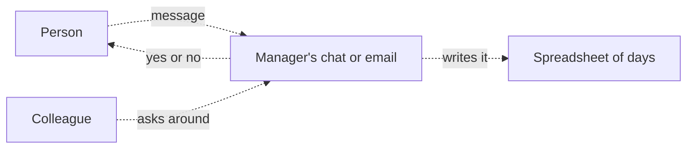
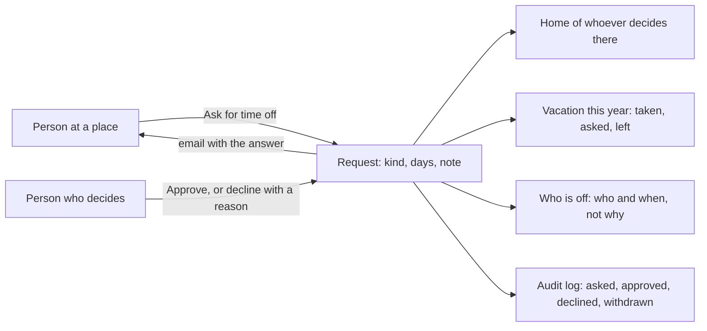

# Time off module

> **In plain words.** A portal can now handle days off. Someone asks for vacation, sick leave or
> personal time at their place, picking the first and last day. The people who decide at that place
> see it on Home, approve it, or decline it with a reason, and the person is told by email. Nobody
> approves their own. When the owner sets how many vacation days each person has a year, everyone
> sees what they took, asked for and have left, and so do the people who decide. Colleagues see
> who is off in the next two weeks and when, but never why. The owner asked on 2026-10-27 for
> features that sell; every company with staff tracks days off, whatever the business.

## What changed, and why

| What | Why |
|---|---|
| `@oltrem/timeoff`: requests for days off at a place, answered by whoever decides there | Days off were asked in a chat or an email and counted in a spreadsheet, and nobody could see who was away |
| `timeoff.ask` and `timeoff.decide`, read at the request's place | The same place-based rules as approvals and tasks: a lead at one branch answers that branch's requests |
| Nobody answers their own request; a no always has a reason; an answer is final | The same rules people trust in approvals |
| One person never has two requests waiting or approved on the same day, refused in one database statement | Two requests sent at once cannot both get through, and the days are never counted twice |
| The working days, Monday to Friday, counted when the request is made | A week off is 5 days, not 7; the count is the one the people who decide saw |
| `timeoff.days_per_year`, the vacation days a year, 0 by default | Most companies give a yearly allowance; one that does not keeps the count switched off |
| Who is off in the next 14 days, without the kind or the note to colleagues | Sick leave is private; colleagues need to know who is away, not why |
| Withdrawn by the person who asked while it waits, or once approved until its first day | A holiday that has not started can be cancelled; one that has begun stays as the record |
| The module's `personal` answer | A privacy request finds every request the person made, sick leave included |

## Before and after

Before, days off were asked and counted outside the portal:

After, the portal holds the requests, the answers and the count:

Explanation: each request is a row of `timeoff_requests` at a place, with the person who asked, the
kind, the first and last day and the working days between them. It is inserted only if the person
has no waiting or approved request on any of the same days, in the same statement, so the database
itself refuses the second of two requests sent at once. An answer changes only a request still
waiting. The vacation count adds up the person's waiting and approved vacation in a calendar year,
splitting a request across New Year between the two years. Who is off reads approved requests in
the next 14 days at the places the reader may ask or decide, and leaves out the kind, note and
reason unless the reader decides at that place. Every change goes through the module's API as the
signed-in person, is checked against their roles at that place, and is audited.

## Impact on each part

| Part | Impact |
|---|---|
| `@oltrem/timeoff` (new) | bit plane `22`, migration `0032_timeoff.sql`, error block `3200`, five routes plus Needs you, two pages, one setting, the privacy answer |
| The client template | mounts the module under Work, after Bookings, with its plain email template `timeoff.message`; one more table, no binding, secret or variable |
| `@oltrem/cli` | `timeoff` is a kit module's name, so `new module` refuses it |
| `@oltrem/privacy` | its search finds time off as one more module that declares `personal`; no change to it |
| Clients | the Time off page from their next deploy, with the vacation count off until the owner sets the days a year; the Owner holds both capabilities, other roles get them from the Access page |

## How it was verified

`pnpm verify` passes. The time-off tests run inside the Workers runtime through the pipeline: who
may ask where, the checks on the kind and days, a second request on the same day refused, what
waits for each person who decides (never their own, soonest first), Needs you, one request opened
only by the person who asked and the people who decide at its place, approved or declined once
with the emails, the vacation count before and after an answer, who is off with the kind hidden
from a colleague, withdrawn before it begins and refused once it has, refusals audited, and the
privacy answer. The day tests cover real dates only, working days from any weekday, and a request
across New Year. The client template's screens journey asks for a week off as the Owner, is
refused the same days again, finds no Approve on their own request, and withdraws it. Not checked:
a phone, a deployed portal, and a second person answering through the pages (covered by the module
tests). Those are listed in the [verification log](../verification-log.md).
