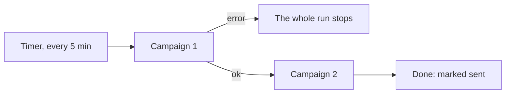
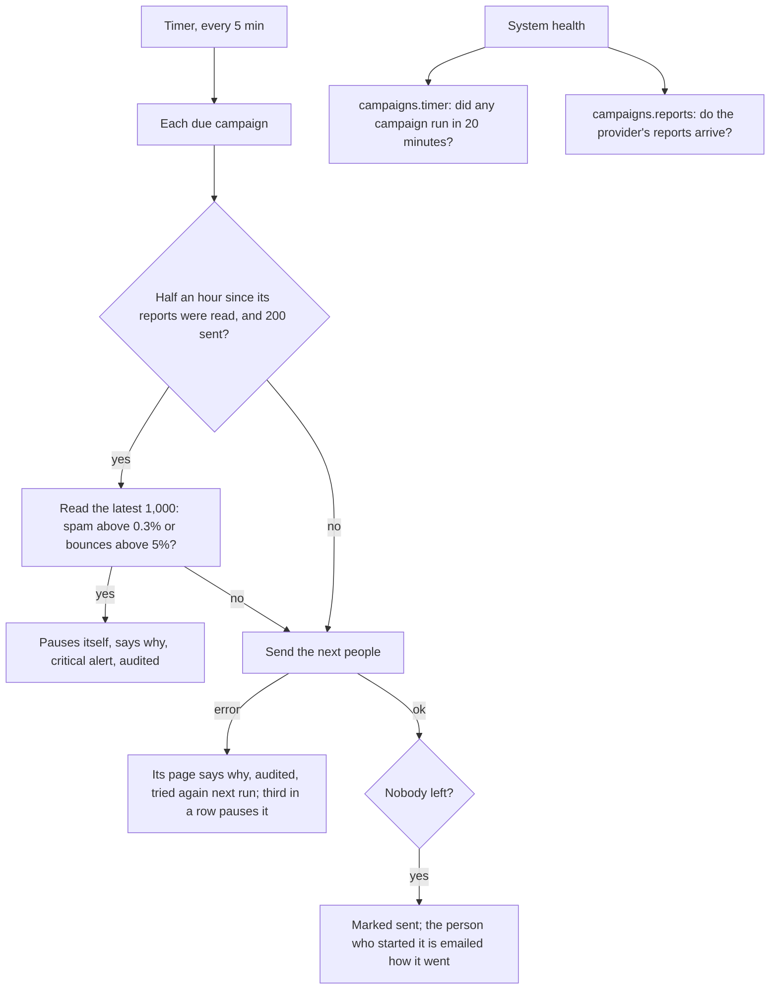

# The watch over bulk mail

> **In plain words.** A sending campaign now looks after itself, and tells people when it cannot.
> If too many of its people mark it as spam (above 0.3%, Gmail's limit) or too many addresses
> bounce for good (above 5%), it pauses itself before it harms the company's name with the
> mailbox providers, and says why. If one of its runs fails, the reason is on its page at once,
> the next run tries again, and the third failure in a row pauses it with an alert. System health
> now says when the five-minute timer stops running the campaigns, and when the email provider's
> reports stop arriving. When a campaign is done, the person who started it gets an email with how
> it went. Its page shows the results by mailbox provider (Gmail, Microsoft, Yahoo and AOL, Apple,
> the others) and has a download of every person and what became of their message. The Email
> page shows what bulk mail may still go out today. This is stage 6, the last of the bulk sending
> plan the owner asked for on 2026-10-28.

## What changed, and why

The owner asked for every part of the sending to be checked while it runs: an error shown at
once, tried again by itself when it can, and everything logged.

| What | Why |
|---|---|
| A run that throws is caught for its campaign alone: its page says why, the audit log keeps it (`campaigns.run-failed`), a warning alert is raised and the next run tries again; the third in a row pauses it with a critical alert | Before, one campaign's error stopped the whole run, so the campaigns after it waited without saying why |
| Every half hour, once 200 were sent, a sending campaign reads the reports on its latest 1,000 messages and pauses itself above 0.3% spam reports or 5% bounces for good (`campaigns.protect`, a critical alert); after a person resumes it, the same reports are not read again for a day | Gmail and Yahoo block senders above these rates; stopping early protects every later email of the company |
| `campaigns.timer` fails when campaigns are due for 20 minutes and no campaign had a run | A timer that stopped is otherwise silent |
| `campaigns.reports` warns when 20 or more messages sent half an hour to two hours ago have no report | Without the provider's webhook, bounces and spam reports never arrive, and the watch above cannot work |
| A summary email (`campaigns.summary`) to whoever started it, once, when it is done | The person who sent it knows it finished, and how |
| Results by mailbox provider, and a CSV download of every person (`campaigns.send`, audited as `campaigns.download`) | Where the problems are, and the full record for a spreadsheet |
| **Bulk mail today** and a row of the email pages on the Email page | The counters and limits the owner asked to see, where the email work starts |

## Before and after

How a campaign's run went before:

An error in one campaign stopped the others, and nothing watched the spam or bounce rates while
it sent.

How it works now:

Each campaign's problems stay its own, the sender's name is checked while it sends, and System
health watches the timer and the reports from outside the run.

## Impact on each part

| Part | Impact |
|---|---|
| `@oltrem/campaigns` | Migration `0050_campaigns_watch.sql` (additive: who started it, the latest rates reading and when the next is due, when its summary went). The run's error handling, the rates watch and the summary in `campaigns.ts`; the template `SUMMARY_TEMPLATE` (`campaigns.summary`); two routes (`GET /campaigns/:id/report`, `GET /campaigns/:id/download`); two health checks (`campaigns.timer`, `campaigns.reports`); three audit actions (`campaigns.run-failed`, `campaigns.protect`, `campaigns.download`). Its page: the rates while it sends, **By mailbox provider**, **Download the results**. |
| `@oltrem/screens` | The Email page: a row of the email pages and, with the campaigns mounted, **Bulk mail today**. |
| A client repository | One new kit migration, applied by the next `npm run deploy` before the code that needs it, and the summary template added to the email module's list. No new binding, variable, secret or setting. |

## How it was verified

The tests in the Workers runtime, with a stand-in provider: a run that throws said on the page,
tried again, paused at the third with the alerts and audit rows, then resumed and sent; a
campaign with 220 reported messages, one a spam report, paused before any call, its alert and
audit, and resumed without reading the same reports again; the summary sent once to the person
who started it; the results grouped by mailbox provider; the download refused to a writer, its
file and its audit row; the reports check ok and then warning; the timer check failing while
nothing ran and ok after a run. The client template's screens test runs the pages end to end,
and found one fault before it shipped: the results table showed too many figures on a phone card,
which the table refuses; three are shown on the card and the rest on a wider screen. Then the full
`pnpm verify`. Not verified: a real provider's reports (the sandbox accounts are the owner's step)
and the pages on a phone.
