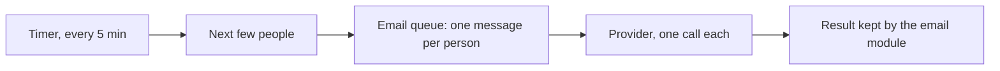
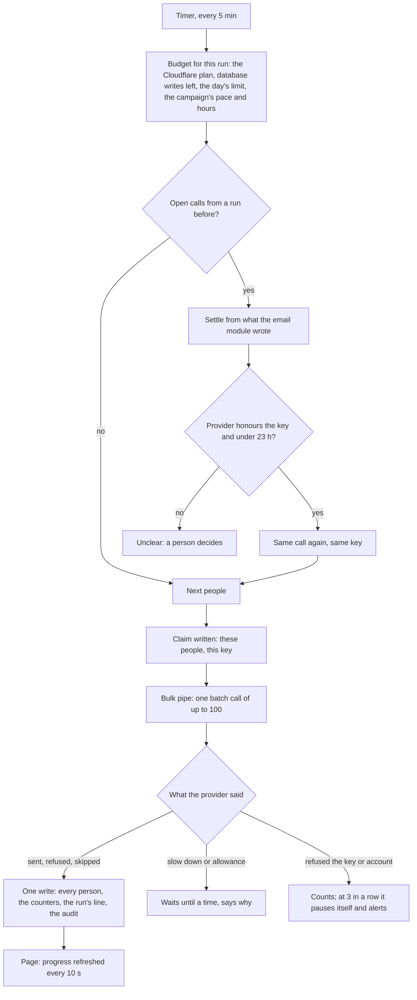

# The bulk sending engine

> **In plain words.** Campaigns now send through a new engine. Every five minutes it hands the
> next people of each campaign to the email provider in large batches, as many as the client's
> Cloudflare plan allows: the free plan or the paid one, whichever the client chose in Settings.
> Nothing is lost in silence. When the provider does not answer, the same batch is sent again
> under the same key, so nobody gets it twice. When that is not possible, those people are marked
> unclear, and a person decides what to do with them. When the provider says to slow down or that
> its allowance is used up, the campaign waits and says until when. When the provider refuses
> three runs in a row, the campaign pauses itself and raises an alert. A send to more than 1,000
> people needs a yes from a second person. A campaign can use a saved template and a saved list,
> can be given its own pace and sending hours, and can have people added or taken off while it
> runs. Its page shows the progress and refreshes it every ten seconds. This is stage 5 of the six
> stages of the bulk sending plan the owner asked for on 2026-10-28.

## What changed, and why

Before this change the timer handed a campaign's people, a few at a time, to the email module's
queue, one queue message per person. On the free plan that spends the queue's 10,000 operations a
day after about 3,000 emails, and a call that got no answer could not be told apart from one
that worked.

| What | Why |
|---|---|
| The provider is called from the timer in batch calls (100 a call for Resend), not through the queue | One call for a hundred people, and no queue operations spent per email |
| The client's Cloudflare plan is a setting, and each run is sized from it (50 messages and 40 calls a run on the free plan, 1,000 messages on Workers Paid), stopping before the day's database writes run out | The owner's ask: the kit follows the client's choice to stay free or pay for more |
| Before a call, the run writes on the campaign which people go under which key | A run that dies half way is settled at the next run from what was written, without guessing |
| No answer: the same call again under the same key while the provider honours it; otherwise the people are unclear and a person decides | Never sent twice without knowing, never dropped without saying |
| The provider's stops each hold the campaign with a reason and a time; three refusals pause it with a critical alert | A stop is visible at once, and a broken key does not keep failing in silence |
| The counters live on the campaign's row | The page's progress reads one row every ten seconds, not the whole list |
| A send over `campaigns.approval_over` (1,000) waits for a second person holding the new `campaigns.approve` | The owner's answer: large sends need two people |
| A saved template and a saved list can be picked; the template's version is fixed at the start, and a change while paused is a new version | Stages 3 and 4 are used, and every person's message can be told apart afterwards |
| Pace, daily cap and sending hours per campaign, people added and taken off while it runs | What a company running a newsletter needs day to day |
| `GET /room` and the **Room today** panel; System health's events queue check | The counters and limits the owner asked to see live |

## Before and after

How a campaign was sent before:

Each person cost queue operations, and a lost answer looked like a failure or a success depending
on when it was lost.

How it works now:

Each run knows how much it may do before it starts, writes what it is about to do, and records
everything in one batch at the end.

## Impact on each part

| Part | Impact |
|---|---|
| `@oltrem/campaigns` | Migration `0049_campaigns_engine.sql` (additive: the campaign's template, list, pace, approval, engine state and counters; when a person became unclear and the version they got). The engine in `campaigns.ts`; the capability `campaigns.approve`; the setting `campaigns.approval_over`; eight routes (`list/add`, `use-list`, `remove-people`, `pace`, `live`, `decide`, `approve`, `room`); `start` answers whether it asked for approval. Its pages: progress, approval, template and list pickers, pace with a row of days, add and take off people, the unclear decision, Room today, and the light page `/campaigns/:id/live`. |
| `@oltrem/email` | Its bulk pipe (`bulk.route`, `bulk.send`) is now called by the campaigns engine; `senders.from` answers the domain. |
| `@oltrem/providers` | A definition's `batch` block; Resend sends 100 a call under `Idempotency-Key`; `failureOf` sorts a failure. |
| `@oltrem/core-health` | The setting `health.cloudflare_plan`, each plan's limits, Workers Paid's monthly budgets, and the `health.queue` check of the events queue's backlog. |
| `@oltrem/core-jobs` | A run's query budget may come from the plan. |
| `@oltrem/core-ui`, `@oltrem/screens` | `CheckChips`, a choice of several in a sideways row; the frame script keeps `data-live` blocks up to date. |
| A client repository | One new kit migration, applied by the next `npm run deploy` before the code that needs it. The client file hands the campaigns the plan, the alerts and the time zone. No new binding, variable or secret. Owners hold `campaigns.approve`; other roles get it from the Roles page. |

## How it was verified

The tests in the Workers runtime, with a stand-in provider the tests script: approval asked,
refused with a note, withdrawn by a change, refused to the one who asked and given by someone
else; one batch call under a key written first; a call without an answer sent again under the
same key; unclear people with a provider that honours no key, and the three decisions; a run that
died half way, settled by the email module's rows, with an old claim left unclear; the allowance,
the speed and three refusals pausing the campaign, the alert resolved on resume; pace, daily cap
and sending hours, overnight and in another time zone; people added from a file and a saved list
and taken off while it runs; the run sized by database writes left and by the paid plan; a
template's version fixed at the start and a new wording version while paused. The tests found
one fault before it shipped: a person sent again in step 1 of a run was picked again in step 2;
step 2 now leaves them out. The client template's screens test runs a campaign end to end: it
waits and says why with no provider, then a Resend instance is connected (its answers stood in
for) and the run sends both people in one batch call with the unsubscribe headers. Then the full
`pnpm verify`. Not verified: a real provider (the sandbox accounts are the owner's step), a
50,000-person campaign against a deployed portal, and the pages on a phone.
