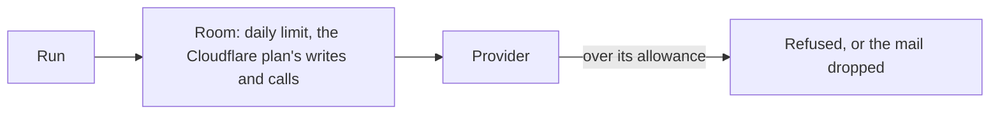
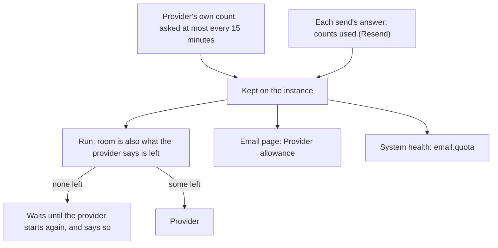

# Email allowance, and code kept once

> **In plain words.** The Email page now shows, for each email provider, how many emails it says
> are left today or this month and when that starts again, beside what the portal itself sent
> through it today, this week and this month. Bulk mail never sends more than the provider says
> is left: past it, some providers drop the mail. When none are left, the campaign waits and says
> until when. System health warns when a provider is down to its last tenth, and fails when it
> has none. In the same pass, four pieces of code that every module had its own copy of are now
> kept once, so the kit stays small as it grows.

## What changed, and why

The owner asked on 2026-10-28 for a check of the emails used and left by month, week and day,
from the providers themselves, and for the code to be kept small with shared building blocks.

| What | Why |
|---|---|
| A provider definition may name its own count of emails used and left (`usage`): Resend's `/usage`, Brevo's account, SendGrid's credits, SES's 24-hour quota. Postmark, Mailgun and SMTP have none, so they show nothing rather than a guess | The figures come from the provider, never from a guess (R-10) |
| Resend's daily and monthly counts used, on the headers of every send's answer, move the kept figures on between asks | A sending-only key cannot read Resend's `/usage` (it answers 401), but every send still reports the counts |
| The figures are asked for at most every 15 minutes and kept on the instance (migration `0051`, one column) | Every page view or run asking the provider would spend the Worker's outside calls |
| `GET /api/email/usage` and **Provider allowance** on the Email page: left, when it starts again, and the portal's own sent counts today, this week (from Monday, UTC) and this month | The provider counts days and months; the week is the portal's own count, since no provider gives one |
| The bulk engine takes the provider's `left` into its room, and holds a campaign at none until the time the provider gave | Brevo's free plan drops mail past its daily limit |
| `email.quota` in System health | A provider running out is seen before campaigns wait |
| `field`, `redirect` and `refused` for page posts (18 pages), `csvResponse` and `fileNameOf` for downloads (7 routes), `actorOf` for who a route acts as (20 modules), `route` for a typed route (24 modules), each kept once | The owner asked that the codebase not grow by much; each copy was identical |

## Before and after

Before, a campaign's room was the portal's own limits only:

The portal did not know what the provider allowed until a send was refused, and on some
providers the mail past the limit was lost.

Now the provider's own figures come in first:

## Impact on each part

| Part | Impact |
|---|---|
| `@oltrem/providers` | The `usage` block in the definition schema; `usage(opened)` on the adapter; `quota` on a send's result; `readUsage`, `quotaOf`, `withQuota`, `leftOf`; migration `0051_providers_usage.sql` (additive: one column); `registry.recordUsage` |
| `@oltrem/email` | `usage` (`fresh`, `left`, `note`, `list`); `GET /usage`; `bulk.route` answers `left`; the health check `email.quota` |
| `@oltrem/campaigns` | The room of a run is never past `left`; a campaign holds at none |
| `@oltrem/screens` | **Provider allowance** on the Email page |
| `@oltrem/core-module`, `@oltrem/iam` and 24 modules | The shared helpers; the modules import them in place of their own copies. No behaviour changes, except that the records' and forms' download names are now cut at 60 characters, as the others were |
| A client repository | One new kit migration, applied by the next `npm run deploy` before the code that needs it. No new binding, variable, secret or setting |

## How it was verified

The providers' tests with a scripted provider: Resend's `/usage` read into its day and month,
and its sending-only key refused with words; the counts on a send's headers kept over the limits
read before, and a day that started again read from the header alone; Brevo's free and paid
plans, SES's quota, SMTP with none; the tightest window, one that reset, and a day read
yesterday. The email tests in the Workers runtime: the bulk route's `left` from Resend's count,
asked once, then moved on by the batch's headers without asking again; `GET /api/email/usage`
with the portal's own counts; `email.quota` ok, warning at the last tenth and failing at none. The
campaigns test: a run handed out only the two left, then held with the provider's words until its
time. The core-module tests for the helpers, and every module's own tests after the change. Then
the full `pnpm verify`. Not verified: a real provider's answers (the sandbox accounts are the
owner's step) and the page on a phone.
