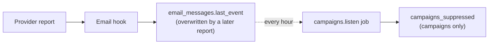
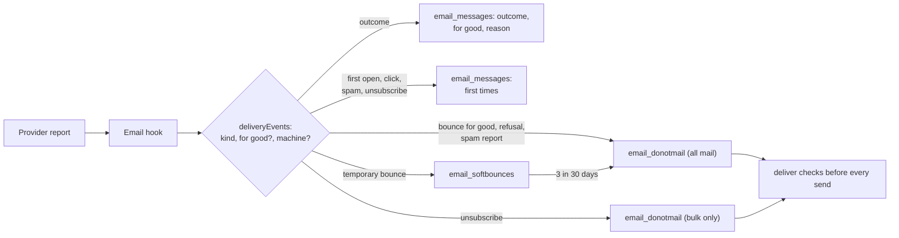

# Email statuses and the do-not-mail list

> **In plain words.** Every email the portal sends now keeps what became of it: delivered, delayed,
> bounced or refused, and whether a bounce is for good or only for now, with the provider's own
> words. It also keeps the first time a person opened it, the first time a machine did (Apple
> opens every email for privacy, so those are counted apart and never as a reader), the first
> click, a spam report and an unsubscribe. An address that bounces for good, is refused by the
> provider, reports spam, or bounces three times in a month goes on the company's do-not-mail
> list at once, and no email of any kind is sent to it again. An unsubscribe stops only bulk
> mail, so a password reset still arrives. This is the first of six stages of the bulk sending
> plan the owner asked for on 2026-10-28.

## What changed, and why

The owner asked for a bulk email service a non-technical company can trust, where every status
that can be confirmed is shown and nothing fails in silence. Before this change a message kept
only its last delivery report, so a late "delayed" could overwrite a bounce, a temporary bounce
looked like a permanent one, Apple's privacy opens counted as readers, and bounces reached the
campaigns' suppression list only once an hour, for campaign mail only.

| What | Why |
|---|---|
| A provider's event map may say a bounce or refusal is for good, or an open is a machine's; a `severity` path reads it from the report where the provider says it there | Resend, Postmark, SendGrid, Mailgun and SES each say it in their own field; Brevo says it in the event's name |
| Resend's `email.failed` and `email.suppressed`, Brevo's `unique_opened`, `proxy_open`, `unique_proxy_open`, `blocked` and `invalid_email` are now read | They were ignored, so a refused message looked sent |
| Each message keeps its outcome (with whether it is for good and the provider's words) and its first open, machine open, click, spam report and unsubscribe, in one write per report | One row per event would spend the free plan's 100,000 daily writes on a few thousand emails; the owner chose to stay on the free plan |
| An outcome for good is never replaced by a later report | A late "delayed" no longer hides a bounce |
| The do-not-mail list moved from the campaigns module to the email module, and `deliver` reads it before every send | Bounces, refusals and spam reports now protect every message the portal sends, not only campaigns, and at once rather than hourly |
| Three temporary bounces in 30 days put an address on the list | A mailbox that is full for weeks is treated as gone, as the large providers advise |
| An unsubscribe stops bulk mail only; a spam report after it widens it to every message | The person still gets the mail they need, such as a sign-in code |
| A message whose every address is barred fails at once with the reason | Never a silent skip |

## Before and after

How a delivery report was kept before:

A report changed one field, the latest event; the campaigns module read it hourly, so a bounce
from a sign-in email protected nothing and a bounced address could be mailed again in that hour.

How it is kept now:

Each report is checked as before, then turned into a kind with two flags. The message row keeps
its outcome and its first times; the do-not-mail list is written at the same moment, and every
send, bulk or everyday, reads it first.

## Impact on each part

| Part | Impact |
|---|---|
| `@oltrem/providers` | The definition contract takes object entries in the event map and a `severity` path; the seven email definitions use them. Events carry `permanent` and `automatic`. |
| `@oltrem/email` | Migration `0043_email_outcomes.sql` adds the outcome and first-time columns and the `email_donotmail` and `email_softbounces` tables. `send` takes `bulk`. A privacy request also answers the address's row on the list. |
| `@oltrem/campaigns` | Migration `0044_campaigns_donotmail.sql` copies the old suppression list into `email_donotmail`. The hourly `campaigns.listen` job is gone. The figures and the reputation check read the outcomes. `campaigns_suppressed` is no longer used; dropping it waits for the owner's yes. |
| A client repository | Two new kit migrations, applied by the next `npm run deploy` before the code that needs them. No new binding, variable or secret. |

## How it was verified

The tests of the three modules in the Workers runtime: each provider's bounces for good and for
now, Apple's opens, Resend's refusals; the outcome kept against a later report; the first times
kept against repeats; the list from a bounce, a refusal, a spam report and three temporary
bounces; an unsubscribe widened by a spam report; a send to a barred address failing with its
reason and a send to some barred addresses reaching the rest; bulk and everyday mail told apart;
the campaign figures and the copied list. Then the full `pnpm verify`. Not verified: real
reports from Resend and Brevo, which need the sandbox's test accounts (after stage 5).
