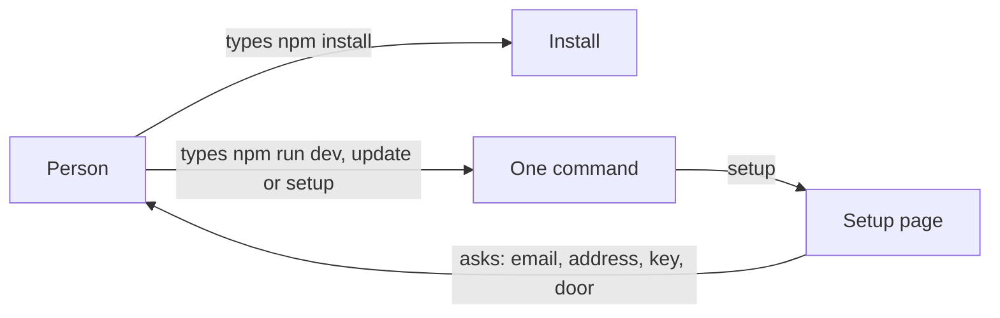
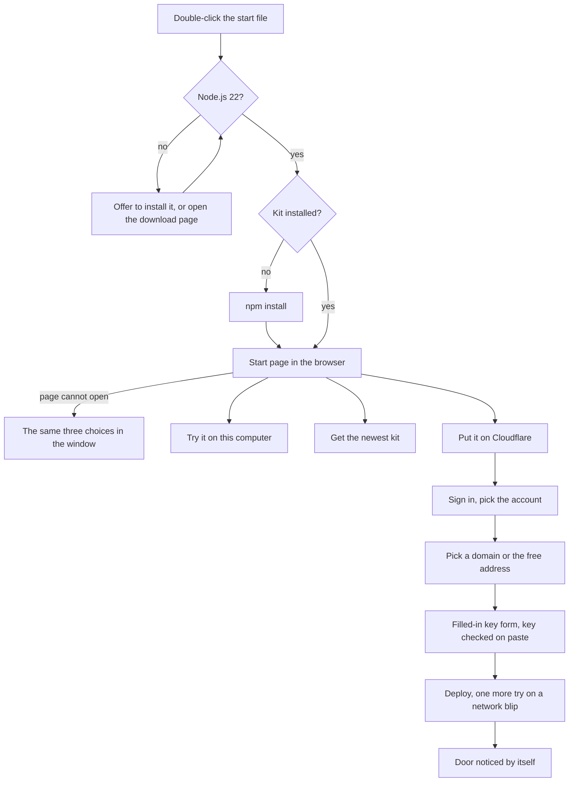

# One-click setup

> **In plain words.** The kit now has one file to double-click on each kind of computer:
> `start-windows.cmd`, `start-mac.command` and `start-linux.sh`. It finds Node.js (and offers to
> install it), installs the kit the first time, then opens a start page in the browser with three
> big choices: try the portal on this computer, get the newest kit, or put it on Cloudflare. Putting
> it on Cloudflare now asks less: after the sign-in it lists your Cloudflare accounts and your
> domains to pick from, opens Cloudflare's key form already filled in, checks the key the moment it
> is pasted, and notices by itself when the door is on. Every step has a way out: a choice asked
> again, one more try when Cloudflare does not answer for a moment, and the same questions in the
> window when the page cannot open.

## What changed, and why

The owner asked for one click on every system, a page for the choices, the sign-in in the same
browser, as much read from Cloudflare as possible, and a fallback at every step.

| What | Why |
|---|---|
| `start-windows.cmd`, `start-mac.command`, `start-linux.sh` at the kit's root (the last two through `scripts/launch.sh`) | One double-click on any system, instead of a terminal and two commands |
| Each file checks for Node.js 22, offers winget (Windows) or Homebrew (Mac) to install it, and otherwise opens the download page | The first thing a new computer is missing is Node.js |
| `npm start` (`scripts/run.mjs start`): the start page with three choices, each run in a second process shown in the page and the window | The person picks with the mouse; nothing to type |
| The kit's look sends its lines as page events when a page started it | `npm run dev` and `npm run update` show in the page with no change of their own |
| The account picked from the sign-in's accounts, passed to wrangler for the run | Before, a sign-in that reached several accounts stopped in the page: wrangler cannot ask without a keyboard |
| The account's domains offered as choices, the name before it defaulting to `portal` | The address no longer has to be typed |
| Cloudflare's token form opened filled in; the key checked on paste and asked again up to three times | A wrong or short key used to fail only at the deploy |
| The door checked from outside every few seconds | The step ends by itself once Access answers in front of the portal |
| One more try for the migrations and the deploy after a passing network error | A reset connection should not stop a first deploy |
| A free port when 8787 is taken; **Stop it** in the page | A second portal, or another program, used to stop `npm run dev` |
| The terminal takes over when the page cannot start or is never opened | The page is the easy way, never the only one |

## Before and after

Before, one command per job, typed in a terminal, and the deploy asked everything:

After, one file opens a start page; the deploy reads what it can from Cloudflare:

Explanation: the start file only prepares the computer and hands over to `npm start`. The start
page's server runs each choice as a second Node process with an IPC channel, as the setup page
already did for the deploy; the kit's look, seeing the channel and `OLTREM_PAGE`, sends each line
as an event, so the page shows `npm run dev` and `npm run update` as it shows the deploy. The
deploy reads the accounts with `wrangler whoami --json`, the domains with the sign-in's own token
(`wrangler auth token`) from Cloudflare's zones list, checks a pasted key with Cloudflare's token
check and a one-row D1 call, and looks at the portal's address for a redirect to the Access
sign-in. Whatever cannot be read leaves the step as it was: a typed address, a key used as pasted,
the door's button.

## Impact on each part

| Part | Impact |
|---|---|
| `@oltrem/cli` | new `src/cloudflare.ts`; `oltrem deploy` reads the accounts, domains, key and door, and retries a long step once; the page and its server gain choices, the start page, **Stop it**, **Paste** and **Back to the start**; the look sends page events |
| The kit's root | the three start files and `scripts/launch.sh`; `npm start` |
| The client template | `npm run dev` moves to the next free port and stops when the page asks; its README says what `npm run deploy` now asks |
| Workflows | none: they run `oltrem release`, which asks nothing |

No new dependency, variable, secret or resource. The account picked lives only in the run
(`CLOUDFLARE_ACCOUNT_ID` for wrangler), never in a file (R-04).

## How it was verified

`pnpm verify` passes. New tests: the look's lines as events, a task ending once; a choice and a
question that answers itself on the deploy's side; the start page's server (its choices, one run at
a time, **Stop it** only for a stoppable run, back to the start, a question answered by itself);
a forked script stopping when asked over IPC; the page's script parsing; reading the accounts,
the sign-in token, the domains, a key in its four states, the door, and the one more try; the
deploy picking among several accounts, offering domains, asking a key again until it works,
refusing a key without D1, and skipping a door already on; the next free port; the start files
executable in git, parsing, checking Node 22, installing only the first time, and using no
`goto` (cmd.exe misreads one in a file with LF endings); the terminal's menu by number.

By hand on a Linux container: the start page in a headless browser at 390 px (the three choices,
`dev` with a port taken, **Stop it**, back to the start) and 1000 px (a deploy picking an account,
a domain, the key box with **Paste**, the door checking by itself).

Not checked: the start files on a real Windows, Mac or Linux desktop (double-click, winget,
Homebrew), a real deploy through the page, the domains and the key check against a real
Cloudflare account, and the door noticed on a real Access sign-in.
