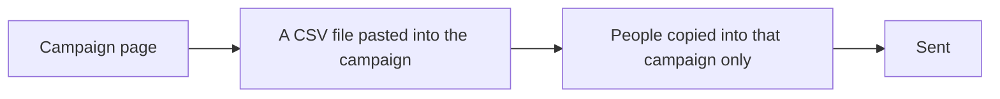
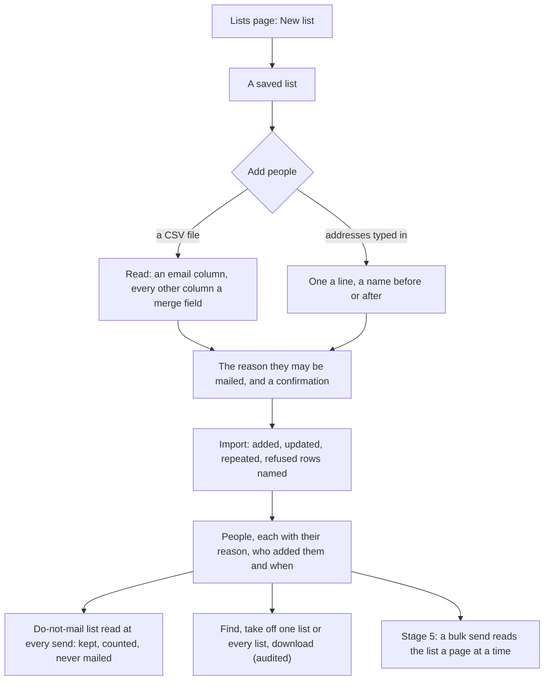

# Saved email lists

> **In plain words.** The company can now keep the lists of people it sends bulk mail to in the
> portal. A list is filled from a spreadsheet file or from addresses typed in, and every time the
> person adding people says why these people may be mailed: they asked, they are customers, or
> another reason written down. The portal says exactly what happened to each import: how many
> were added, updated, repeated or refused, and which rows were refused. People on the
> do-not-mail list stay on the list but are never mailed, and the list shows how many they are.
> One person can be found and taken off, or taken off every list when they ask to be forgotten.
> A list can be downloaded by someone allowed to, and that download is recorded. This is the
> fourth of the six stages of the bulk sending plan the owner asked for on 2026-10-28.

## What changed, and why

Before this change a campaign carried its own copy of the people it went to, pasted in as a
file each time. Nothing kept a list to send to again, and nothing kept why each person could be
mailed.

| What | Why |
|---|---|
| Lists kept in D1, one row per person, without a second index | An import of N people writes N rows, which keeps a large list inside the free plan's daily writes |
| The reason to mail asked at every import, with a confirmation, and kept on each person | Bulk mail needs a lawful reason; asking every time means it is never assumed, and each person can show theirs |
| An import's result counted and the refused rows named | Nothing is dropped in silence |
| The do-not-mail list read at the send, not copied into the list | A person who unsubscribes after the import is still never mailed |
| Counts kept on the list, recounted at most every fifteen minutes | The page of lists reads one row a list rather than every person |
| Taking an address off every list at once, answered in a privacy request | A person who asks to be forgotten is forgotten everywhere in one step |
| Downloading behind its own capability and a fresh sign-in, audited | A list of people is personal data |
| Three capabilities, held at the company | Seeing, changing and taking a copy away are different trust |

## Before and after

How a bulk send found its people before:

The people lived only inside their campaign, with no reason kept for mailing them.

How it works now:

A list is filled once, with its reason, and kept; stage 5 lets a bulk send pick it.

## Impact on each part

| Part | Impact |
|---|---|
| `@oltrem/email` | Migration `0048_email_lists.sql` adds `email_lists` and `email_list_members`. Three capabilities: `email.lists.read`, `email.lists.write`, `email.lists.export` (fresh sign-in). Ten routes under `/api/email/lists`, the pages Messages, Lists and a list's own page, and `createEmail(...).lists` for a send. New error `KIT-E-1510`. A privacy request now finds the lists an address is on. |
| `@oltrem/campaigns` | Nothing it does changed. |
| `@oltrem/screens` | The stylesheet rebuilt for the new pages' classes. |
| A client repository | One new kit migration, applied by the next `npm run deploy` before the code that needs it. No new binding, variable or secret. Owners hold the new capabilities; other roles get them from the Roles page. |

## How it was verified

The tests in the Workers runtime: who may read, change and download; a list made, renamed and
its name refused when empty; a CSV import adding, updating and counting repeats and refused rows
by number; the reason required and its note for `other`; replace against add; addresses typed
with names before and after; the 50,000 cap; people on the do-not-mail list counted and shown;
finding by address and by name, and paging; one person taken off, an address taken off every
list and found by a privacy request; archive, restore and delete; the download's columns and its
audit row; the people handed to a send in address order. The client template's screens make a
list, type in addresses with the confirmation, and open it. Then the full `pnpm verify`. Not
verified: a 50,000-person import against a deployed portal's D1 (its time and rows written);
the pages on a phone.
