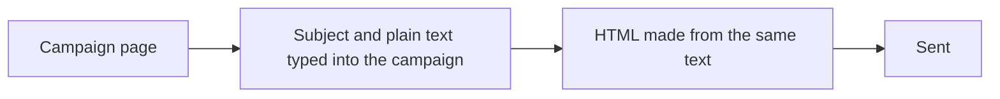
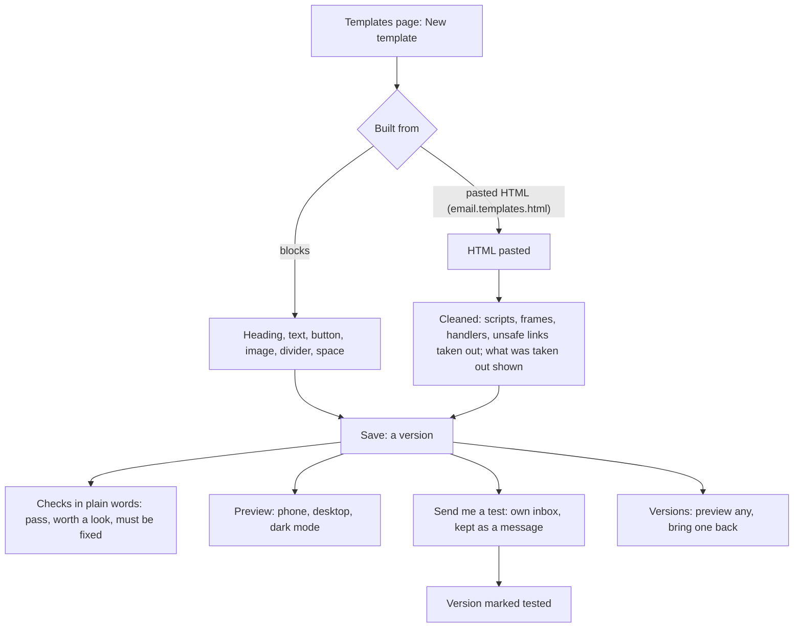

# Saved email templates

> **In plain words.** The company can now keep its email designs in the portal. Anyone allowed
> builds one from blocks on a phone: a heading, text, a button, an image, a divider, a space,
> with the person's name filled in where it is written as `{{first_name}}`. Someone trusted
> with more may paste a design made elsewhere as HTML; the portal cleans it first, taking out
> anything that could run code or load another page, and says exactly what it took out. Every
> template checks itself as it is saved and says in plain words what must be fixed (an empty
> subject, a button that leads nowhere, a message too big for Gmail) and what is worth a look.
> It can be previewed as a phone, a desktop and a mail app in dark mode show it, sent as a test
> to oneself, and every saved version can be brought back. This is the third of the six stages
> of the bulk sending plan the owner asked for on 2026-10-28.

## What changed, and why

The owner asked for templates saved in the database, with blocks for everyone and HTML for the
people allowed to paste it (his answer of 2026-10-28). Before this change a campaign's message
was plain text typed into the campaign itself, and nothing kept a design to use again.

| What | Why |
|---|---|
| Blocks put together as table HTML with a dark-mode palette and a plain-text copy | Mail apps read tables reliably; dark mode is how many people read mail; the text part helps delivery and screen readers |
| Pasted HTML cleaned by HTMLRewriter before it is saved, and what was taken out kept on the template | A pasted design can hide a script or a tracking form; the person is told what changed, so nothing changes in silence |
| Checks on every view, `pass`, `warn` or `fail`, in plain words | A problem shows the moment it is made, not after a send; a template with a failing line will not be sent to many people (stage 5) |
| A version per save, folded together while one person is still at it; an older version brought back | History that is useful rather than one row per button press; nothing is lost |
| A save over a newer version refused (`KIT-E-1509`) | Two people editing at once never undo each other's work |
| The preview as its own page under a policy that runs nothing, framed with `sandbox` | A pasted design is shown safely inside the portal |
| The test sent at once, kept as a message, its version marked tested | The person sees the real thing in their own inbox; a refusal is the answer on the page and in the message list |
| Three capabilities, held at the company | Reading, building and pasting HTML are different trust |
| The CSV reading and merge fields moved from campaigns to email | Saved templates and the saved lists of stage 4 fill people in the same way |

## Before and after

How a bulk message was written before:

A design lived only inside its campaign, as plain text, and had to be typed again next time.

How it works now:

A template is built once and kept, checked at every save, and shown exactly as a mail app will
show it. Stage 5 lets a bulk send pick it.

## Impact on each part

| Part | Impact |
|---|---|
| `@oltrem/email` | Migration `0047_email_templates.sql` adds `email_templates` and `email_template_versions`. Three capabilities: `email.templates.read`, `email.templates.write`, `email.templates.html`. Nine routes under `/api/email/templates`, the page Messages, Templates, and `createEmail(...).templates` for a send. New error `KIT-E-1509`. `readList` and `merge` now live here. |
| `@oltrem/campaigns` | Reads its list and merge fields from `@oltrem/email`; nothing it does changed. |
| `@oltrem/screens` | The stylesheet rebuilt for the new page's classes. |
| A client repository | One new kit migration, applied by the next `npm run deploy` before the code that needs it. The template's preview shows the campaigns' footer setting. No new binding, variable or secret. Owners hold the new capabilities; other roles get them from the Roles page. |

## How it was verified

The tests in the Workers runtime: the design (values escaped, merge fields and their fallbacks,
https links only, the footer and its unsubscribe link, the plain text, pasted HTML with an
escaped value); the checks (what passes, what must be fixed, the Gmail size); the cleaning of a
hostile paste (scripts, a refresh, handlers, a frame, unsafe links and images, an unknown tag,
risky styles, comments) and the words it reports; who may read, build and paste; versions folded
within ten minutes and new after, or by another person; a save over a newer version refused; a
block that does not exist named by its number; the preview's headers and its older version; a
test sent through a scripted Brevo and kept as a message, marking the version, and a refused
test kept as failed and audited as refused; revert, copy, archive and restore with their audit;
the client template's screens building a template from blocks, adding a button, previewing it in
dark mode and reading its versions. Then the full `pnpm verify`. Not verified: a real test sent
through Resend or Brevo (after stage 5, on the sandbox's test accounts); how real mail apps show
the design; the page on a phone.
