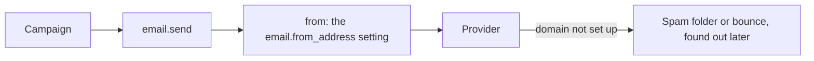
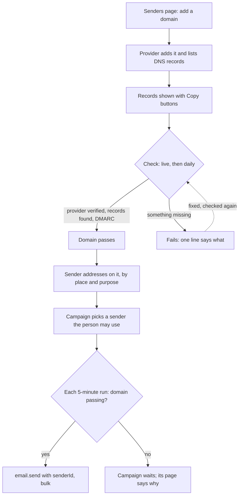

# Sender addresses and sending domains

> **In plain words.** A company can now add its own email domain to the portal, and the portal
> sets it up with Resend or Brevo for it and lists the DNS records to add, each with a Copy
> button. The portal then checks the domain, live and once a day, and says in plain words what
> it found: whether the provider has verified it, whether each record is in place, and whether
> the domain has the DMARC record that Gmail, Yahoo and Microsoft require before they accept
> bulk mail. On that domain the company adds the addresses its mail comes from, such as
> news@ or hello@, says what each is for (bulk mail, everyday mail or both), and who may send
> from each. A campaign now picks its sender from the addresses the person may use, and sends
> only from a domain that passes its check; if the domain stops passing, the campaign waits and
> its page says why, rather than sending mail that would land in spam. This is the second of the
> six stages of the bulk sending plan the owner asked for on 2026-10-28.

## What changed, and why

The owner asked which address bulk mail is sent from to be chosen, by permission, with default
addresses per domain. Before this change every message came from the one address in the
portal's settings, nobody checked that its domain was set up to send, and a domain that broke
went unnoticed until the mail bounced or went to spam.

| What | Why |
|---|---|
| A provider definition may carry a `domains` block: how to add a domain, read it and ask the provider to look again, and where its verified flag and DNS records are | The provider is where a domain is verified; written as data like the rest of a definition, so a new provider needs no code. Resend and Brevo carry one |
| The portal adds a domain through the provider and shows its records with Copy buttons | Typing a DKIM key by hand from a phone fails; a staff member who is not technical copies and pastes |
| The check reads the provider and public DNS and writes one line per finding, in plain words | No silent failure: each record found or missing, and what to do |
| DMARC is required, and two SPF records fail the check | Gmail, Yahoo and Microsoft refuse bulk mail without DMARC; two SPF records break SPF for every receiver |
| A provider or DNS that does not answer leaves the state as it was and says so | An outage on their side is not a broken domain |
| A key that may only send (Resend refuses it domain calls) is met with a manual confirmation | The portal says why it cannot ask, and the person's confirmation is audited |
| Sender addresses belong to a place of the company, with a purpose and defaults per domain | Who may send from which address is a permission, like everything else in the portal |
| A campaign picks its sender; it starts and sends only from a passing domain, and waits while its domain fails | Mail from a domain that does not pass goes to spam or bounces, and hurts the company's reputation |
| The daily check runs four domains an hour | The free plan allows about fifty outside calls per run; each domain takes a few |

## Before and after

How a message found its sender before:

Every message came from the one address in the settings. Nothing checked its domain.

How it works now:

A domain is added once and checked from then on. Only addresses on a passing domain are offered
for bulk mail, and the campaign checks again at every run, so a domain that breaks later stops
the campaign rather than its mail.

## Impact on each part

| Part | Impact |
|---|---|
| `@oltrem/providers` | The definition contract takes a `domains` block; Resend's and Brevo's definitions carry one. `createDomainClient` speaks it. New error `KIT-E-1410`. |
| `@oltrem/email` | Migration `0045_email_senders.sql` adds `email_domains` and `email_senders`. Two capabilities: `email.senders.use` (send from an address) and `email.senders.manage` (domains and addresses, with a fresh sign-in). Twelve routes, the hourly job `email.domains`, the health check `email.domains`, and the page Messages, Senders. `send` takes `senderId`. New errors `KIT-E-1506` to `1508`. |
| `@oltrem/campaigns` | Migration `0046_campaigns_sender.sql` adds the campaign's sender. A campaign needs a sender on a passing domain to start, may change it until it is sent, and waits while its domain fails. |
| `@oltrem/screens` | The frame script copies a value when a button with `data-copy` is pressed, and says "Copied". |
| A client repository | Two new kit migrations, applied by the next `npm run deploy` before the code that needs them. No new binding, variable or secret. A campaign that was sending when the update lands waits until someone picks its sender. |

## How it was verified

The tests in the Workers runtime: the domain client against Resend's and Brevo's documented
answers (adding, reading by id or by name, a domain already there, a refusal with the key
blanked, a definition without domain calls); the senders against a scripted provider and a DNS
zone (adding through Brevo, the check lines, a passing domain and its audit, two SPF records,
DNS down, Resend's sending-only key and the confirmation, the hourly recheck and the health
warning, the rules of addresses and defaults, permissions by place, a send from a sender and a
refusal); the campaigns' sender (picked, refused to one who may not use it, a start refused to
one who may not use it, a campaign waiting while its domain fails); the client template's
screens: a sender added on the Senders page and picked on the campaign page before it sends.
Then the full `pnpm verify`. Not verified: real calls to Resend and Brevo, which need the
sandbox's test accounts (after stage 5); the page on a phone.
