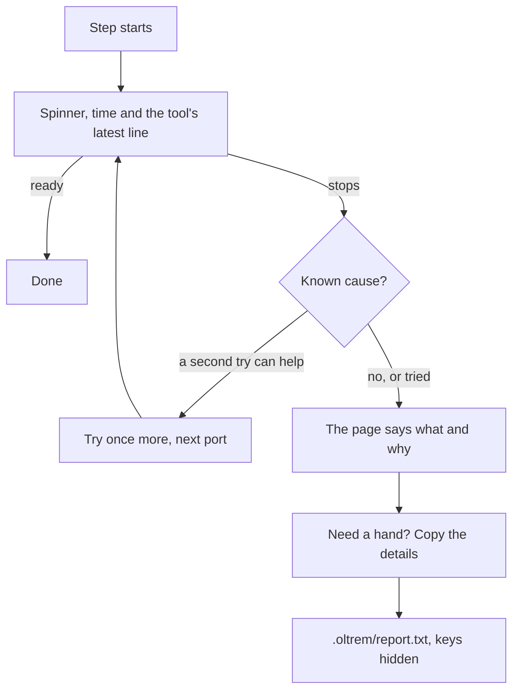

# Setup that explains, repairs and hands over its details

> **In plain words.** On the owner's Windows computer, "Try it on this computer" first span for
> ten minutes, then stopped with a line that said nothing useful. Now every running step shows
> what its tool is saying at that moment; the start page puts the kit's packages right by itself;
> the portal on this computer finds where wrangler says it is ready, recognises the usual
> problems and tries once more when that can help. When something still stops, the page explains
> it and offers **Copy the details**: everything needed to help, with keys hidden, ready to paste.

## What changed, and why

The owner asked that each step give information, fix itself, retry, and when it fails, give
details and logs that can be copied and pasted for help.

| What | Why |
|---|---|
| A running step shows its tool's latest line (`progress` events from the look) | A spinner with only a time said nothing for ten minutes |
| **Copy the details** on any stop, the same text in `.oltrem/report.txt`, keys hidden | Getting help needed the logs, which sat in hidden folders |
| `npm run dev` reads wrangler's "Ready on" address, starts wrangler without a keyboard, recognises seven known problems and tries once more when a second try helps | The start waited on the wrong address and could not say why wrangler stopped |
| Stopping ends wrangler's whole process tree (`taskkill /T` on Windows) | A plain kill on Windows leaves wrangler's runtime holding the port |
| The start page installs the packages when missing or older than the lockfile, twice if needed | A pull outside **Get the newest kit** left old packages behind |
| The start files point at `.oltrem/report.txt` and `.oltrem/start.log` when they stop | The window should say where the details are, too |

## Before and after

Before, a step that waited showed only its time, and a stop showed one line:

After, a step says what its tool says, repairs what it can, and hands over its details:

Explanation: the page's server keeps every event of a run. When a run ends with a problem it turns
them into plain text, adds the computer, the kit's commit, the last lines of the run's logs, hides
anything shaped like a key, writes the file and tells the page, which shows the copy box. The
portal on this computer runs wrangler with its information lines into the log, shows the latest
one, and decides from what wrangler printed whether a second try is worth it.

## Impact on each part

| Part | Impact |
|---|---|
| `@oltrem/cli` | the look sends task progress and exports `stopTree`; the page server writes and serves a run's details (`reportText`, `redact`, `reportFile`, `/report`); the page shows progress and the copy box; `oltrem deploy --page` names its logs |
| The kit's root | `npm start` repairs the packages first and passes each choice's logs; `npm install` and `npm run update` note the lockfile they installed; the start files name the details file |
| The client template | `npm run dev` as described above |
| Workflows | none |

No new dependency, variable, secret or resource.

## How it was verified

`pnpm verify` passes. New tests: progress events on change, a few times a second at most;
`redact` hiding keys and a sign-in query while keeping an error and a path; `reportText` with the
computer, the about lines, every shown line, a task's last progress only, a key answer hidden, the
last lines of a log and a missing one; the server writing the file, naming it and serving it only
with the key; wrangler's ready address, its last line worth showing with the routine notices left
out, and the causes it recognises; the packages found missing, out of date and up to date.

By hand on a Linux container: the real `npm run dev` started from the page in 5 s with its
progress lines, stopped over IPC; a run made to stop, in a headless browser at 1000 px, showing the
stop, the copy box and the details selected when the browser refused the clipboard.

Not checked: the owner's Windows computer, where the first stop happened, and whose cause the
details from the next run will show.
