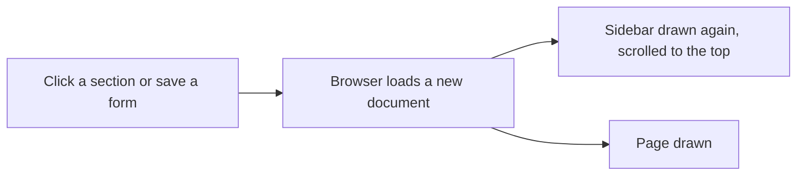
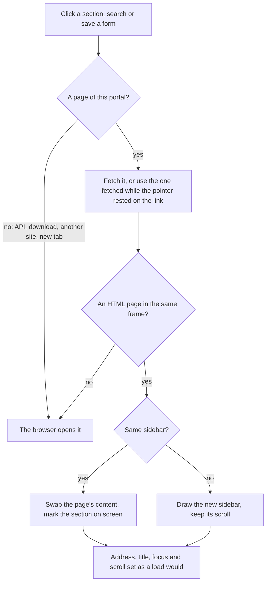

# A sidebar without reloads

> **In plain words.** The portal no longer reloads the whole screen when someone opens a section
> or saves a form. Only the page's content changes; the sidebar stays where it was, scrolled where
> it was. The sidebar closes to a narrow rail of icons with the arrow at its top and remembers
> that choice. It is more compact, each group of sections has its own colour, the scrollbar is a
> thin line that shows only under the pointer, and the account at its foot is one row that opens
> a small menu. The long Work group became three: Work, Team and Sales.

## What changed, and why

The owner showed the sidebar on a computer and asked for the same feel as the first client's
admin portal, which was studied for what it does, not copied (R-03): a sidebar that never
refreshes or loses its scroll when anything is done, that closes and opens smoothly, and looks
compact and clean.

| What | Why |
|---|---|
| A script, `/ui/app.js`, opens a page, a search, a filter or a form's change in place: it fetches the next page and swaps only `main.ui-page` | Every click used to reload the whole document, so the sidebar was drawn again from the top |
| The section on screen is marked by copying the new page's marks; a changed sidebar (another section given or taken) is drawn again with its scroll kept | The sidebar stays true without being rebuilt on every page |
| Back and Forward return to where the page was scrolled; a change that returns to the same page keeps its scroll and shows its outcome | The page behaves as a load would, minus the jump |
| The arrow closes the sidebar to a 64 px rail; names show beside the rail on hover or focus; `POST /ui/side` keeps the choice in the `oltrem_side` cookie | The owner asked for collapse and expand; the server draws the next page the same, so nothing jumps |
| 36 px rows, plain icons in their group's colour (eight `--ui-hue-*` tokens, each checked at 3:1 in both themes), a dot before each group's name, the current section tinted with a marker and bold words | The old tiles were all one green down a 16-entry group: a wall |
| The thin scrollbar shows only under the pointer | The old one was the system's full scrollbar with arrows |
| The account is one row; pressed, a menu with My access, the theme and Sign out opens above it | The old foot took three rows |
| Work split into Work, Team and Sales, in a fixed order whichever order the modules are listed in | The owner's choice on the card of 2026-10-28; "Money" was turned down as a name |
| The theme switch acts at once and saves behind the scenes | It used to reload the page |

## Before and after

Before, every click loaded a whole new document:

After, the script fetches the page and swaps only its content:

Explanation: the server still draws every page whole, so a page opened directly, or with no
script, is the same page. The script only changes how the browser moves between them. The frame
carries a short key (`data-frame`) made from the sections and the account it shows; the script
compares it to decide whether the sidebar can stay as it is.

## Impact on each part

| Part | Impact |
|---|---|
| `@oltrem/screens` | the new frame (`src/layout.tsx`), its script (`src/client/frame.js`, copied by `pnpm ui:build` into `src/generated/app-js.ts`), `/ui/app.js` and `POST /ui/side`; the speculation rules are gone (the script fetches ahead itself); group order and colours replace the tones |
| `@oltrem/core-ui` | eight group colours, the frame's classes, `Done` marked for the script |
| The modules | Time clock, Shifts, Time off, Expenses and Equipment moved to Team; Quotes and Invoices to Sales |
| The client template | nothing to change; its tests now cover the sidebar cookie and the script |

No new dependency, variable, secret or resource.

## How it was verified

`pnpm verify` passes. New tests: each group colour at 3:1 on the page and the surface in both
themes; the script parses and leaves the API, hooks, `/ui/*`, the local door and invitations to
the browser; the generated script matches its source; the frame loads the script, carries its key
and draws the sidebar closed from the cookie; the groups keep the kit's order when a module adds
one; `POST /ui/side` sets and clears the cookie and returns to the page; `/ui/app.js` is served.

By hand in headless Chromium against `npm run dev`: a section opened from the bottom of the
scrolled sidebar with no document request and the scroll kept (841 px before and after); Back
marking Home again; the rail closed, its label beside an icon, the choice kept after a reload; the
account menu open and closed beside the rail; the theme switched with no reload; a search and the
company form sent in place; the phone's menu at 390 px closing as a section opens; light and dark.

Not checked: Safari and Firefox, a real phone, a deployed portal behind Access (an expired sign-in
answering a fetch), and every module's own forms one by one (they share the one path tested here).
