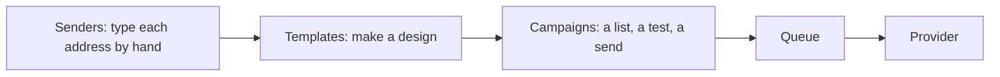
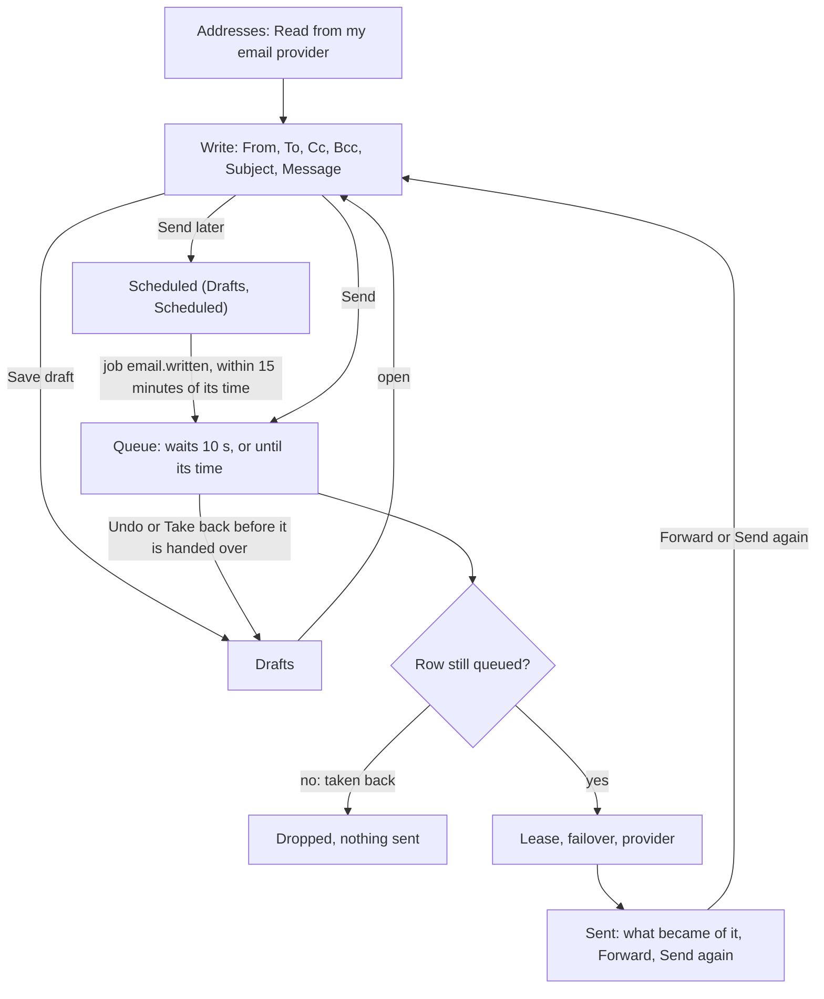

# Writing email like a mail app

> **In plain words.** The owner found the email pages confusing and asked for something that
> works like Gmail: a place to simply write and send an email, with the company's addresses read
> from the email provider instead of typed in. The portal now has a Write page: pick the address
> it comes from, type who it goes to (with Cc and Bcc), a subject and the message, and send. A
> sent email waits ten seconds so Undo can take it back. An email can be saved as a draft and
> finished later, or scheduled for a day and a time. A Sent page lists what went out and what
> became of each (delivered, opened, bounced and so on); one opens with its timeline, Forward and
> Send again. The addresses and domains the email account
> already has are read from the provider with one button. The sidebar splits mail into
> **Messages** (Write, Drafts, Sent, Email, Campaigns) and **Mail settings** (Providers, Addresses,
> Templates, Lists). Replies still go to the address's own mailbox: the owner chose no inbox in
> the portal for now.

## What changed, and why

| What | Why |
|---|---|
| Read from my email provider (Mail settings, Addresses): the domains and sender addresses the account already has are added, each domain with its check | Typing them by hand was the confusing step; eight providers list them (Resend, Brevo, Postmark, SendGrid, Mailgun, Amazon SES, Mailjet, SMTP2GO) |
| A Write page: From, To, Cc and Bcc, Subject, Message | Sending one email needed a template and a campaign before; a person can now just write |
| Cc and Bcc carried by every provider that takes them; Sender, which takes one recipient, refuses copies so the next provider sends | One message, the same everywhere; a provider that cannot is skipped, never half-sent |
| Bold, italic, lists and links typed as plain marks, sent as a plain letter | A personal email should look like one, not like a designed newsletter |
| Undo for ten seconds after Send | The most common mistake is noticed just after pressing Send |
| Drafts and Send later, kept per person, on the company's clock | What a mail app has; the company's clock, not the server's, says when "9:00" is |
| A Sent page with what became of each email, its timeline, Forward and Send again | A person sees their own mail, not the whole company's message log |
| Messages and Mail settings in the sidebar | Sending and setting up are different jobs; the first is used every day |
| No inbox | The owner's choice (C): replies reach the address's normal mailbox |

## Before and after

Sending one email before:

Sending one email now:

The email's row moves from `queued` to `sent` in one guarded update when the queue hands it over,
and Undo moves it from `queued` to `draft` the same way, so exactly one of them wins.

## Impact on each part

| Part | Impact |
|---|---|
| `@oltrem/providers` | Each email definition may list what the account sends from (`transport.identities`); `cc` and `bcc` on a message, checked, and written into every provider's request; SMTP sends copies as recipients and never writes a `Bcc` header |
| `@oltrem/core-outbox` | `enqueue(event, { delaySeconds })`: the queue's own wait, at most twelve hours, on the first send |
| `@oltrem/email` | `POST /domains/discover`; the Write, Drafts and Sent pages and a sent email's page; routes `GET /write`, `POST /write`, `/written` and its undo and delete; migration `0052_email_written.sql`; the job `email.written`; the built-in template `email.written`; error `KIT-E-1511`; a privacy request lists the emails written to an address; `createEmail` takes an optional `timeZone` |
| `@oltrem/screens` and `@oltrem/core-module` | A page may sit `before` another in its group; the group Mail settings |
| A client repository | One new kit migration, applied by the next `npm run deploy` before the code that needs it. The template passes the bookings time zone to email. No new binding, variable or secret |

## How it was verified

The tests in the Workers runtime: each provider's identities read and checked, Postmark skipped
without its account token, a refused key; copies in each provider's request, the 50-recipient
cap and repeated addresses refused, SMTP's copies, Sender refusing copies; an email written with
copies sent through a scripted Brevo and kept with all its addresses; refusals for an address the
person may not use, too many people and an empty subject; Undo in the wait (the queue's copy
dropped, nothing sent, the draft back) and too late after it went (`KIT-E-1511`); a draft saved,
read only by its writer, saved again and deleted; Send later refused too soon, kept until its
window, then queued with the wait left (600 seconds) and sent, and one taken back; the sent list
with each message's state, and nothing of another person's; the outbox's
wait handed to the queue, its replay time after a failed first send, and a wait too long refused.
The client template's screens write, undo, save a draft and list it, forward it and open Sent. Not verified: a real queue's
wait on a deployed portal, real provider accounts' identity lists, the pages on a phone.
