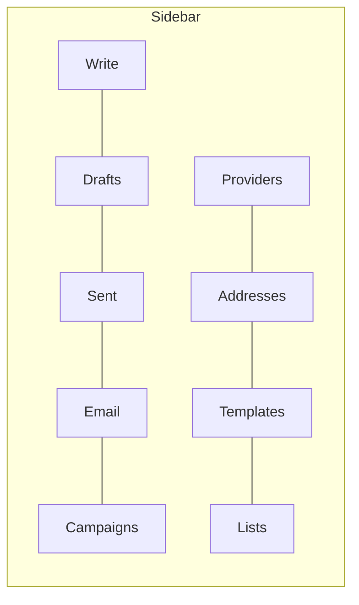
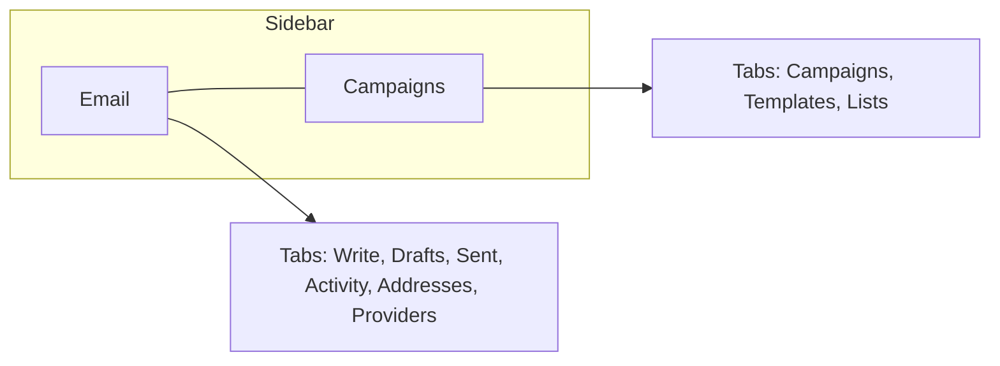
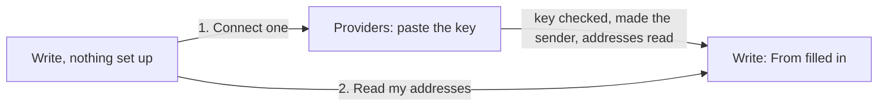

# A shorter sidebar, tabs and compact buttons

> **In plain words.** The owner found the portal hard to find one's way in: with every feature
> on, the sidebar listed 37 pages in 9 groups, email alone took 9 of them, and the buttons were
> large. The sidebar now lists the main pages only, 18 of them in 5 groups. A page that belongs
> to another (Drafts belongs to Email, Templates to Campaigns, Time off to Team) is a tab in a
> sideways row at the top of that page. Buttons and form fields are smaller, as in the first
> client's portal, which the owner pointed to as the example.

## What changed, and why

| What | Why |
|---|---|
| A page may name the sidebar entry it folds into (`PageNav.tabs`) | One rule for every module: the sidebar shows main pages, the rest are tabs |
| The sidebar shows each set once, under its name, leading to its first tab | 37 entries became 18; nothing is more than one tap further away |
| Each page of a set opens with the set as a row of tabs above its title | Where a person is, and the pages beside it, are always on screen (R-12: options in a sideways row) |
| Five groups: Work, Company, People, Messages, System | Groups of one entry each (Team, Sales, Developer, Administration) were headings with nothing under them once folded |
| Email is one entry: Write, Drafts, Sent, Activity, Addresses, Providers | Sending one email took the owner through four places in the sidebar; they are now tabs of one page, which opens on Write |
| Campaigns is one entry: Campaigns, Templates, Lists | Templates and lists exist for bulk mail |
| The Email activity page loses its row of links | The tabs replace it |
| A page with no entry of its own is marked under the entry its path starts with | An opened sent email marks Sent, not Write |
| Buttons 40 px (44 px for a form's main action), words 14 px semibold; fields 44 px | The owner found the buttons too big; text in fields stays 16 px so a phone does not zoom |
| Write is the setup when there is no address to send from: 1. connect the email service, 2. read its addresses | The owner went through four places to send one email and did not know the order |
| Connecting a provider checks its key at once, makes an email provider the one that sends when none does, reads its addresses and opens Write | Check, Make it send and Read from my email provider were three more presses on two pages |

## Before and after

Before: every page in the sidebar.

Now: main pages in the sidebar, the rest as tabs on the page, and the first email in one path.

## Impact on each part

| Part | Impact |
|---|---|
| `@oltrem/core-module` | `PageNav.tabs`, optional |
| `@oltrem/screens` | The sidebar folds sets of tabs; the frame draws the tab row; the groups and the kit's own sections are regrouped; the Activity page (`/email`) is named so |
| `@oltrem/core-ui` | Smaller buttons and fields (`--spacing-row-h-form` 44 px) |
| The modules | Their `nav` names their tabs and the new groups; no route, table or permission changes |
| A client repository | Nothing to do: the next `npm run update` brings it |

## How it was verified

The screens tests on Node: a set folded into one sidebar entry, led by the tab labelled as the
set and marked on another tab; the tab row above the title with the page's tab marked; a page
without an entry marked under the entry its path starts with; the groups in their order and
colours. The client template's screens tests: every page still opens in the frame with its
section marked; Write showing the two steps with nothing set up; connecting a provider (its
answers stood in for) landing on Write with it the one that sends. The type check of every
package. Not verified: the look on a phone; a real provider's key.
