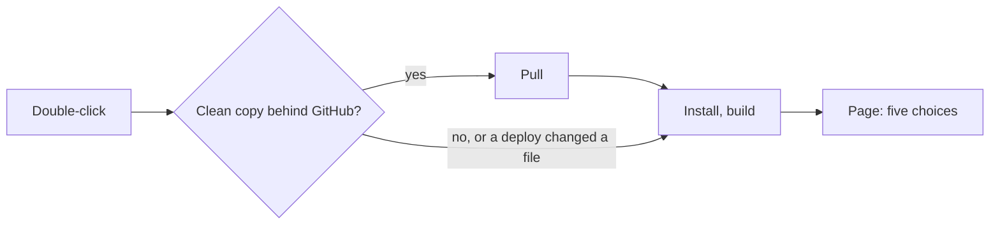
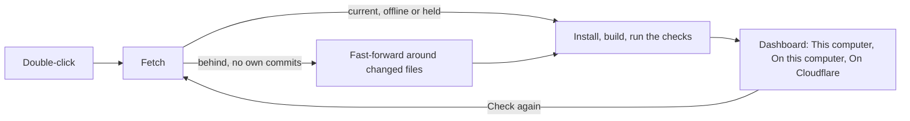

# The start page as a dashboard, ready on every start

> **In plain words.** The owner found the page the start files open poorly thought out, and asked
> that a double-click check the kit, bring in what is new and leave the computer fully ready. Every
> start now brings in the newest kit whenever git can do it safely, even after a deploy changed a
> file, installs and builds what that needs and runs the checks. The page then shows what it
> found, and is a dashboard instead of a list of five large buttons: what this computer has, the
> portal on this computer with its address and Stop, and where the portal lives on Cloudflare.

## What was wrong, and what changed

| Before | Now |
|---|---|
| A clean copy was updated, but one a deploy had touched (it writes `wrangler.jsonc`) never was | git brings the new kit in around changed files; it changes nothing only when a new change touches one, or the copy has commits of its own, and the page says which |
| What the start checked was said only in the terminal window | The **This computer** card: the kit's commit, what was brought in change by change, Node and the packages, each check that needs a look with its fix |
| **Get the newest kit** as a choice, though every start now does it | **Check again**, which does the whole start again in place |
| Three separate choices to run the portal (here, Wi-Fi, anywhere) | One card with **Who may open it** as three options in a row |
| A running portal's address only as a line in the output; the choices hidden until it stopped | **Open the portal** and **Stop the portal** on its card; the other cards stay, waiting |
| Nothing said whether the portal was already on Cloudflare | **On Cloudflare** says where it is set up to live, and offers **Put it live** or **Put it live again** |
| Each run replaced the whole page, ending with **Back to the start** | Runs show under the cards and **Clear** takes them away; the header says Ready, Running or that something needs a look |
| 56 px buttons and 72 px choice cards | 36 px buttons and 44 px fields, as in the portal |

## Before and after

## Impact

| Part | Impact |
|---|---|
| The kit's root (`scripts/run.mjs`) | `ready()` runs the start's steps and returns what the page shows; `npm run start` passes it to the page; a new `check` command; the choice `update` became `check` (`npm run update` stays) |
| `@oltrem/cli` (`setup-page.ts`, `setup-page-html.ts`) | Events `status` and `serving`; `servePage` keeps the status and the choices for every page that connects; the dashboard; smaller sizes. `oltrem deploy --page` keeps its steps, in the smaller sizes |
| The client template (`scripts/dev.mjs`) | Sends its address to the page when the page started it |

## How it was verified

The start page's server tests: the status first, then the choices, kept across a run and replaced
by a run's own; a page opened mid-run getting the choices before the run. The launch tests: when
a start brings the newest kit in, the order of the start's steps, where the portal is set up to
live. `run.mjs check` run in a git clone (fetch, build, 9 checks passed). The page drawn in a
headless browser at computer and phone widths, idle and with the portal running. Not verified: a
double-click on a real Windows, macOS or Linux computer; a start that brings changes in around a
deploy's file.
