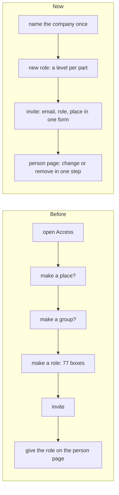

# Access, roles, settings and parts redesigned

> **In plain words.** The owner could not make a role and found inviting, giving roles, groups
> and places confusing and tied to each other. The cause of the first: until the company is named,
> the portal refused every role, group and place action with "no tenant: nothing to govern yet",
> while the page still offered the buttons. Every access page now says "First, name the company"
> until it is named. A role is made with one row per part (None, See, Do or Manage); inviting is
> one form with the role and the place; a role is changed in one step; a person's page says what
> they can do and why. Settings are in sections with search, a Changed filter and Reset. Parts are
> switched from a dashboard of tiles, in the portal and on the setup page, by anyone given the
> permission.

## Why

An audit drew 49 access and settings pages at phone and computer widths and walked each flow. It
found: every access page wider than a phone; three layers of tabs with each action shown twice;
77 checkboxes on a role, about 11,000 pixels tall on a phone, with raw permission ids; no way to
change someone's role but to end it and give another; the same role given twice at one place;
words such as scope, binding, eligible and position; error titles "Bad grant" for everything;
settings one form each in module order, arrays shown as `[]`, Owners shown rows only the Vendor
changes. Proven admin products were studied for the shape (invite with role and place in one form,
a part-by-level role grid, access that only adds up by default, settings in sections with search
and a changed marker); only their design was taken (R-03).

## What changed

| Area | Before | Now |
|---|---|---|
| Before the company exists | every action offered, each refused as "Bad grant: no tenant" | one card, "First, name the company", and nothing that would fail |
| Navigation | People and Access tabs, five segmented tabs, actions twice | one sideways row: People, Roles, Groups, Places, Requests, Reviews, Vendor access; one main action per page |
| Making a role | 77 checkboxes; Start from links lost the name | a row per part by its name with None, See, Do or Manage, single picks folded inside; Start from keeps the name; a refusal keeps what was typed; the Owner role read-only but for the Vendor |
| Inviting | role and place chips, place always shown | addresses, a role the inviter may give, the place folded as "Whole company", review in 30, 90 days or a year |
| A person | grant table with red End buttons | their roles as rows with Change (one step) and Remove (asks first); what they can do and where each permission comes from; extra access added one by one; their own page read only |
| Duplicates | the same role twice at one place | refused in words, and not offered |
| Groups | members by typed email only | picked from the people with accounts |
| Errors | "Bad grant" and raw ids | "That cannot be done" or "Not yours to give", with names in words |
| Settings | one form each, module order | sections (Company, Email, Money, People and access, Security, System), search, Changed filter, Reset to default, a control per type, one value for all currencies or time zones; the Vendor's rows hidden from Owners |
| Parts | Vendor only; a list with two presets | a permission an Owner may put in a role; tiles grouped as the sidebar with switches, a count, filters and presets; the setup page's step 7 the same |

## How it was checked

Each part has its tests: the client's screens tests (no-company card, the role levels and Custom,
refusals keeping the form, the Owner role read only, change a role, duplicate refused, the group
picker, settings sections and filters, Parts for an Owner, a role with the permission and one
without), the screens package tests (frame script, names, settings, people and access), the iam
tests and the CLI's deploy, setup page and parts tests. The merged pages were drawn with
Playwright at 390 and 1280 pixels. Not checked on a real phone yet.
