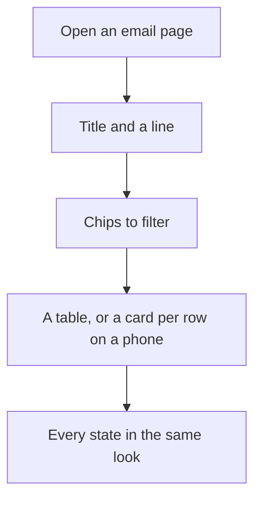
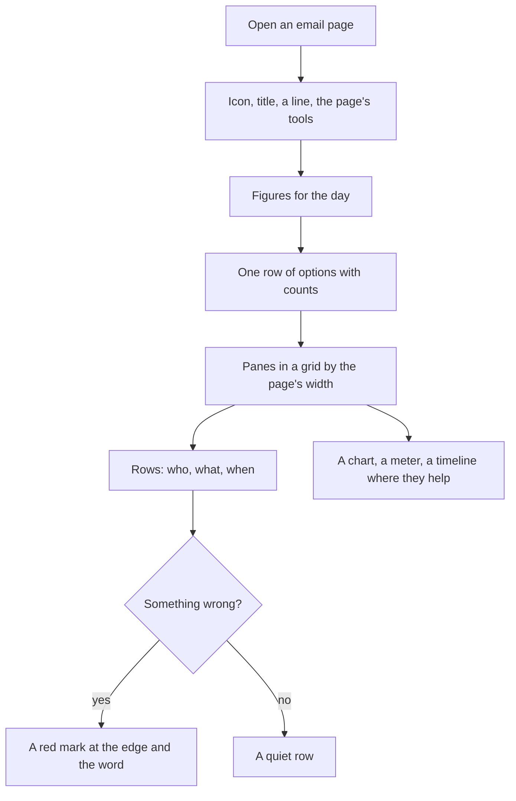

# The email pages, remade as a console

> **In plain words.** The email pages worked, but they looked like forms and tables: long lists of
> words, every fact in its own box, the same look for a problem and for a success. Now they read
> like a mail app and an operations console. Sent is cut into days and marks a problem at its
> edge. Write is one card, the way a phone's mail app writes. Activity opens with the day's
> figures and a two-week chart. Each provider is a card with a bar for today's use. Each domain
> shows every check and every DNS record with its own Copy button. The pieces they are built from
> belong to the whole kit, so any page of any module can use them next.

## Why

The owner asked for every email page to be remade at the level of the best consoles the platform
already has (its error, analytics and server pages), with pieces useful everywhere, not only here.
The study of those pages and of Gmail, Resend and Postmark gave five rules, written fresh for the
kit (R-03):

1. A slim page head: the section's icon on its group's colour, the title, one line, the page's
   tools on the right.
2. One row of options at the top, with the counts, sideways on a phone.
3. Solid panes on thin lines, in a grid that follows the page's width, not the window's.
4. Dense rows: who, what, when, and a coloured mark at the edge only when something is wrong.
5. Colour says a state, always beside a word or an icon; a group's colour only says which part
   of the portal you are in.

No new dependency, variable or resource (R-09): Tailwind 4 and the kit's own tokens, the
browser's own `<meter>`, SVG for the chart, and no inline style, so the content security policy
holds.

## What changed

| Page | Before | Now |
|---|---|---|
| Every page's head | A title and a line | The group's icon, the title, a line the module may set, and the page's tools |
| Activity (`/email`) | A table of messages and blocks of words | Figures for the day, a row to filter with counts, messages as rows, a 14-day chart with its table, a meter per provider window |
| Write | A form of stacked fields | A compose card: From, To, Cc and Bcc folded, Subject, the message, and Send, Save draft, Send later in its foot |
| Drafts and Scheduled | Two tables | One page with a row to pick, each email a row with its own Delete or Take back |
| Sent | A table | Rows cut into days, filtered (all, opened, on the way, problems), a mark at the edge for a problem |
| One sent email | Facts in boxes | The email as it was written, and **What became of it** as a timeline |
| Addresses | A table | Cards: an avatar, the domain's state, what it is for, the signature |
| Domains | Lines of text | A pane per domain: every check, every record with Copy beside each value |
| Providers | A table and long words | Ready to send as a pane (folded once all pass), each provider a card with today's use, the tiles to connect |
| One provider | Facts in rows | State, key and last check as figures, the last failure in full, the test and the key beside on a wide page |

The kit gained, in `@oltrem/core-ui`: `Toolbar`, `Segmented`, `PaneGrid`, `Pane`, `Figures`,
`Rows`, `Row`, `Avatar`, `Timeline`, `Meter`, `CopyField`, `Facts`, `ColumnChart` and
`LinkButton`. `Stats` now draws with `Figures`, and `StatusPill` became a soft tint that reads in
both themes. The email module gained one route, `GET /api/email/stats`: 14 days of counts, read
through the index the tenant's messages already have.

## Before and after

Before: each page was a title over a table, and a failed email looked like a delivered one until
you read its word.

Now: the page says what matters first, and only a problem draws the eye.

## Impact

| Part | Change |
|---|---|
| `@oltrem/core-ui` | the console pieces (`src/console.tsx`, their styles in `theme.css`), `LinkButton`, `StatusPill`'s look, `Stats` as figures; `.ui-page` is a size container |
| `@oltrem/screens` | the page head with icon, line and tools; Activity, Providers and one provider remade; the stylesheet built from every module's pages |
| `@oltrem/core-module` | a module page may set its head's line (`sub`) and tools (`tools`) |
| `@oltrem/email` | Write, Drafts, Sent, one sent email and Addresses remade; `GET /stats` |
| A client portal | the new look after updating the kit; no setting, migration or secret |

The stylesheet is now just under the 64 KiB a test allows; the next page remade should reuse these
pieces rather than add classes.

## How it was verified

- `packages/core-ui/test/console.test.tsx`: every piece renders with no inline style; the options
  mark the current one; a row's own button sits outside its link; the avatar's letters and colour;
  the timeline; the meter's thresholds; the copy button names its value; the chart's hover names,
  key and table.
- `modules/email/test/email.test.ts`: `GET /stats` counts each outcome on its day.
- `templates/client/test/screens.test.ts`: the provider, Write, campaign and alert journeys
  through the remade pages.
- Every remade page drawn headless with sample data at 390 px in light and 1280 px in dark.

Not verified: the pages on the owner's phone and PC; a real provider's usage on the meters.
