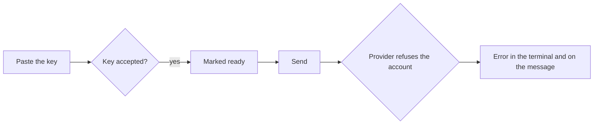
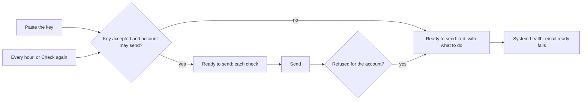

# Ready to send: the portal says why email cannot leave

> **In plain words.** The owner spent a day believing email was set up, while every message was
> refused: the Brevo account was new, and Brevo does not let a new account send until its support
> switches transactional email on. The key worked, so the portal's check said the key was fine,
> and the reason appeared only in the terminal. Now the portal checks everything an email needs
> to leave (a service that sends, a working key on an account allowed to send, an address to send
> from, its domain verified, room left), shows the list at the top of Write and on the Providers
> pages with what to do under each problem, raises it in System health, and checks again every
> hour or when **Check again** is pressed.

## What was wrong, and what changed

| Before | Now |
|---|---|
| Checking a Brevo key asked `GET /v3/account` and passed on any 200 | The answer must also say `relay.enabled: true`; otherwise the check fails with what to do: ask Brevo to activate transactional email. A definition can say this for any provider (`probe.ready`) |
| A real send refused for the account was written on the message only | It is also kept on the service, so its page, Write and System health turn red at once |
| Write said only "no email service sends yet" | **Ready to send** at the top of Write: a red notice listing what stops email, each with what to do, and **Check again**; when nothing stops it, one line that opens to every check |
| Providers listed services and their last check | **Ready to send** on Providers and on each email service's page |
| System health watched waiting and refused messages, the allowance and domains | Also `email.ready`: fails while a check stops email, warns while one may cost mail |
| A key was checked when it was pasted, and when a person pressed Check the key | Also every hour (the `email.ready` job), so an account switched off, or switched on, shows within the hour |

## Before and after

Before: a key the provider accepted counted as ready, though the account could not send. The
refusal surfaced only on each failed message and in the terminal.

Now: the account's own state is part of the check, a refusal turns the service red at once, and
the list says what to do; the hourly check and Check again turn it green once fixed.

## Impact

| Part | Change |
|---|---|
| `@oltrem/providers` | `probe.ready` on a definition; Brevo's reads `relay.enabled` |
| `@oltrem/email` | `readiness()`; `GET /ready`, `POST /ready/check`; the job and the health check `email.ready`; an account refusal kept on the instance; Write shows Ready to send |
| `@oltrem/core-ui` | `Checklist`, one check per line with its state in words and its fix |
| `@oltrem/screens` | Ready to send on Providers and on an email service's page; `POST /providers/ready` |
| A client portal | nothing to set: the job and the check come with the email module |

The hourly job makes one call to each email service that may send; nothing else calls a provider.

## How it was verified

- The adapter: a Brevo answer with `relay.enabled: false` fails the probe with the fix; `true`
  passes (`modules/providers/test/adapters.test.ts`).
- The rules: every check, alone and together (`modules/email/test/ready.test.ts`).
- End to end in the module: a send refused for the account by every service fails the message,
  keeps the refusal on the service, makes `GET /ready` and `email.ready` fail; Check again with the
  account let through passes; a person without `email.manage` is refused
  (`modules/email/test/email.test.ts`).
- The pages on a 390 px screen: Write and Providers with two checks stopping email.
- The live Brevo account API was read to confirm the field: an account that sends answers
  `relay.enabled: true`; the owner's new account's refusal names the same activation.
