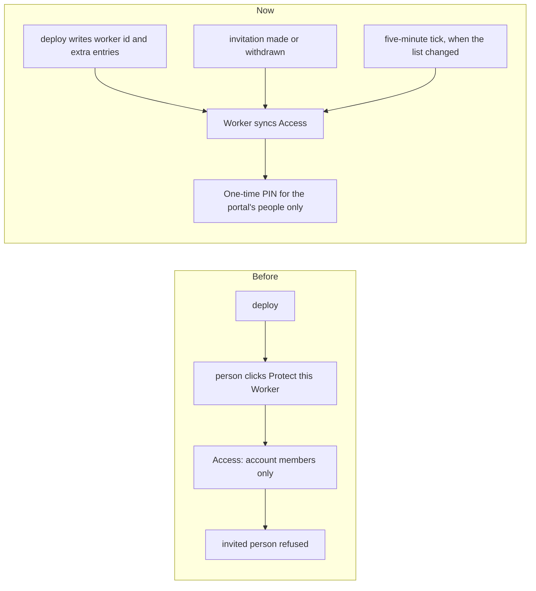

# Setup remade: the door keeps itself, parts switch off, permissions shown

> **In plain words.** A first deploy on a real account stopped with wrangler's "fetch failed",
> and the setup page could not say why. The kit now records the network error inside wrangler and
> says it in plain words. The setup page is remade as sections, one per step, that follow the run.
> Setup can change who the Vendor is, let in more people (or a whole company's addresses), and
> offers more ways to give the portal an address. The door (Cloudflare Access) now sends a
> one-time code by email to the portal's people and keeps that list itself, which fixes "Cloudflare
> sign-in is restricted to members of the account". Parts of the portal can be switched off and on
> without a deploy, with an "Email only" preset. The permission screens show what the model always
> had, and Invite someone works.

## Why

The owner's first deploy on a client's account (Windows, Node 22) stopped twice at "Putting the
portal on Cloudflare" with `fetch failed`, after the database migrations had worked. wrangler
retries the upload three times by itself before it prints that, so the failure was steady, and its
own log keeps only the stack, never the network error. The owner also listed what setup and the
portal lacked: a page that uses its width and follows the run, address choices, other sign-in
emails, a way to change the Vendor, an email-only portal for a prospect, a permissions console, a
door that sends codes to invited people, and a Sign out.

## What changed

| Area | Before | Now |
|---|---|---|
| A failed deploy | wrangler's "fetch failed" and its advice | the request that failed, its error code, how much was sent and after how long, and what to try (`network.ts`, `look/net-watch.cjs`) |
| The setup page | one log growing downward in a 760 px column | a sidebar of sections and the seven steps; each step has what it is, what to do, the question, what happened and a folded console; it scrolls to the active step unless the person scrolled |
| Who signs in (step 2) | the Vendor's email, once | keep or change the Vendor; a list of other addresses or `@domain` entries, each with a role, kept in `iam.door_extra_emails` |
| The address (step 3) | the free address or a domain | also: an address already attached in the dashboard, a name checked free before the deploy, "add one later" with the dashboard steps, "a domain elsewhere" (move it to Cloudflare, or forward it) |
| The door (step 6) | click "Protect this Worker behind Access" by hand; it admitted account members only | the Worker keeps the Access app: One-time PIN only, its people, pending invitations and the extra entries, public paths for hooks and health; synced on a tick, after invitations, and when the deploy asks |
| The portal's key | D1 and analytics | also the two Access permissions; a key without them still works and the door is then set by hand, with the right steps |
| Parts (step 7 and Settings, Parts) | every module always mounted | `settings.parts_off`: a part off is hidden, its routes 404, its jobs and checks pause, its permissions hide; data is kept. Step 7 picks each part: on the setup page a dashboard of switches grouped as the sidebar, with the count, presets (Everything, Email only, Only what's always on), filters and a search; in the terminal numbered lines |
| Permissions | a role form and a hidden exceptions page | an access console: ready-made sets, default and special permissions, where each permission comes from, per-person exceptions; the Vendor holds every permission (now tested) |
| Invite someone | reloaded the page | a same-page link was taken as Back by the frame script; fixed |
| Sign out | only on this computer | everywhere; it also ends the Access sign-in (`/cdn-cgi/access/logout`) |

## How it was checked

Each part has its own tests (`packages/cli/test/{network,deploy,door,parts,setup-page}.test.ts`,
`modules/iam/test/{door,parts,iam,routes}.test.ts`, the core packages' `parts.test.ts`,
`packages/screens/test/{frame,sign-out}.test.ts`, the template's screens and parts tests). The
network watch was tried against a stand-in API that cuts the upload: wrangler's own run recorded
`ECONNRESET` on the script upload. The setup page was drawn with Playwright at phone and computer
sizes. Not checked against the live API: the Access path overrides and the app update, which the
first real deploy shows; the cause of the owner's "fetch failed" waits on his next run, which now
names it.
