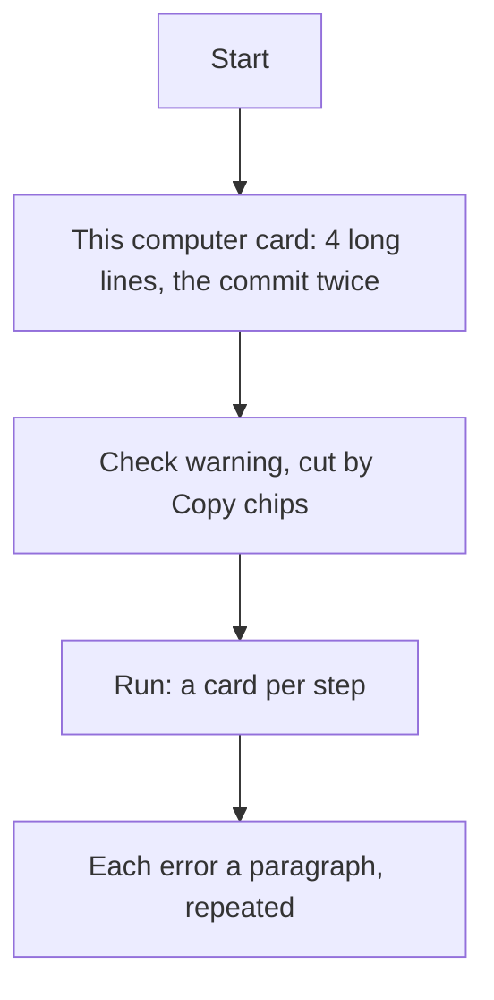
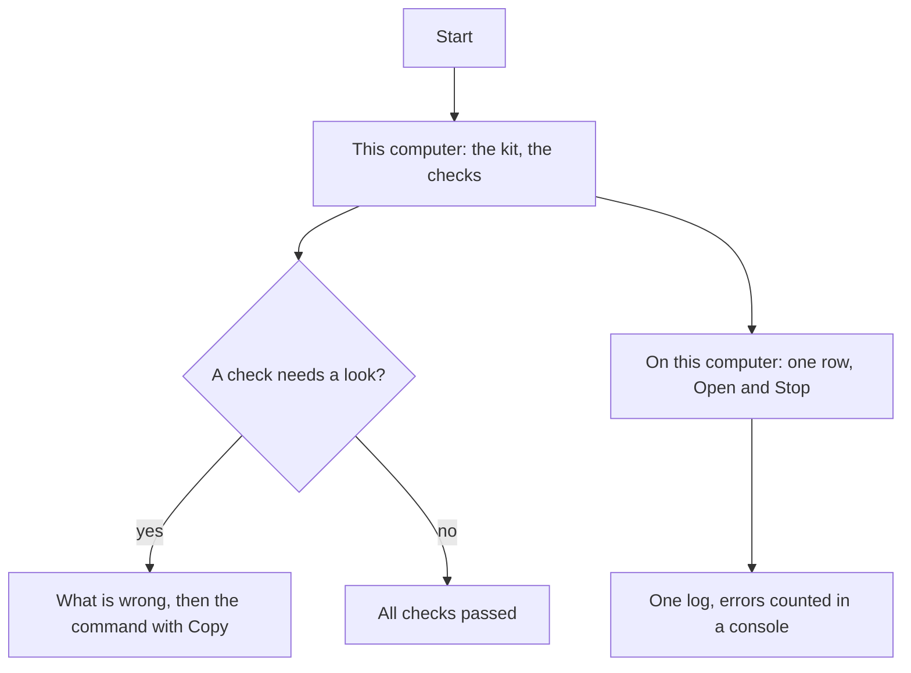

# The start page, remade compact

> **In plain words.** The page the start files open took a lot of room to say little. The commit
> line was repeated, a warning about pnpm was cut into pieces by "Copy" buttons, the same error was
> printed six times in full, and the warning itself was wrong: the kit does not need pnpm installed,
> because it fetches the right one by itself. Now the page is two short lines for this computer, a
> fix you type is one command with Copy, errors are gathered and counted in a small console, and
> the pnpm warning no longer appears when the kit fetches pnpm itself.

## What was wrong, and what changed

| Before | Now |
|---|---|
| "Updated to the newest kit" listed the commit's subject, then the same subject again among the changes | One line with the count; the changes open under it; the commit and day sit on the right |
| "Node.js, the packages and the tool are ready" took its own line | Node's version is in the footer, beside the time of the check |
| Anything shaped like an email (`pnpm@10.28.0`, an address in an error) became a chip with Copy, in the middle of a sentence | Only web addresses become links; nothing else in a line becomes a control |
| A check's fix was a sentence: two commands joined by "or" | A fix that is a command is a box with Copy, one per command |
| PM-01 advised `corepack enable && corepack prepare …` | `npm install -g pnpm@<version>`: one command on every Node the kit supports. Node 25 no longer ships Corepack ([Node.js docs](https://nodejs.org/api/corepack.html)) |
| PM-01 warned on every start where pnpm is not installed, though the start runs the pinned pnpm through npx | The start tells the check it does (`doctorEnv` in `scripts/run.mjs`), as npm does when it starts it, so PM-01 passes |
| Each of wrangler's error lines was a paragraph; the same error six times took a screen | They gather in one small console, the error code marked, a repeat counted (×6) |
| The portal running took a box, a button row and a footer | One row: Running at the address, **Open**, **Stop** |
| The run's lines were a numbered step card per title, like the deploy's | One log under the cards; only `oltrem deploy --page` keeps its seven numbered cards |

## Before and after

Before: every fact had a line of its own, and repeated facts were repeated on the page.

Now: each fact once, a fix ready to paste, and the noise of a running portal kept small.

## Impact

| Part | Change |
|---|---|
| `@oltrem/cli` | the page's style and script rewritten (`src/setup-page-html.ts`); PM-01's fix |
| The kit's root | `scripts/run.mjs` runs the checks with `doctorEnv` |
| A client portal | nothing |

The page's events, its server and the deploy's page are unchanged.

## How it was verified

- `packages/cli/test/setup-page.test.ts`: the page's script parses; its colours are the portal's
  tokens; only addresses become links (a version and an email do not); a command fix is
  recognised and a sentence is not; wrangler's error lines are recognised.
- `scripts/launch.test.mjs`: the checks are told about the npx pnpm only when the kit runs it.
- `packages/cli/test/doctor.test.ts`: PM-01's fix is the one npm command.
- The page drawn headless at 390 px and 1100 px with the owner's case (an update of three changes,
  the pnpm warning, the portal running with seven error lines), with everything passing, and the
  deploy's step 4.

Not verified: a double-click on the owner's Windows PC.
