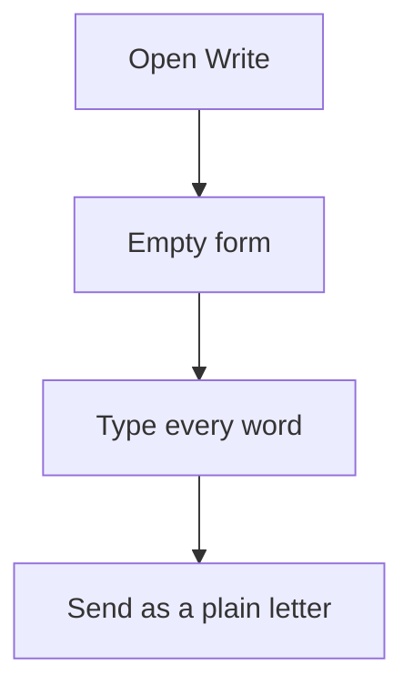
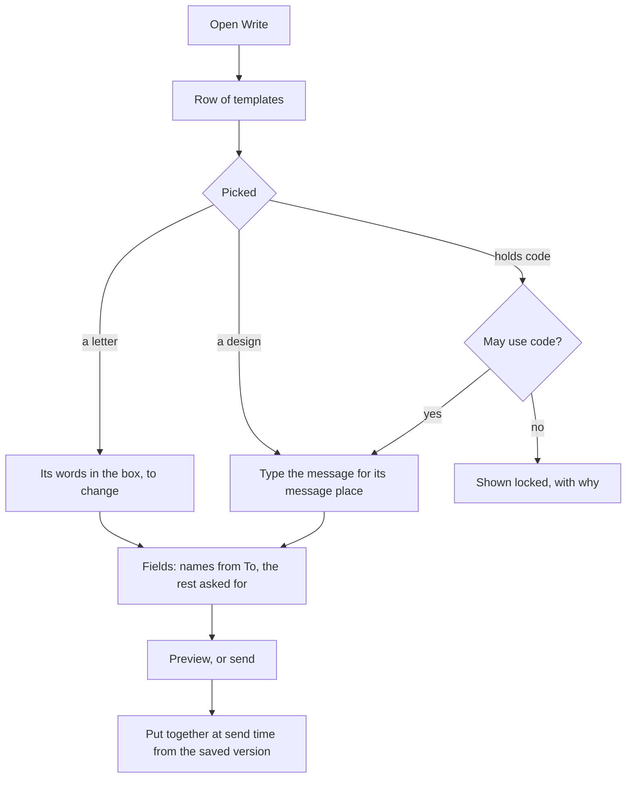

# Templates on Write, and who may use code

> **In plain words.** Saved templates used to be for campaigns only, and the Write page was a
> blank box every time. Now a template says where it is used: on Write, in campaigns, or both. A
> **letter** is a saved reply: pick it on Write and its words are in the box, ready to change. A
> **design** keeps the company's look and puts what you write in its message place. Names fill in
> by themselves from the first person in To, and the template's own blanks, such as an order
> number, are asked for. Code (HTML) is guarded by two permissions: one to add or change it in a
> template, one to use it on Write. Write also gained a preview, address suggestions and Save as
> template.

## Why

The owner asked for the email system to grow a great deal: templates, a template picker on
Write, code in templates added only by those allowed, and code on Write used only by those
allowed. What other mail tools do was the guide (Gmail's templates, Front's and Help Scout's
saved replies, Postmark's and Resend's layouts with a content slot), written fresh for the kit
(R-03). Four rules came out of it:

1. A saved reply and a designed layout are different things, so a template is a **letter** or a
   **design**.
2. Picking a template never loses what was typed.
3. Code is a separate right from building templates: someone who builds from blocks may move a
   code block, never change it.
4. A template states where it may be used, so a campaign cannot send a reply meant for one person.

No new dependency, variable, table or resource (R-09): four columns on `email_templates` and four
on `email_written` (migration `0054`), and one capability, `email.write.code`.

## What changed

| Part | Before | Now |
|---|---|---|
| A template | A design for campaigns | A letter or a design, for Write, campaigns or both, counted each time Write sends with it |
| Blocks | Heading, text, button, image, divider, space | Also a **message** place for Write's words and a **code** block of cleaned HTML |
| Code in a template | Pasted HTML only, for `email.templates.html` | Also code blocks; added or changed only with `email.templates.html`, locked for the others, who may move or remove it |
| The Templates pages | Under Campaigns: a list and an editor | Under Email: a row to filter (all, for Write, for campaigns, with code, archived), a letter's words or a design's blocks, Edit, Preview and Versions in a row, **Write with it** |
| Write | A blank form | A row of templates on top; a letter fills the form, a design takes the message; its fields asked for; Write in Words or HTML for `email.write.code`; Preview; address suggestions; Save as template |
| Sending from Write | Always the plain letter | The plain letter, or the design read from D1 at its version when the email is put together, so a large design never rides in the queue |
| Campaigns | Any template | Only templates for campaigns; one for Write alone is refused |

## Before and after

Before: every email was written from nothing, and templates lived only in campaigns.

Now: Write starts from the company's own words and look, and code goes only where it is allowed.

## Impact

| Part | Change |
|---|---|
| `@oltrem/email` | migration `0054`; `email.write.code`; letters, uses, message and code blocks; the Templates pages in `templates-page.tsx`; Write's row, fields, HTML, preview, suggestions and Save as template; `GET /written/:id/preview`; `GET /templates?use=`; the template `email.written-design` |
| `@oltrem/campaigns` | its template picker asks for templates for campaigns; a template for Write alone is refused |
| A client portal | the migration runs with the next deploy; existing templates are for campaigns, as before; the Owner holds `email.write.code` at once, and others get it from a role |

## How it was verified

- `modules/email/test/templates.test.ts`: a code block refused to a builder from blocks, added by
  one who may add code, moved by the builder with the lines sent back as the form sends them,
  refused when changed, the copy refused, and removable.
- `modules/email/test/senders.test.ts`: a letter sent from Write with its field and the first
  person's name filled in, a stray field dropped, the version and fields kept, the use counted; a
  design with a message place and code sent with the words in it, escaped values and no script; a
  template with code offered locked and refused without `email.write.code`, and HTML refused the
  same; the preview of a draft; HTML written by one who may, cleaned.
- `modules/campaigns/test/campaigns.test.ts`: a template for Write refused for a campaign.
- `templates/client/test/screens.test.ts`: a design made from the Templates page; a letter opened
  on Write with its words and its field, and **No template** taking them away again.

Not verified: the pages on the owner's phone and PC; a send through a real provider.
