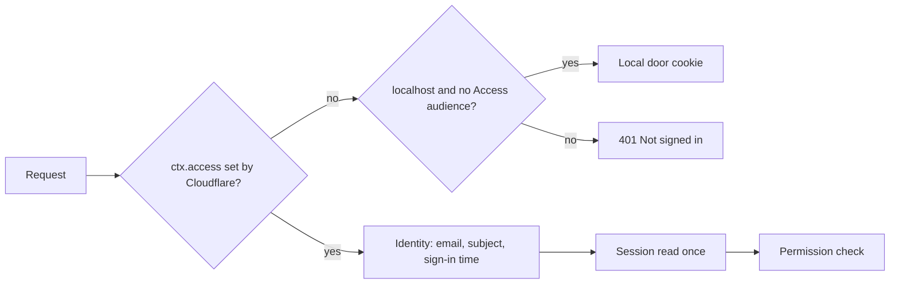
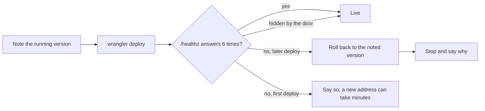

# Core hardening

> **In plain words.** The owner asked what matters most for the kit. A review of security, the
> free plan's limits and selling it to more clients found the weak points in the foundations, not
> on the screens. This change fixes them: the portal trusts only the sign-in Cloudflare itself
> checked, a stored key can only go to the service it was saved for, the five-minute job fits the
> free plan again, and a deploy from the PC checks the portal and steps back on its own.

## Sign-in

| Before | Now |
|---|---|
| The identity was read from the `cf-access-*` request headers, whose token was decoded, not verified. On an address Access did not cover, anyone could send them. | The identity comes only from `ctx.access`, the runtime's own record that Access signed the person in. No record, no identity; the local door on `localhost` is the one exception. |
| The session was read from KV up to 24 times on Home. | Once per request. |

Headers a visitor sends are now ignored. Tests send forged headers and expect a refusal.

## Integration keys

- Writing an integration's definition (its address, its SMTP host) needs the new permission
  `providers.definitions`, which only the Vendor holds.
- A key is sealed together with the host it was saved for. If the definition or the connection
  later points at another host, the key is refused (`KIT-E-1411`) and must be pasted again.
- A key sealed before this change opens only where the kit's own definition of that integration
  sends it.

## The free plan

| Measure | Before | Now |
|---|---|---|
| Busiest five-minute tick (limit 50 queries) | 46 queries | 34 |
| Five-minute jobs | every 10 minutes | every tick |
| KV reads on Home | 24 | 1 |
| Worker size, gzip | 621 KiB | 467 KiB (minified) |

Health checks now run every 15 minutes by default (a failing one every 5), and at most one daily
job starts per tick. A test runs a 300-tick day and holds every tick at 45 queries or fewer.

## Deploying from the PC

- A first deploy asks the client's name and names every resource after it (`acme-ltd-portal`),
  so two clients never share a database. A deployed Worker keeps its name.
- Alerts go to the Vendor (and a real Owner address) when nobody is set.
- Backups are always on in every preset; Email only keeps Deployments on too.
- After new keys are written, every run asks whether `oltrem-keys.txt` has a safe copy, until
  the owner says yes.

## Verified

Unit and Worker tests for each point (forged headers refused, a key sent elsewhere refused, two
spends at once, the SNS timestamp, the 300-tick day, rollback and a failed rollback, naming), and
`pnpm verify`. Not verified live: the first deploy on Cloudflare after this change.
