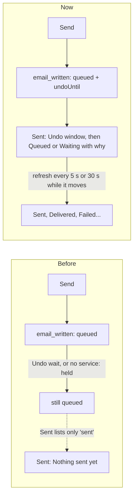

# Email: Write, Sent, Addresses and fresh sign-in, remade

> **In plain words.** An email you send now shows on Sent straight away, with what is happening
> to it (Undo window, Queued, Waiting, Sending, Sent, Failed). If no email service is set up yet,
> it says so in words. Write is now a compact card like Gmail's: addresses turn into chips, Cc
> and Bcc open from small buttons, bold, italic, list and link have buttons, and a preview beside
> it shows the email as you type. You can send from a new address straight from Write, if your
> role allows it. Addresses has one path: connect your email service, and the portal lists its
> domains and addresses for you to add, all at once or one by one. The portal now asks you to
> sign in again only for a download of people's data and for anything that shows a secret, and
> where it does, the page says "Confirm it's you" instead of quietly showing less.

## Why

The owner tested the email pages on a phone and listed what was wrong. These were the points for
this part of the work:

1. Addresses took too many steps by hand.
2. Write could not send from an address not added yet.
3. Write looked like a form, not a mail app.
4. A sent email did not show on Sent.
5. Addresses sometimes showed a smaller view with no reason given (image 3).
6. The portal asked for a recent sign-in for everyday work.

No new dependency, variable or resource (R-09). There is one new permission,
`email.senders.add`. Like every new permission, the registry gives it to the Owner role, and the
Vendor holds it, and no other role gets it until someone adds it.

## What was wrong, at the source

| What the owner saw | Cause |
|---|---|
| Sent stayed empty after Send | The Write route already writes the email's row, as `queued`, in the same request, but `GET /written?state=sent` read only `sent` rows. A row becomes `sent` only when the queue hands it over: after the ten-second Undo wait, and never while no email service is set up (the outbox holds it). |
| Addresses read only, now and then (image 3) | `email.senders.manage` asked for a sign-in within ten minutes. After that, `GET /senders` answered `KIT-E-2004`, and the page fell back to the read-only list without a word. The "Email only" preset was not the cause. |

The fix is in the API (`written.list` reads `queued` and `sent`, and the view carries
`undoUntil`), not in the page. The page adds words for each state, Undo on the row, and a live
block (`data-live="sent"`). The block refreshes every 5 seconds during the Undo window or a
hand-over, every 30 while an email waits, and stops when nothing moves.

## Fresh sign-in, permission by permission

| Permission | Before | Now | Why |
|---|---|---|---|
| `email.lists.export` | fresh | **fresh** | It hands out people's data. The list page checks first (`GET /lists/:id/download/ready`) and shows **Confirm it's you** in place of Download. |
| `email.manage` | fresh | not fresh | A test send, a readiness check and releasing held mail neither show nor replace a secret. |
| `GET /instances/:id/hook` (under `email.manage`) | fresh, through its permission | **fresh, asked by the route itself** | The delivery reports address carries a secret token. |
| `email.senders.manage` | fresh | not fresh | Adding and editing addresses is everyday work. This flag was the cause of image 3. |
| `email.senders.add` (new) | none | not fresh | Adding a From address in Write is everyday work. The domain check makes it safe. |
| `email.senders.use`, the templates, `email.write.code`, the lists' read and write | not fresh | unchanged | Everyday work. |
| `providers.manage`, `providers.definitions` | fresh | **unchanged** | They paste and replace keys. Write and Addresses read `providers.read` only. |

These permissions no longer ask for a fresh sign-in, so the role editor's Admin level now
includes `email.manage` and `email.senders.manage`. The IAM README now states the rule: a fresh
sign-in is for secrets and people's data, and a page shows a way to sign in again instead of a
smaller view.

## What changed

| Page | Before | Now |
|---|---|---|
| Write | Long form; a row of template buttons; Cc and Bcc in a "More" fold; help text open on the page; readiness always shown | Compact From, To, Cc and Bcc lines. To becomes chips (red when not an address). Cc and Bcc are small buttons on the To line. A template select, buttons for bold, italic, list and link, Words or HTML (only for those allowed code), and a Formatting popover. A live preview beside the card, or under it on a phone. Readiness folds to one line when all is well. Send (Ctrl or Cmd with Enter), Send later and Save draft. After Send: a notice naming who it goes to, with Undo and a link to the email on Sent |
| Write, From | Only addresses already added | **Another address** opens a dialog for people with `email.senders.add` or `email.senders.manage`. The address is checked against the domains here and what each provider lists. If accepted, it is saved and picked, and nothing typed is lost. If refused, the page says how to fix it: "… cannot send for X yet. Add and verify X there …" |
| Sent | Emails appeared only once handed over | Emails appear from the moment Send is pressed, with Undo on queued rows and plain words when an email waits ("No email service can send yet …") instead of a code. The page refreshes itself while anything moves |
| Addresses | Domains and addresses added by hand in separate places; "Read from my email provider" added everything at once | One path. With no service, the empty state's single step is "Connect your email service first". With a service and no domain, the page lists what the provider has, with **Add all** or **Add** for each. Each domain is a pane: its state, **Check again**, its addresses as rows with Edit and Remove, defaults picked inline, **Add an address**, and the checks and DNS records folded (open while failing). Someone who may only send sees a plain list |

New routes: `GET /domains/found`, `POST /domains/discover` with `names`, `POST /senders/own` and
`GET /lists/:id/download/ready`. The frame script learned the compose attributes (`data-chips`,
`data-fold` and `data-unfold`, `data-mark`, `data-marks-of`, `data-send-key`,
`data-submit-with`), described in the screens README. Every part works without the script.

## Verified

- `modules/email`: 97 tests pass. New ones cover:
  - Sent listing an email at once, with `undoUntil`, then as sent.
  - Which permissions ask for a fresh sign-in.
  - An old sign-in still releasing mail and managing addresses, while the hook refuses it.
  - The download and its ready probe refusing an old sign-in.
  - `found` and discover with names.
  - The new From address: its permission, a known domain, a provider-listed address and a refused domain.
- `templates/client` screens test, the whole flow without a provider:
  - The Addresses empty state, and Add all adding nothing.
  - The send redirect and its notice.
  - Sent showing the email at once, in its Undo window with plain words, and Undo from Sent.
  - Another address added and picked from Write, and one refused.
- `packages/screens` frame test: Ctrl or Cmd with Enter sends, the template select submits, the
  marks go around the selection, and a folded line opens.
- Type check of every package; eslint and prettier on the files changed. The stylesheet stays
  under its 64 KiB cap.
- Screens checked at 390, 1440 and 1900 pixels, before and after, on a local portal.

## Not here yet

- Chips take suggestions from the browser's list of recent addresses (`datalist`), not a menu of
  their own.
- Sent shows the Undo window ending only on its next refresh (every 5 seconds), not counted down
  to the second.
