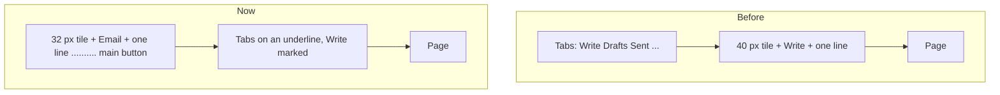

# The frame and the page head

> **In plain words.** The owner tested the portal on his computer and found three things wrong
> with the frame every module sits in. The whole page moved a little left and right when he went
> from one module to another (points 3 and 4). On a wide screen the page used about half the
> width and left the rest empty (point 6). And the top of each module, a row of tabs over an icon,
> a title and a line, looked bland and worked badly (point 12). Now the page never moves, a list
> or a console uses the screen, and each module opens with one clear head: its name and what it is
> for, its main button on the right, and its tabs under it.

## The sideways shift (points 3 and 4)

**The cause.** On a computer with a classic scrollbar (Windows, most Linux), a page taller than
the window shows a scrollbar and a short page does not. The page's content was centred in what
was left, so it moved by half the scrollbar's width, 7.5 px, between a short page and a long one.
It happened everywhere because every page is centred the same way.

**Ruled out.** The tab row's underline (every tab drew the same 2 px border, the marked one only
changed colour, so no label moved); the page change's motion (it moves the content 8 px down,
never sideways, and the frame script keeps the sidebar); fonts (the system's own, so nothing swaps
in late); the sidebar (its width changes only when its arrow is pressed). In the view transition
the content's box glided between the old and the new left edge, which made the shift look like a
slide: that went with the cause.

**The fix.** The document keeps the scrollbar's room on every page (`scrollbar-gutter: stable` on
`html`). A phone's scrollbar floats over the page and takes no room, so nothing changes there.

Measured with Chrome and classic scrollbars, the page's left edge across eleven pages (Home,
Write, Sent, Activity, Settings, Users, Roles, System status, Audit log, Records, Integrations),
each loaded and each opened in place by the frame script:

| Width | Before | After |
|---|---|---|
| 1440 px | 328 px on a short page, 320.5 px on a long one | 240 px on every page (the page now fills the width) |
| 1900 px | (the same 7.5 px, measured with the fix taken out again) 302 / 294.5 px | 294.5 px on every page; the first tab at 332.5 px on every page |

`packages/screens/test/css.test.ts` fails if the stylesheet loses `scrollbar-gutter: stable`, or
if the marked tab ever turns bold.

## The width (point 6)

| Before | Now |
|---|---|
| Every page at most 64 rem (1024 px), centred: on a 1900 px screen about 640 px stood empty. | A console (lists, panes, two columns) grows to 96 rem (1536 px), its gutters 16 px on a phone and 32, 40 and 48 px from 1024, 1280 and 1536 px. |
| Forms as wide as anything else. | A form (`kind: 'form'` in a page's answer; Settings and Connect an integration in the kit) keeps its content to 56 rem, left-aligned under a head and tabs as wide as a console's, so the head never moves between a form and a console. |
| The sign-in page a 40 rem column. | The same. |

## The page head (point 12)

How strong consoles do it, and what was taken: Vercel and GitHub put a section's name above an
underline row of its pages, with the page on screen marked and counts beside a tab (GitHub's
Issues 12); Stripe and Resend give each page a title with its main action on the right and a
short line; Linear keeps the head compact and the tabs keyboard-friendly. None of them names the
page twice, as the old head did (a "Write" tab over a "Write" title).

- **One row:** the group's tile, the heading, a short line under it, the page's actions on the
  right (`tools`, the main one last). On a phone the actions wrap under the words.
- **The tabs under it:** links on an underline, the marked one in the group's colour and never
  bold, a soft hover, a clear focus ring, a count when the page gives one (`counts`). On a phone
  the row scrolls sideways into faded gutters (R-12), and the marked tab is scrolled into view;
  the arrow keys, Home and End move between tabs. From 1024 px the row stays at the top while a
  long page scrolls, on glass once stuck (in browsers that can tell; elsewhere it scrolls away).
- **No word twice:** on a set's own pages the heading is the set's name (Email) and the marked tab
  names the page; a screen reader hears "Email: Sent".
- **Pages inside:** a page inside a tab (a message, Connect an integration) keeps the set's row and
  tabs, with its own title under them; a page inside a section without tabs (a list of Records,
  Create form) has a breadcrumb back to the section.
- **No jump:** the head and the tabs keep still in a page change; only the content below fades.
- Users & access draws the same tabs instead of its row of chips.

The old API still works: `title`, `sub`, `tools` and `PageNav.tabs` mean what they meant. `counts`
and `kind` are new and optional, in `@oltrem/core-module`'s page answer and in `Tabs`
(`count`, `hue`).

## Surfaces (the frame's side of point 8)

Card borders a step softer in light and dark, the small shadow one layer instead of two, and one
radius (12 px) for cards, panes and figures, which had been 16 and 12. The compiled stylesheet
stays under its cap: the phone bar's mark now uses the sidebar's mark class (the gradient
utilities went), and the word "filter" in prose no longer pulls in a dozen variables
(`@source not inline('filter')`).

## How it was checked

- The measurements above, with Playwright on Chrome 153, classic scrollbars forced
  (`--disable-features=OverlayScrollbar`, without `--hide-scrollbars`); and on a phone profile no
  room is kept (the page is the screen's full 412 px).
- Switching from Write to Sent in place: the tab row's top stays at 93 px; arrow keys and End move
  the focus along the tabs; on a phone the marked tab (Integrations) is in the row's view.
- Tests: `packages/screens` (31), `packages/core-ui` (46), `packages/core-module` (21) and the
  client's screens test (38) pass, with new tests for the head, the breadcrumb, counts, kinds,
  the arrow keys and the stylesheet.
- Screenshots before and after at 390 and 1900 px of Write, Sent, Settings and Users.

Not done here: the kit's Create list, Create form and Create group pages could be `kind: 'form'`
too (their deps' `show` takes no head yet); module pages that show their main action in the body
(`ActionRow`) could move it to `tools`.
